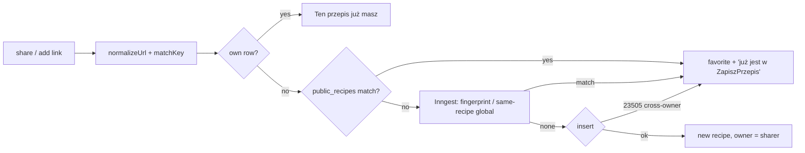

# E01-S03a — One recipe per link ("added first")

> Backlog: `.ai/specs/backlog-przebudowa.md` (E01-S03, split into **S03a** = this spec and **S03b** = `/przepis/{slug}`, see the end). Risk: **high** (schema + data change on production, dedup semantics, ownership). **Depends on E01-S06 (favorites)**, which ships first (decision Q3). Builds on S18 (`profiles`) and S02 + views (`public_recipes`, owner-only RLS), all live.
> Revised after the architectural review (2026-10-16). Review findings are referenced as **[R-…]**.

## 📝 TLDR
Today every account keeps its **own copy** of a recipe: dedup and uniqueness are per user (`(user_id, source_url)`, `(user_id, source_fingerprint)`), so the public feed shows the same link 2–3 times. *Proposed (future behavior):* one recipe per source post across the whole site. Its owner is whoever added it first, and it appears in their "Moje przepisy". Anyone else adding it gets it in **their favorites** ("This recipe is already in ZapiszPrzepis. We added it to your favorites"). The existing duplicate groups are collapsed once, reversibly.

## ✅ Decisions (Open Questions gate, 2026-10-16)
- **Q1 — Split.** S03a = global dedup + ownership (this spec). S03b = `/przepis/{slug}` + 301, a separate spec after S03a. The source label needs no slice.
- **Q2 — Collapsing existing duplicates.** The canonical row is **`@uzytkownik-5`'s copy** (the main recipe account) where one exists, otherwise the **oldest**. The other copies leave `recipes`. They're archived first, so the step is exactly reversible (see Data Model). Their owners get the canonical recipe as a favorite.
- **Q3 — S06 (favorites) first.**
- **Q4 — Owner-only refresh/delete.** Delete is blocked while anyone else has the recipe as a favorite.
- **Q5 — Source label order** (not answered, current behavior kept): "Autor · Platforma" (#185).
- **Q6 — Account deletion:** before an account is deleted, each recipe it owns that **others have favorited passes to the oldest such favoriter**, so the recipe survives. Recipes nobody else has go with the account, as today.
- **Assumption (no product impact, reviewer-raised):** the "same recipe" signal (`findSameRecipe`: same title + same ingredients) also goes **global** in Inngest. Otherwise a cross-user repost of the same recipe from a different post still creates a second public copy [R-M3].

## 📝 Problem Statement
The public app shows one feed to everyone, but the data model still assumes private collections. Measured in production on 2026-10-16: 458 recipes, **8 links saved by 2–3 accounts (18 rows)**, 2 author fingerprints repeated across accounts, and 9 slugs used by more than one row. The duplicates are visible publicly, the same link gets extracted (and paid for) repeatedly, and versions diverge: in 7 of the 8 URL groups the ingredients differ.

Exact-URL groups (first owner → later copies):

| Group | Copies |
|---|---|
| ciastka maślane z marmoladą | `-4` → `-5` |
| bułki poznańskie | `-4` → `-3` |
| tiramisu | `-4` → `-5` |
| truskawkowy sernik zebra | `-4` → `-3` |
| ciasteczka maślane z rowkami (FB) | `-4` → `-5` |
| paella | `-4` → `-3` |
| tortilla z patelni | `-4` → `-3`, `-5` |
| „Przepis, który podbił internet” (YouTube) | `-4` → `-3`, `-5` |

By Q2, `-5` wins 5 of these and `-4` wins 3. The **real** group set also includes Facebook alias variants and fingerprint matches [R-M1, R-M2], and it is computed at apply time, not hard-coded.

## 📝 Proposed Solution
1. **Uniqueness becomes global:** `unique(source_url)` and `unique(source_fingerprint) where not null` replace the per-user indexes. `recipes.user_id` = **owner** (first adder; for legacy groups, the Q2 canonical owner).
2. **Intake checks the whole site** in `share/actions.ts`, `add-recipe-action.ts` and Inngest `run-extract-recipe.ts`. The checks: the URL key **through `matchKey`**, so Facebook group aliases match [R-M1]; the fingerprint and same-recipe checks in Inngest. Outcomes:
   - **none:** extract.
   - **own:** "Ten przepis już masz".
   - **someone else's:** favorite + "already in ZapiszPrzepis" + "Otwórz przepis". No extraction.
3. **Cross-owner insert conflict** (a race, or a key the lookup missed): **favorite + complete the share only**. **No gap-fill and no image archive** on someone else's row [R-H4]. Gap-fill stays for `existing.user_id === userId`.
4. **Database-enforced rights** [R-H6]:
   - a `before delete` trigger on `recipes` refuses while users other than the owner have it as a favorite
   - a `before delete` trigger on `auth.users` passes ownership on (Q6)
5. **One-off collapse** by a script and an atomic SQL function, with a log that makes it exactly reversible [R-H2, R-H3].

*Rejected:*
- per-user copies with a canonical pointer (keeps the duplication)
- dedup only for new adds (public duplicates remain)
- a data-driven SQL migration with hard assertions (breaks `db reset` / CI, can't apply the Facebook alias logic) [R-H2]

## 📝 Architecture
- **Lookup by context.**
  - **User session:** `recipes` is owner-only, so the global check reads **`public_recipes`** (exposes `id`, `slug`, `source_url`, no `user_id`) through `matchKey`; "is it mine" is `recipes … eq(user_id)`.
  - **Inngest** (service key): global lookups on `recipes` by URL key, fingerprint and same-recipe.
- **`classifyExisting({ ownMatch, globalMatch })`** → `none | own | other`. Pure, shared by the three entry points, unit-tested.
- **Favorites:** S06's table and `addFavorite`. S03a calls them from intake and from the collapse.
- **Failed shares** [R-M4]:
  - `getFailedShares` also treats a failed share as resolved when the user **has the URL as a favorite**
  - the favorite path and the collapse mark the user's failed shares for that URL `completed` with the canonical `recipe_id`
- **Pending check** stays per-user (own RLS on `recipe_shares`). A link someone else is extracting right now gets extracted again; the global index then turns the second insert into a favorite. That's an accepted extra paid extraction [R-L2].

Takeaway: a recipe is created at most once, and every intake path leaves the user with it either in "Moje przepisy" or in their favorites, never with someone else's row modified.

## 📝 Data Model
**Migration A — `…_recipe_merge_infra`** (schema only, no data assertions, safe on `db reset`):
- `recipes_merged_duplicates`: a plain column copy of `recipes` (`create table … as select * from recipes where false`; **no indexes, no `nextval` default** [R-H3e]) + `canonical_id`, `merge_id uuid`, `merged_at`. RLS on, no policies (service-only).
- `recipe_merge_log(merge_id, kind, ref_id, old_value, new_value, created_at)`. `kind` is one of: `share_repoint`, `favorite_repoint`, `favorite_deleted`, `favorite_created`, `failed_share_completed`, `fingerprint_copied`. This records every side effect, so the down path is exact, with no time windows and no marker columns on S06's table [R-H3a, R-H3b].
- `collapse_recipe_group(canonical_id bigint, loser_ids bigint[], merge_id uuid)`: `security definer`, `set search_path = ''`, `execute` granted to `service_role` only. For each loser, **inside one transaction** and in this order:
  1. Repoint existing favorites of the loser → canonical. If the favoriter already has the canonical, delete the duplicate favorite instead (logged) [R-C1]. A favorite whose user **owns** the canonical is kept: S06 allows favoriting your own recipes (#200).
  2. Insert a favorite for the loser's owner → canonical, `on conflict do nothing` (logged when inserted). This applies even if they own the canonical, which can't happen for a loser's owner anyway, since the loser is a different row.
  3. Repoint `recipe_shares.recipe_id` loser → canonical, for all statuses (logged by share id).
  4. Mark the loser owner's `failed` shares for that URL `completed` with the canonical id (logged).
  5. Copy the loser's `source_fingerprint` onto the canonical when the canonical has none, and clear it on the loser (logged) [R-M2].
  6. Copy the loser row into `recipes_merged_duplicates`, then `delete` it from `recipes`.
- `restore_recipe_merge(merge_id)`: the exact inverse, in reverse order. **Precondition:** migration B's down has already dropped the global indexes [R-H3c]. Re-inserted rows keep their ids. On a `(user_id, slug)` collision (the user has since saved a same-titled recipe), the restored slug gets the suffix `-restored-N`, logged [R-H3d].

**Script — `scripts/collapse-duplicate-recipes.ts`** (service key, `--dry-run` default, `--apply`), following `scripts/backfill-source-urls.ts`:
- Builds the groups as connected components over exact `source_url` ∪ **`matchKey` equivalence** (Facebook aliases) ∪ `source_fingerprint` [R-M1, R-M2].
- Picks the canonical per group by the Q2 rule: the `@uzytkownik-5` row, else the oldest. The owner is resolved by username at run time.
- Dry run: prints every group (canonical, losers, owners), the favorites to create or repoint, the shares to repoint, and the fingerprints to move. That report is reviewed **right before** `--apply` [R-H5].
- `--apply`: generates one `merge_id` and calls `collapse_recipe_group` per group **inside one RPC transaction**, by wrapping them in a `collapse_recipe_groups(jsonb, merge_id)` function. Then it re-checks that 0 duplicates remain.

**Migration B — `…_recipes_global_unique`:** drop `recipes_user_source_url_uniq` and `recipes_user_source_fingerprint_uniq`; create `recipes_source_url_uniq` and `recipes_source_fingerprint_uniq`. It **fails safely** if any duplicate remains, so it can't be applied before the collapse. `(user_id, slug)` stays (S03b).
- **Known gap** [R-M1]: `unique(source_url)` can't express Facebook alias equivalence. Intake (`matchKey`) and the collapse script cover it; the index is the backstop for exact-URL races.

**Triggers (migration C — `…_recipe_ownership_guards`, ships in Phase 1, before any data changes [R-H6]):**
- **`recipes_block_shared_delete`:** `before delete on recipes`. Raises `P0001 'recipe_shared'` when `favorites` has rows for this recipe from users other than `old.user_id`. It's skipped inside `collapse_recipe_group` / account deletion through a transaction-local setting.
- **`transfer_recipes_on_account_delete`:** `before delete on auth.users`. For each recipe owned by `old.id` with favorites from others: set `user_id` = the oldest favoriter (by `favorites.created_at`) and delete that user's favorite of it. The remaining recipes cascade as today (Q6).

**Storage:** loser image files are kept (the archive references them). The cleanup comes in the same later migration that drops the archive.

## 📝 API Contracts
No new endpoints.
- `share/route.ts`: `?duplicate=1` (own) as today; new `?in_favorites=1` → the toast. `add-recipe-action.ts`: redirects to the canonical recipe with `?in_favorites=1`.
- **Delete** (`api/recipes/delete`): the DB trigger is the guard. The route **attempts the row delete before the storage cleanup** and maps `recipe_shared` → `409` + "Inne osoby mają ten przepis w ulubionych — możesz go usunąć tylko ze swojej listy." A blocked delete never touches storage [R-H6]. No count function is exposed [R-L1].

## 📝 UI/UX
- The toast after adding an existing link (`role="status"`, ~5 s): "Ten przepis już jest w ZapiszPrzepis. Dodaliśmy go do Twoich ulubionych." + "Otwórz przepis".
- Owner recipe page: a blocked "Usuń przepis" shows the 409 text as an inline `alert`.
- Non-owner: no owner actions; the heart shows "W ulubionych" (S06).

## 📝 Edge Cases & Failure Scenarios
- **Concurrent first shares of one link:** after migration B the second insert → `23505` → favorite + share `completed`. The handler matches **both** the old per-user and the new global index names across the deploy gap [R-H4]. Before migration B the race can create a new duplicate group, which the next dry run picks up [R-H5].
- **Facebook post under its group number and under its name:** `matchKey` finds it at intake; the collapse groups it.
- **Fingerprint match under a different URL:** Inngest favorites the existing recipe; legacy pairs are collapsed by the script.
- **The owner deletes a recipe others rely on:** refused by the trigger → 409, storage untouched.
- **The owner deletes their account:** shared recipes move to the oldest favoriter (Q6).
- **A loser's old failed shares:** marked `completed` by the collapse; `getFailedShares` treats favorited URLs as resolved, so nothing reappears in the bell [R-M4].
- **Restore after new activity:** `-restored-N` slugs, logged; favorites created after the merge are untouched.

## 📝 Risks & Impact Review
- **Production data change, `risk-high`:** the collapse removes rows from `recipes`. It is reversible through `recipe_merge_log` + `restore_recipe_merge` while the archive exists. SDLC gates: a migration up/down check, a rollback plan in the PR, a second person's review.
- **Verification constraint:** there's no local database (Docker is off by the owner's decision), so an up/down test against a seeded fixture can't run in this environment. The substitute, as in E01:
  - transactional checks against production that roll back: call `collapse_recipe_group` on the real groups, assert, `rollback`
  - the script's dry-run report
  - unit tests for the pure parts

  Stated in the PR.
- **Contract change:** uniqueness is global, so any insert path without a global check now fails on duplicates. Impact search before merging: `grep -rn "from('recipes').insert"`.
- **Order** (enforced): S06 live → Phase 1 (code + guard triggers) → Phase 2 (collapse) → Phase 3 (migration B). Migration A raises if `favorites` is absent.

## 📋 Phasing
- **Phase 1 — Global intake + guards** (no data change): `classifyExisting`, global lookups through `matchKey` / `public_recipes`, the favorite path, the cross-owner insert handler, the `getFailedShares` change, the delete and account-transfer triggers, and the delete route ordering. Shippable on its own.
- **Phase 2 — Collapse:** migration A + the script. Dry run reviewed by the repo owner, then `--apply` with their explicit approval.
- **Phase 3 — Global unique indexes** (migration B), applied **immediately after** Phase 2 so the race window is minutes.

## 📋 Implementation Plan
**Phase 1**
1. `classifyExisting` + unit tests (none/own/other, normalized URL, Facebook alias via `matchKey`).
2. `recipe-dedup.ts`: global session lookup on `public_recipes` through `matchKey`. Tested against a mocked client asserting the LIKE pattern is used.
3. `share/actions.ts` + `add-recipe-action.ts` → favorite path + `?in_favorites=1`. Unit tests on the branching.
4. Inngest: global URL / fingerprint / same-recipe lookups. The cross-owner `23505` → favorite + completed, with **no gap-fill or archive** (a regression test asserting no update on the other owner's row); both index names handled.
5. `getFailedShares`: favorited URLs count as resolved (extends the existing `failed-shares.test.ts`).
6. Migration C (triggers) + the delete-route reorder + the 409 mapping. Checked with a rolled-back transaction against production; a unit test for the route mapping.

**Phase 2**
7. Migration A (archive, log, functions).
8. `scripts/collapse-duplicate-recipes.ts` (`--dry-run` / `--apply`). Unit tests for the grouping (exact ∪ alias ∪ fingerprint, the Q2 canonical rule).
9. A rolled-back production rehearsal: apply → assert (0 duplicates; every loser owner favorites the canonical; **no favorite points at a missing row**; shares repointed) → `restore_recipe_merge` → assert the original state → `rollback` [R-L3].

**Phase 3**
10. Migration B + a post-apply check (the global indexes exist, 0 duplicates, `db push --dry-run` is clean).

---

## 📝 S03b (follow-up spec) — `/przepis/{slug}` + 301
*Not designed here.* After S03a the slug collisions drop to recipes that genuinely differ but share a title. S03b will:
- make slugs globally unique (suffix `-2`)
- add the public `/przepis/{slug}` route + 301 from `/recipes/{slug}`
- update the 5 URL builders (`recipe-card.tsx`, `share/route.ts`, `add-recipe-action.ts`, `refresh-action.ts` ×2), `RECIPE_PAGE_RE` and the middleware allowlist
- remove S02's "prefer own, else oldest" stopgap
