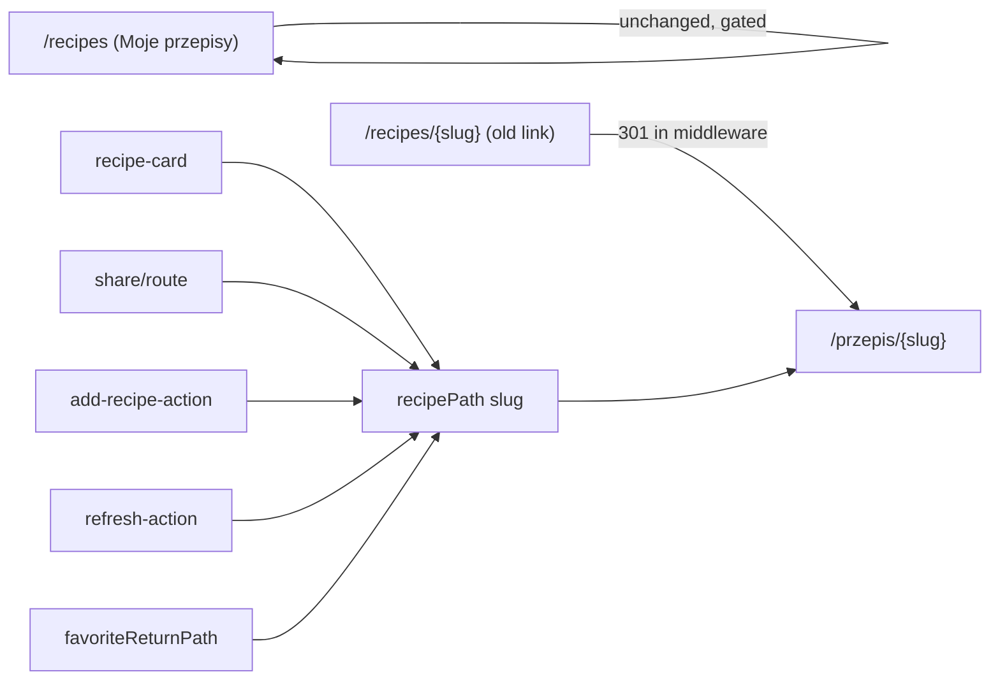

# E01-S03b — Public `/przepis/{slug}` route + 301

> Backlog: `.ai/specs/backlog-przebudowa.md` (E01-S03b, issue #220). Follow-up to **S03a** (`.ai/specs/2026-10-16-global-recipe-dedup-przepis-slug.md`, #199), which makes one recipe per link globally and keeps `(user_id, slug)`. Risk: **high** (public URL contract change + slug migration on production). **Depends on E01-S03a** (global dedup collapses same-URL duplicates first) and builds on E01-S02 (public reads, the `/recipes/{slug}` stopgap this spec removes).
> Autonomous run (`om-auto-write-spec`, 2026-10-16): the Open Questions gate was resolved into **Resolved assumptions** below for human override before merge.

## 📝 TLDR
Today a recipe's only public address is `/recipes/{slug}`, the slug is unique **per user**, and the page resolves an ambiguous slug with a stopgap ("prefer the visitor's own recipe, else the oldest"). *Proposed (future behavior):* one globally-unique slug per recipe and one canonical public URL `/przepis/{slug}`, with a permanent 301 from `/recipes/{slug}`. The slug ambiguity — and the stopgap — disappear, and every link the app builds points at the new address through one shared helper.

## 📝 Resolved assumptions (autonomous defaults)
- **Q1 — Scope / split.** One spec. S03b is a single deployable capability: the canonical URL, the 301, and the slug-uniqueness change are mutually dependent (the 301 and the stopgap removal only make sense once slugs are globally unique). *Rationale: splitting further would ship a half-state where `/przepis` exists but slugs are still ambiguous.*
- **Q2 — Canonical direction.** `/przepis/{slug}` is canonical; `/recipes/{slug}` becomes a **permanent 301**, kept indefinitely (no sunset) for shared links and SEO. *Most reversible, matches the issue.*
- **Q3 — Which row keeps the bare slug on a global collision.** The **oldest** row (by `created_at`, tie-broken by `id`) keeps `{slug}`; later collisions get `{slug}-2`, `{slug}-3`… *Mirrors S03a's "oldest wins" bias; deterministic and reproducible.*
- **Q4 — Where the 301 lives.** In `middleware.ts`, as a pure path rewrite (no DB) for single-segment `/recipes/{slug}`, leaving `/recipes` (the owner's "Moje przepisy" list) untouched. *Reuses the existing routing choke point; no new route handler, no extra edge DB call.*
- **Q5 — Route location.** Move the page to `app/przepis/[slug]/page.tsx` (out of the `(authenticated)` group, where S02 left it only because moving it was out of S02's scope). The old `app/(authenticated)/recipes/[slug]/` page is deleted; `refresh-action.ts` moves with it. *The canonical public page should not sit under a misleading group.*
- **Q6 — One URL helper.** All link construction goes through a new `recipePath(slug)` in `src/lib/routes.ts`. The S03a note counted 5 builders; there are **6** — the sixth is `favoriteReturnPath` in `src/lib/login-redirect.ts` (it also encodes the slug, which the others don't). The helper standardizes encoding. *Removes drift; the count correction is why the helper matters.*
- **Q7 — Status code.** `301` (permanent) for the GET recipe page, as the issue states. Query strings (`?duplicate=1`, `?in_favorites=1`, `?fav=1`, `?refresh_error=1`, `?refreshing=1`) are preserved across the redirect.
- **Q8 — Order vs S03a.** S03b ships **after** S03a's collapse (Phase 2) so the only remaining same-slug cases are recipes that genuinely differ by content but share a title. *Sequencing; S03b's uniqueness migration fails safely if run on un-collapsed data — see Data Model.*

None of these weakens security, data scoping, or a documented compatibility surface: the only prior public recipe URL is `/recipes/{slug}`, which continues to resolve (via 301) to the row that keeps the bare slug; a collision loser never had a unique public URL to break.

## 📝 Problem Statement
`RECIPE_PAGE_RE = /^\/recipes\/[^/]+$/` and `isPublicRoute` (`src/lib/routes.ts`) expose `/recipes/{slug}` publicly, but:
1. **The URL leaks the old model.** `/recipes` is also the owner's private list ("Moje przepisy"); the public single-recipe page lives under the same prefix and, physically, under `app/(authenticated)/`.
2. **Slugs are unique per user, not globally** (S03a keeps `(user_id, slug)`). The recipe page (`app/(authenticated)/recipes/[slug]/page.tsx`, lines 108–126) compensates with a stopgap: it loads **all** rows for a slug and picks "the visitor's own, else the oldest". That is ambiguous, does an extra query, and a guest silently gets "the oldest" — not necessarily the one a shared link meant.
3. **Six call sites build the URL by hand** (`/recipes/${slug}`), one of them with different encoding, so the path is not changeable in one place.

Measured context (from S03a, 2026-10-16): 9 slugs were used by more than one row. After S03a's collapse, exact-URL duplicates are gone, so the residual multi-row slugs are genuinely distinct recipes with the same title — exactly the case a globally-unique slug must disambiguate.

## 📝 Proposed Solution
1. **Globally-unique slug.** A one-off migration suffixes collision losers (`-2`, `-3`…, oldest keeps the bare slug), then a global `unique(slug)` replaces the per-user `(user_id, slug)` uniqueness. The intake/insert path generates a globally-unique slug (append the lowest free numeric suffix on conflict).
2. **Canonical route.** Move the page to `app/przepis/[slug]/page.tsx`; drop the stopgap and select the single row by `slug`.
3. **301.** `middleware.ts` permanently redirects single-segment `/recipes/{slug}` → `/przepis/{slug}`, preserving the query string; `/recipes` (list) and all other paths are unchanged.
4. **One helper.** `recipePath(slug)` in `src/lib/routes.ts`; all 6 builders call it. `RECIPE_PAGE_RE`/`isPublicRoute` gain the `/przepis/{slug}` shape (and keep `/recipes/{slug}` so the 301 itself is a public route).

*Rejected:* a Next `rewrite` instead of a redirect (keeps two live canonical URLs, splits SEO); a DB lookup in middleware to resolve slugs (an edge DB call on every recipe hit, when a pure string redirect suffices); per-user slugs with a disambiguating query param (keeps the ambiguity the issue removes).

## 📝 Architecture
- **`src/lib/routes.ts`** (current + new): `recipePath(slug)` builds `/przepis/{encodeURIComponent(slug)}`; `PRZEPIS_PAGE_RE = /^\/przepis\/[^/]+$/`; `RECIPE_PAGE_RE` kept for the legacy path; `isPublicRoute` returns true for `/`, `/przepis/{slug}` **and** `/recipes/{slug}` (so middleware can run the 301 without bouncing a guest to `/login`).
- **`src/middleware.ts`**: before the public-route check, if `RECIPE_PAGE_RE.test(pathname)` → `NextResponse.redirect(new URL('/przepis/' + slug + search, request.url), 301)`. Pure path math, no session or DB dependency; the existing `updateSession` still runs first.
- **`app/przepis/[slug]/page.tsx`** (moved from `(authenticated)/recipes/[slug]/`): the slug now resolves to one row — `public_recipes`/`recipes` `eq('slug', slug).maybeSingle()`; the "own vs oldest" branch and the second query are deleted. `isOwner` is computed as before. `refresh-action.ts` moves alongside and its redirects use `recipePath`.
- **The 6 URL builders** → `recipePath(slug)`:
  - `src/app/components/recipe-card.tsx:30`
  - `src/app/share/route.ts:68` (`+ '?duplicate=1'`)
  - `src/app/(authenticated)/recipes/add-recipe-action.ts:26`
  - `src/app/(authenticated)/recipes/[slug]/refresh-action.ts:34` and `:66` (move with the page)
  - `src/lib/login-redirect.ts:20` (`favoriteReturnPath`, `+ '?fav=1'`)

Takeaway: one canonical URL, one builder, and a stateless 301 — the recipe page becomes a single-row read.

## 📝 Data Model
No new entities. A migration pair, following S03a's "collapse then global index" pattern:
- **Migration A — `…_slug_global_unique_backfill`:** for each slug used by more than one row, keep the oldest (`created_at` asc, `id` asc) and suffix the rest (`{slug}-2`, `-3`, …, each checked free), recording `(recipe_id, old_slug, new_slug)` in a `recipe_slug_rename_log` so the change is reversible. Idempotent (no-op when already unique).
- **Migration B — `…_recipes_slug_global_index`:** drop the per-user `(user_id, slug)` unique constraint/index; add `recipes_slug_uniq unique(slug)`. **Fails safely** if any duplicate slug remains, so it cannot run before Migration A (or before S03a's collapse). Down: drop the global index, restore the per-user one, and (optionally) replay `recipe_slug_rename_log` in reverse.

Insert path (`share/actions.ts` / Inngest / `add-recipe-action.ts` wherever the slug is set): on a global slug conflict, append the lowest free numeric suffix — the same rule as the backfill, so new and legacy rows are consistent.

## 📝 API Contracts
No new endpoints. `GET /recipes/{slug}` → `301` `/przepis/{slug}` (query string preserved). The recipe page and its query params (`?duplicate=1`, `?in_favorites=1`, `?fav=1`, `?refresh_error=1`, `?refreshing=1`) are unchanged at the new path. `POST /share` and `/api/*` are untouched (middleware's 301 branch matches only single-segment `/recipes/{…}`).

## 📝 UI/UX
No new screens or states — the same recipe page served at `/przepis/{slug}`. The only visible change is the address bar (and that old links still work via the redirect). Accessibility, text-scale, and the WCAG/readability tokens from E01-S01 are unchanged. Prototype: none (no new surface).

## 📝 Edge Cases & Failure Scenarios
- **Old shared link `/recipes/{slug}` for a collision loser (renamed to `-2`):** 301 points to `/przepis/{slug}` = the row that kept the bare slug. The loser's new `/przepis/{slug}-2` has no inbound legacy link, which is correct — it never had an unambiguous public URL. Documented, not a regression.
- **`/recipes` (owner list) and `/recipes/{slug}/anything`:** not matched by `RECIPE_PAGE_RE` (single segment), so no redirect; the list stays gated.
- **Running Migration B before the collapse or the backfill:** the index creation fails safely; nothing is left half-applied.
- **A guest hits the new `/przepis/{slug}`:** allowed by `isPublicRoute`; RLS/`public_recipes` governs data exactly as for the old path.
- **Case / encoding:** `recipePath` encodes once; the 301 preserves the original slug segment verbatim, so no double-encoding.
- **Crawlers with the old URL cached:** a `301` (not `302`) tells them to update; no duplicate-content split.

## 📝 Risks & Impact Review
- **Public URL contract change (`risk-high`).** `/recipes/{slug}` is a live, shareable, indexed surface. Mitigation: permanent 301 kept indefinitely; `BACKWARD_COMPATIBILITY.md` (if present) must record the redirect. A spec-level impact search before merge: `grep -rn "/recipes/" src` to catch any builder this spec missed.
- **Production slug migration.** Migration A renames rows and B swaps a unique constraint. Reversible via `recipe_slug_rename_log`. SDLC gates for a schema/data change: up/down check, rollback plan in the PR, a second person's review. No local DB (Docker off) → verify with a transactional production rehearsal that rolls back, plus unit tests on the suffixing rule, exactly as S03a does.
- **Sequencing.** Must land after S03a Phase 2 (collapse); B fails safely otherwise, so the risk is an aborted migration, not corruption.
- **Middleware size budget.** The 301 is a few lines of path math — no new imports, no bundle impact (the 3 MiB Worker limit noted in `middleware.ts` is not threatened).

## 📝 Decisions in play
Relies on S03a's decisions (global dedup already landed) and E01-S02 (public reads). Supersedes S02's in-code stopgap ("prefer own, else oldest", recipe page lines 108–126) — removing it is in scope here, not a contradiction of S02.

## 📋 Phasing
- **Phase 1 — Canonical route + 301 (no data change):** `recipePath` helper, the 6 builders, the moved `app/przepis/[slug]` page with the stopgap removed, and the middleware 301. Shippable before the slug migration **only if** slugs are already globally unique from S03a's collapse; otherwise the moved page keeps a minimal single-row read and the stopgap removal waits for Phase 2 (see the step note).
- **Phase 2 — Global slug uniqueness:** Migration A (backfill + log), the insert-path suffix rule, then Migration B (global unique index), applied right after A so the ambiguity window is minimal.

## 📋 Implementation Plan
**Phase 1**
1. `routes.ts`: add `recipePath(slug)`, `PRZEPIS_PAGE_RE`, extend `isPublicRoute` (`/`, `/przepis/{slug}`, `/recipes/{slug}`). Unit tests for the regexes and the helper (encoding, both path shapes).
2. Point the 6 builders at `recipePath` (recipe-card, share/route, add-recipe-action, refresh-action ×2, favoriteReturnPath). Keep each builder's own query suffix. Unit test `favoriteReturnPath` still encodes.
3. Move the page to `app/przepis/[slug]/page.tsx` and `refresh-action.ts` with it; delete `app/(authenticated)/recipes/[slug]/`. Replace the "own vs oldest" block with a single `eq('slug', slug).maybeSingle()` read (guard: only after Phase 2 if duplicates can still exist — otherwise keep a one-row read that takes the oldest and remove the "own" branch). Keep `isOwner`.
4. Middleware: 301 `/recipes/{slug}` (+ search) → `/przepis/{slug}` before the public-route check; `/recipes` and multi-segment paths untouched. Unit test the branch (redirect target, status 301, query preserved, list path skipped).

**Phase 2**
5. Migration A: slug backfill with `recipe_slug_rename_log`; idempotent. Unit test the suffixing rule (oldest keeps bare slug; lowest free suffix).
6. Insert-path global-unique slug generation; regression test the conflict path.
7. Migration B: drop per-user, add global `unique(slug)`, fail-safe on duplicates; down restores the per-user index. A rolled-back production rehearsal (rename a real collision, assert resolution, restore, rollback) + a post-apply check (`db push --dry-run` clean, 0 duplicate slugs).
