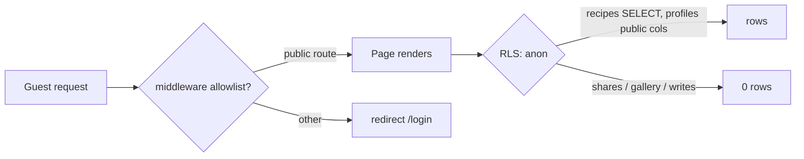

# E01-S02 — Public access: anonymous browsing + guest/logged header

> Backlog: `.ai/specs/backlog-przebudowa.md` (E01-S02). Risk: **high** (RLS data scoping). Category: refactor, security. Source doc for `om-auto-create-pr`.
> Depends on: **E01-S18** (minimal identity profile — display name + username, anon-readable) for the author line.

## 📝 TLDR
Today every route redirects an unauthenticated visitor to `/login` (middleware session gate + per-page `redirect('/login')`), and `recipes` RLS is per-user (`FOR ALL using user_id = current_user_id()`). *Proposed (future behavior):* a guest can open the home, search and a recipe page and **read** recipes (incl. the "Dodała {autor}" line) without logging in; writes and private data stay owner-scoped, and the photo gallery stays login-only. Scope is the **access layer on the existing routes** — the `/przepis` rename (S03) and the new UI (S04/S05/S07) ride on later slices.

## 📝 Problem Statement
The rebuild makes ZapiszPrzepis public (handoff access matrix: guests browse + search; login adds favorites + gallery; adding needs full access). Nothing reaches a guest while two layers both deny anonymous reads:
- **Middleware** (`src/middleware.ts`): "All other paths require a session" → redirect to `/login`. Deliberately on `middleware.ts`, not Next 16 `proxy.ts` — `proxy.ts` bundles ~4.6 MB into the Worker, past the free-tier 3 MiB limit (#119). **Constraint: keep this convention.**
- **Per-page guard**: pages like `src/app/page.tsx` also call `redirect('/login')` on no user.
- **RLS**: `public.recipes` has only `recipes_user_isolation` (`FOR ALL`, `user_id = public.current_user_id()`); an `anon` request reads zero rows. Helper `public.current_user_id()` is already granted to `anon`.
- **Header shell**: the header lives in `(authenticated)/layout.tsx`; the public routes have no header and no guest/logged variant.

## ✅ Decisions (resolved at the Open Questions gate)
- **Q1 — No S03 coupling (interim open).** Verified in code: dedup is per-user (`recipe-dedup.ts` filters every lookup by `user_id`; unique index `(user_id, source_fingerprint)`), so there are no intra-user duplicates, and with only a few test users cross-user duplicates are effectively nonexistent. S02 opens anon read on the current schema now; S03's global-dedup model later makes the same policy expose one canonical row per recipe. *(Worth a one-off prod check that no two test accounts already saved the same URL before merge.)*
- **Q2 — Access layer only** on existing routes (`/`, `/recipes`, `/recipes/[slug]`). No route moves/renames here.
- **Q3 — Gallery fully hidden from anon** (not even the count). Guest sees a generic locked block ("Galeria dostępna po zalogowaniu", no number).
- **Q4 — Author line included now**, via the minimal identity profile from **E01-S18** (display name + username). Gender/vocative and full settings stay in S12/S13.

## 📝 Proposed Solution
1. **Middleware** — replace the catch-all `redirect('/login')` with an explicit **public allowlist** for `/`, `/recipes`, `/recipes/[slug]` (and the existing `/share`, `/api/inngest`, auth pages). Everything else still requires a session. Session refresh (`updateSession`) keeps running for everyone so a logged-in guest is recognized.
2. **Per-page guards** — the public pages drop `redirect('/login')` and instead branch on `user` to pick guest vs logged content.
3. **RLS** — add a **read** policy on `recipes` for `anon` + `authenticated` (all rows), keeping `insert/update/delete` owner-only; add an anon-read policy to the `profiles` table (S18) for `display_name`/`username`; keep `recipe_shares`, failed-shares and the gallery owner-only (gallery hidden from anon per Q3).
4. **Public layout + header states** — a layout wrapping the public routes that renders the header with guest ("Zaloguj się" + MENU) vs logged-in (Dodaj / Powiadomienia / MENU) variants (full styling from S01; the richer header is S04).

## 📝 Architecture
- **Primary surface:** `src/middleware.ts` (allowlist), the public pages (`src/app/page.tsx`, `(authenticated)/recipes/page.tsx`, `(authenticated)/recipes/[slug]/page.tsx` — read-opened in place; physical move deferred to S03), a new public layout + header-state props on `src/app/components/app-header.tsx`, and the Supabase RLS migration.
- **Reused primitives:** `createSupabaseServerClient` / `updateSession` (`src/lib/supabase/*`) unchanged — an anonymous request already uses the `anon` role, so RLS alone decides visibility. `public.current_user_id()` already granted to `anon`.
- **Two-layer invariant:** middleware controls *routing*; RLS controls *data*. Neither alone is the access boundary — the authpriority test (below) must pass with the middleware allowlist in place so a bug in one layer cannot leak private data.


Takeaway: a guest reaches only allowlisted routes, and even there RLS returns only the public read surface.

## 📝 Data Model (RLS — the risk-high core)
No table shape changes in S02 (the `profiles` table itself is E01-S18). S02 adds **read** policies only.

```sql
-- recipes: anyone may read; writes stay owner-only (existing recipes_user_isolation
-- is FOR ALL, so split it or add a permissive SELECT policy that widens only reads).
create policy recipes_public_read
  on public.recipes for select
  to anon, authenticated
  using (true);
-- Keep recipes_user_isolation for insert/update/delete (scope it FOR UPDATE/DELETE/INSERT,
-- or leave FOR ALL — a permissive SELECT policy is OR-ed in, so reads widen while
-- write checks still require user_id = current_user_id()). Verify the OR semantics in a test.

-- profiles (from E01-S18): expose only the public identity columns to anon.
-- display_name + username are public by design; private attributes (gender, …) must
-- NOT live as anon-readable columns — keep them in an owner-scoped table/columns or a view.
create policy profiles_public_read
  on public.profiles for select
  to anon, authenticated
  using (true);
```
- **Anon read surface:** `recipes` display fields (title, slug, category, tags, times, main image, normalized source) + `profiles.display_name`/`username` for the author line. **Not** exposed: gallery images, `recipe_shares`, failed shares, any private profile attribute.
- **Gallery:** no anon policy → zero rows for a guest (Q3). The recipe page shows the generic locked block.
- **Column safety:** if a guest-facing query would select internal columns (`user_id`, raw `source_url`), restrict the select list or expose a read view; raw internals stay out of guest responses.

## 📝 API Contracts
No new endpoints. Server Components call the Supabase client as today; the change is which role/policies apply. `recipe_shares`/write Server Actions keep their own `getUser()` guard (RLS is the backstop, not the only check).

## 📝 UI/UX
- **Header states:** guest = "Zaloguj się" (bordered) + MENU; logged-in = Dodaj / Powiadomienia / MENU (full header is S04; S02 ships the state switch + a11y basics from S01).
- **Recipe page, guest:** full recipe readable incl. "Dodała/Dodał {display_name}" (link to `/u/{username}` — target page is S14; link may 404 until then, or render non-link until S14 — see Edge Cases). Gallery → locked block "Galeria dostępna po zalogowaniu" (no count). Favorite heart → `/login?next=…` (favorites logic is S06).
- **States:** default / empty (no recipes) / loading / error / logged-in vs guest. No horizontal scroll; focus visible (S01).

## 📝 Edge Cases & Failure Scenarios
- **`/u/{username}` not built yet (S14):** the author link would 404. Decision: render the author name as **plain text (no link) until S14**, or ship a minimal `/u` stub. Pick in implementation; default = plain text now, link when S14 lands.
- **Logged-in user on a public route:** must still see their logged-in header and own data; `updateSession` must keep refreshing tokens on allowlisted routes.
- **RLS regression:** a mistaken `using (true)` on write, or a too-broad profiles policy, leaks data — covered by the required isolation tests.
- **Guest hits a gated route directly** (`/dodaj`, settings): still redirected to `/login`.
- **Private-mode / no cookies:** anon read works (no session needed).

## 📝 Risks & Impact Review
- **Blast radius:** RLS on `recipes` is a shared contract surface. Widening SELECT to `anon` is the whole point; the danger is accidentally widening writes or exposing private columns/tables. Mitigation: permissive SELECT policy that touches reads only; explicit tests.
- **Required by SDLC (risk-high):** an integration test for the **denied path** (anon cannot insert/update/delete, cannot read shares/gallery/private profile columns) and the **wrong-scope read** (user A cannot mutate user B); a second person's review (auth/scoping change).
- **Rollback:** drop the two read policies (`recipes_public_read`, `profiles_public_read`) and restore the middleware catch-all → back to fully-gated. Migration ships with a down path. No data migration, so rollback is clean.
- **Reversibility:** fully reversible (policies + routing), no destructive data change.

## 📋 Phasing
- **Phase 1 — Data access (RLS):** anon read policies + isolation tests. Shippable behind the still-gated middleware (no UI change yet).
- **Phase 2 — Routing + guards:** middleware allowlist + drop per-page `redirect` + guest/logged branching. Guest can now reach the pages.
- **Phase 3 — Header states + author line:** public layout, header guest/logged variants, author line reading S18 profile.

*(Phase 3 depends on E01-S18 having landed; Phases 1–2 do not.)*

## 📋 Implementation Plan
**Phase 1 — RLS**
1. Migration: add `recipes_public_read` (+ scope writes) and confirm OR-semantics; no anon policy for `recipe_shares`/gallery.
2. Integration tests: anon reads recipes; anon gets 0 on shares/gallery and is denied all writes; user A cannot mutate user B. (Gate: `pnpm test` green.)

**Phase 2 — Routing**
3. `middleware.ts`: public allowlist for `/`, `/recipes`, `/recipes/[slug]`; everything else still gated. Keep `updateSession` for all.
4. Public pages: remove `redirect('/login')`; branch content on `user`. App still works logged-in and now logged-out.

**Phase 3 — Header + author (needs S18)**
5. Public layout + `AppHeader` guest/logged props (states only; full styling S04).
6. Author line: read `profiles.display_name`/`username`; render link (or plain text until S14).
7. Guest recipe page: gallery locked block (no count); heart → `/login?next=…`.

## 🔍 Self-review (staff-engineer lens)
- **Scope cohesion:** one capability — "a guest can read". Profile identity split out to S18; dedup/model to S03; favorites to S06; new UI to S04/S05/S07. ✅
- **Canonical mechanisms:** reuses existing Supabase clients + `current_user_id()`; no parallel auth. ✅
- **Contracts/compat:** RLS SELECT widening flagged; writes unchanged; down-migration provided. ✅
- **Sensitive data:** gallery + private profile attrs kept off the anon surface; column-safety noted. ✅
- **Testability:** every step has a test or a working-app checkpoint; denied-path + wrong-scope tests are mandatory. ✅
- **Open risk to confirm in review:** exact OR-semantics of a permissive SELECT policy alongside the existing `FOR ALL` isolation policy — prove with the isolation test before trusting it.

## 🛠 Implementation notes (2026-10-16, `feat/e01-s02-public-access` @ 99bb673)
Changes found while implementing. Where they contradict the sections above, they win.
- **Gallery (Q3) is a UI boundary, not RLS.** The gallery is the `recipes.image_urls` *column*, not a table, so "no anon policy → zero rows" above was wrong: a public-read row carries the column. Implemented: the gallery isn't rendered for guests, so its URLs never reach the browser, but they stay readable through the raw API. That fits the handoff's purpose (a login incentive; the photos come from public posts). A data-level hide needs a column list, i.e. the `public_recipes` view below.
- **Route scope narrowed.** Public: `/` and `/recipes/[slug]`. `/recipes` is "Moje przepisy" and stays owner-only, because a guest has no list of their own.
- **Query audit (new, required in the same change).** With `using (true)`, SELECTs no longer mean "my recipes". These now filter by `user_id` explicitly: the `/recipes` list and its counts, the `/settings` count, the `getFailedShares` auto-resolve (regression test added), and the delete route. Public on purpose: home "Ostatnio dodane" and the recipe page by slug. Without this, the delete route could resolve another user's recipe, then report success while deleting nothing (RLS matched 0 rows).
- **Slug collisions (interim).** The recipe page picks the visitor's own row, otherwise the oldest. The feed is keyed by `id`. E01-S03's global slug replaces this.
- **Author line**: "Dodane przez {display_name}". It stays gender-neutral until S12 and plain text until S14.
- **Not done in S02:** return-to-page after login (`/login` has no `next` support; belongs to S06/S12). No RLS isolation tests could be run: the repo has no database test harness and Docker isn't available here.

### Follow-ups
1. **Make public reads fail closed:** restore owner-only RLS on `recipes` and serve public reads through a `public_recipes` view with an explicit column list (no `image_urls`, no `user_id`). Today a new `from('recipes').select()` without a `user_id` filter quietly leaks across users. Only two readers are public right now, so it's a small change. Do it before S03/S14 add more.
2. **`slug` index.** The slug-only lookup can't use `(user_id, slug)`. Either a global unique slug arrives in S03, or a one-line index goes in now.
3. **Move `recipes/[slug]` out of the `(authenticated)` group** (with S03's `/przepis` rename).
4. **DB test harness** for the risk-high RLS gates: denied path and wrong-scope reads.

**Status (2026-10-16):** follow-ups 1 and 2 are done on `feat/e01-public-recipes-view` @ 0e8c36d. `recipes_public_read` is dropped, so `recipes` is owner-only again. Guests read through `public_recipes` (explicit column list plus `author_name`). The gallery comes from `recipe_gallery_images`, which only signed-in users can read, so decision Q3 is now enforced in the database. Both views allow SELECT only. `idx_recipes_slug` is added. Follow-ups 3–4 remain open.
