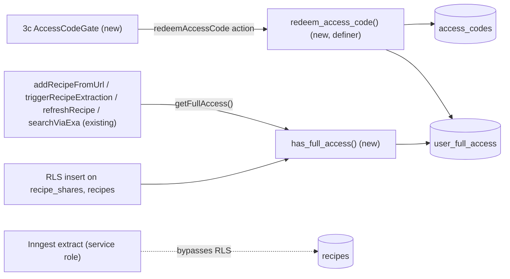

# E01-S11 — Add gate: access code (screen 3c)

Issue: #214 · Epic: #201 · Backlog: `.ai/specs/backlog-przebudowa.md` (E01-S11) · Risk: **high** (access control)

## 📝 TLDR

Today any signed-in account can add recipes: the home form, the Web Share Target and re-extraction all queue a paid extraction for whoever has a session. The rebuild (E01) splits accounts in two. **Proposed:** a signed-in user without **full access** can browse, keep favorites and use the gallery, but cannot add recipes. Full access is unlocked by redeeming an **access code** on screen 3c (payment comes later, in a separate epic). The gate is enforced server-side in every add path **and** in RLS, so a crafted PostgREST call cannot get around the UI.

## 📝 Problem Statement

- Since S12 (Facebook/Google sign-in) any person with a social account can sign up. Every added link costs money (Firecrawl, LLM extraction, Exa search) and becomes a public recipe under `/przepis/{slug}`. Open adding is both a cost risk and a content-quality risk.
- The product decision (CLAUDE.md, "Dostęp") is that only full-access users add recipes. Full access comes from a code or a payment.
- Today the only gate is `requireUser()` or `auth.getUser()`. RLS lets any `authenticated` session insert into `recipe_shares` and `recipes` for its own `user_id`, so hiding the form alone would not be a gate.

## 📝 Proposed Solution

1. **A private entitlement**: one row per user in `public.user_full_access` (who, since when, source `code | grandfathered | payment`). The flag is **not** stored on `profiles`, because that table is anon-readable and an entitlement is private.
2. **A codes table** `public.access_codes` that the API roles cannot read. It stores only a SHA-256 of the normalized code, plus `max_uses`, `use_count`, `expires_at` and `note`. The "used by" record is `user_full_access.code_id`: a user redeems at most once, because a user who already has access gets `'already'`.
3. **One SECURITY DEFINER RPC** `public.redeem_access_code(p_code text)` does all validation in one transaction under a row lock. The client never sees code rows.
4. **One predicate** `public.has_full_access()`, used by RLS and by the server-side TS helper `getFullAccess()`.
5. **Enforcement in three layers:**
   - **Server actions / route:** `addRecipeFromUrl`, `triggerRecipeExtraction` (`/share`), `refreshRecipe` and `searchViaExa` refuse before any insert or paid call. The dedup lookup runs first in the add/share paths, because a link someone else already added only goes to the user's favorites, and favorites need no full access (CLAUDE.md).
   - **RLS:** INSERT on `recipe_shares` and on `recipes` additionally requires `has_full_access()`. Inngest writes with the service role and is unaffected.
   - **UI:** screen 3c replaces the add form when the user lacks access.

**Alternatives considered**

- *Reuse the `INVITE_CODE` env (S-07 registration gate).* It is a single shared code with no limit, expiry or audit trail, so it fails the AC ("use limit, expiry, used by"). The registration gate stays as it is. The two codes are different concepts: registration versus entitlement.
- *A `has_full_access` column on `profiles`.* `profiles` is anon-readable, so it would leak who has paid or been invited, and the owner-update policy would let a user flip the flag on themselves. Rejected.
- *Supabase custom JWT claim.* It needs an auth hook. The claim goes stale until the token refreshes, so a user who just redeemed a code would still be refused. Rejected; a per-request RPC is one cheap indexed lookup.
- *Plaintext codes.* Workable because the table is unreadable to the API, but a DB dump or log would expose live codes. A SHA-256 of a high-entropy code costs nothing. Codes are not passwords (they are not user-chosen), so a fast hash is adequate.

## 📝 Architecture

Takeaway: one predicate (`has_full_access`) decides everywhere, and only the definer RPC can grant access.

- **New module:** `src/lib/full-access.ts` contains `getFullAccess(supabase)`, which wraps `rpc('has_full_access')`, and the `NO_FULL_ACCESS` error message constant.
- **New action:** `src/app/(actions)/redeem-access-code.ts` (`'use server'`).
- **New component:** `src/app/components/access-code-gate.tsx` (screen 3c).
- **Consumers wired here:** the home page (`/`) shows the gate instead of `AddRecipeForm`. `/share` redirects users without access to `/?add_error=no_access`.
- **Future consumers (not built here):** S09 menu lock state (`hasFullAccess` → padlock + "Wymaga kodu lub pełnego dostępu"), S10 `/dodaj` (renders the same `AccessCodeGate`), and the payment epic (inserts `user_full_access` with `source='payment'`).

## 📝 Data Model

Migration `supabase/migrations/20261017140000_full_access_gate.sql` (idempotent where practical):

| Table | Columns | Access |
|---|---|---|
| `access_codes` | `id bigint identity pk`, `code_hash text unique not null` (hex SHA-256 of the normalized code), `max_uses int not null default 1 check (max_uses > 0)`, `use_count int not null default 0 check (use_count >= 0 and use_count <= max_uses)`, `expires_at timestamptz null` (null = no expiry), `note text`, `created_at` | RLS on, **no policies, all privileges revoked** from `anon` and `authenticated` |
| `access_code_attempts` | `id`, `user_id fk on delete cascade`, `attempted_at`, index `(user_id, attempted_at)` | RLS on, no policies, revoked (rate limiting) |
| `user_full_access` | `user_id uuid pk fk → auth.users on delete cascade`, `source text check in ('code','grandfathered','payment')`, `code_id fk null`, `granted_at` | RLS on, policy **select own row** (`user_id = current_user_id()`). Only `select` is granted to `authenticated`, with no insert/update/delete, so a user cannot grant themselves access |

**Normalization** (in SQL, a single source of truth): `lower(regexp_replace(p_code, '[\s-]', '', 'g'))`. Letter case, whitespace and hyphens do not matter (AC2), so "ABCD 1234" and "abcd-1234" are the same code. The hash is `encode(sha256(convert_to(normalized, 'UTF8')), 'hex')`, using the built-in `sha256()` so no extension is needed.

**Functions:**

- `has_full_access() returns boolean`: `stable`, `security definer`, `set search_path = ''`. It returns `exists (select 1 from public.user_full_access where user_id = auth.uid())`. Execute is granted to `authenticated` and `anon` (anon always gets false).
- `redeem_access_code(p_code text) returns text`: `security definer`, `set search_path = ''`. Execute is granted to `authenticated` only. Steps:
  1. If `auth.uid()` is null, raise `not_authenticated`.
  2. Take `pg_advisory_xact_lock(hashtext(uid::text))`, which serializes concurrent calls by the same user (a double submit, or two tabs with two codes). Then, if the user already has full access, return `'already'`. No use is consumed.
  3. If the user has 5 or more failed attempts in the last 15 minutes, return `'rate_limited'`. The code is not checked at all, so brute force gets no oracle.
  4. Look up `code_hash` with `for update`. If the code is missing, expired (`expires_at <= now()`), or exhausted (`use_count >= max_uses`), record a failed attempt and return `'invalid'`. All three cases return the same token, so the response tells an attacker nothing about which codes exist.
  5. Otherwise, in the same transaction: `use_count + 1`, insert `user_full_access(source='code', code_id)`, delete this user's attempt rows, and return `'ok'`.

  The function **never raises for the invalid cases**, because a raise would roll back the recorded attempt and defeat the rate limit.
- `create_access_code(p_code text, p_max_uses int default 1, p_expires_at timestamptz default null, p_note text default null) returns bigint`: owner tooling. Execute is revoked from `public`, `anon` and `authenticated`, so it is service-role / SQL editor only. It applies the same normalization and hash and refuses codes shorter than **10** normalized characters. S12 makes new accounts free, so the per-user rate limit alone does not stop a determined guesser; code length does. The owner should use random codes, e.g. `upper(substr(md5(gen_random_uuid()::text), 1, 12))`.

**RLS changes:**

- `recipe_shares`: replace `recipe_shares_user_isolation` (`for all`) with four per-command policies. SELECT, UPDATE and DELETE are owner-only as today. **INSERT** is `with check (user_id = current_user_id() and (select public.has_full_access()))`.
- `recipes`: same split of `recipes_user_isolation`. **INSERT** additionally requires `has_full_access()`. No user-session code inserts into `recipes` today (Inngest uses the service role), so this only closes the direct-PostgREST path.
- UPDATE and DELETE stay ungated. "Ponów" (retry, `retryShare`) also stays ungated on purpose: it re-sends a share that was already accepted under full access, and access is never revoked in this story. If the payment epic adds revocation (refunds), it must add `getFullAccess` to `retryShare`.

**Backfill (grandfathering):** two groups get `user_full_access(source='grandfathered')`. First, every `auth.users` row with an `auth.identities` row of provider `email`: before S12, the only way to create an account was the S-07 signup, which demands the `INVITE_CODE`, so every email account is an invited adder even if it has not added anything yet. Second, anyone who already owns a `recipes` or `recipe_shares` row. A social-login (S12) account with no recipes gets nothing and needs a code, and S12 keeps its OAuth buttons off until this gate is live. The backfill uses `on conflict do nothing`, so it is re-runnable.

**Sensitive data:** codes are stored only as a hash. Attempts are owner-only. The entitlement is visible to its owner only. Nothing is added to the anon-readable `profiles`.

## 📝 API Contracts

- **Server action** `redeemAccessCode(prev: RedeemState, formData: FormData): Promise<RedeemState>`, used with `useActionState`:
  - It reads `code` and trims it. An empty value returns `{ status: 'invalid' }` without calling the RPC.
  - It calls `requireUser()`, then `supabase.rpc('redeem_access_code', { p_code })`.
  - It maps `'ok' | 'already'` to `{ status: 'ok' }` plus `revalidatePath('/')`, `'invalid'` to `{ status: 'invalid' }`, `'rate_limited'` to `{ status: 'rate_limited' }`, and an RPC error to `{ status: 'error' }`. The mapping uses an exact-equality lookup, never `includes` (lessons.md).
- **`getFullAccess(supabase): Promise<boolean>`** returns `false` on an RPC error. It fails closed.
- **Add paths:**
  - `addRecipeFromUrl` runs dedup first. `completed`/`pending`/`other` (someone else's recipe goes to favorites) behave as today for everyone. Only before the **new-share insert** does it check access and redirect to `/?add_error=no_access`.
  - `triggerRecipeExtraction` has the same order: dedup first, then it throws `Error('No full access')` before the insert. `/share` maps that message to a 303 redirect to `/?add_error=no_access`.
  - `refreshRecipe` redirects to `recipePath(slug)?refresh_error=no_access`, which shows its own toast.
  - `searchViaExa` returns `{ error: 'no_access' }` before the paid Exa call.

## 📝 UI/UX

Prototype: `.ai/specs/assets/access-code-add-gate/3c-mockup.html`

Screen 3c is the `AccessCodeGate` component. The home page renders it for a signed-in user without access, in place of `AddRecipeForm`. A guest still sees the existing sign-in CTA.

- Heading "Dodawanie przepisów" (h2) and a short explanation in 19 px `text-ink-soft`: "Żeby dodawać własne przepisy, wpisz kod dostępu. Ulubione i galeria działają bez kodu."
- **Field** (`<label for>` "Kod dostępu"): 2 px `border-field` border, at least 56 px high, `autocomplete="off"`, `autocapitalize="characters"`, `spellcheck=false`. On error it gets a 2 px `border-danger` (#b91c1c) border, `aria-invalid="true"` and `aria-describedby` pointing to the error.
- **"Odblokuj" button**: `Button` primary `lg` (56 px, `bg-action` #c2410c with white text). It is disabled with "Sprawdzam…" while pending.
- **Error** (`role="alert"`, `text-danger`, ≥ 16 px): invalid → "Ten kod nie działa. Sprawdź, czy wpisano go bez błędów."; rate-limited → "Za dużo prób. Spróbuj ponownie za kwadrans."; server error → "Coś poszło nie tak. Spróbuj ponownie." Focus stays in the field.
- **Success** (`role="status"`, `bg-success-bg` with `text-success` and a ✓ icon plus a text label): "Gotowe — możesz dodawać przepisy." The **same render** then shows `AddRecipeForm` below, which gets focus.
- **Payment placeholder:** a line "Pełny dostęp płatny — wkrótce." in `text-ink-soft`. It is a plain sentence, not a link. A link that leads nowhere fails WCAG and honesty, and payment is a separate epic.
- **`?add_error=no_access`** (arriving from Share Target or a stale tab) shows an info line above the gate: "Dodawanie przepisów wymaga kodu dostępu."
- WCAG 2.2 AA: visible `outline-focus` focus, every target ≥ 48 px, no horizontal scroll at 320 px, and the icon always has a text label.

## 📝 Edge Cases & Failure Scenarios

| Case | Behaviour |
|---|---|
| Two users redeem the last use at the same time | `for update` serializes them. The second sees `use_count >= max_uses` and gets "Ten kod nie działa". |
| A user double-submits, or two tabs submit two codes | The per-user advisory lock serializes the calls. The second sees an existing `user_full_access` and returns `'already'`, which the UI maps to `ok`. No second use is consumed. |
| A user with access visits the gate (stale tab) | The action returns `ok`. The page shows the form. |
| Code with mixed case, spaces or hyphens (" AbCd-12 34 ") | Whitespace and hyphens are stripped and the code is lowercased before hashing. |
| `has_full_access` RPC fails (network/DB) | `getFullAccess` returns false. The user sees the gate, and RLS refuses any insert anyway. Fails closed. |
| User without access POSTs `/share` | A link someone else already added goes to the user's favorites, as today. A new link redirects to `/?add_error=no_access`; the share is not stored, and that intent is lost (an accepted trade-off). |
| User without access calls PostgREST `insert recipe_shares` directly | RLS `with check` fails (42501). |
| Previously added `pending` share of a user who now lacks access | Impossible in this story because access is never revoked. If an owner revokes by SQL, existing shares keep processing; only new ones are refused. |
| Account deletion | Cascades remove the entitlement and attempts. `use_count` is not decremented, so the use stays spent. |
| Brute force | 5 failures per 15 min per user. Codes have ≥ 10 normalized characters, owner-generated at random. |

## 📝 Risks & Impact Review

- **Hard-to-reverse:** the RLS split on `recipes` and `recipe_shares`. Rollback recreates the two `for all` policies (down-SQL is provided in the migration's trailing comment). The new tables can be dropped without touching recipe data.
- **Lock-out risk:** if the backfill misses a real adder, that person cannot add until they get a code. The rehearsal reports the number of grandfathered users against all users, so the owner can check before applying.
- **Parallel S12:** new social-login accounts start without access. That is intended and matches CLAUDE.md.
- **Parallel S04/S09:** S04 rewrites the home page. This story changes only the `user ? … : …` branch. S09 consumes `getFullAccess`. Both are noted in the shared session notes.
- **Owner-gated deploy order: migration first, then the app.** With the migration applied and the old build still live, grandfathered users add as before. A non-grandfathered user's add fails RLS, and the old build shows its generic "Coś poszło nie tak" (acceptable for the minutes between steps). The reverse order is **not** safe: a new build without the migration finds no `has_full_access` RPC, fails closed and locks out every adder, mama included.

## 📋 Phasing

- **Phase 1 — DB gate:** migration, RLS split, functions, backfill, a rolled-back rehearsal script, and generated types.
- **Phase 2 — Server enforcement:** `getFullAccess`, the guards in four add paths, the `/share` mapping, and unit tests.
- **Phase 3 — Screen 3c:** `redeemAccessCode` action, `AccessCodeGate`, home wiring, `no_access` message, and component tests.

Each phase leaves the app working. Phase 2 against a DB without the migration fails closed: the RPC does not exist, so `getFullAccess` returns false. **Phase 2 must not ship before the migration is applied in prod.** Phases 1–3 therefore land on one implementation PR, and the owner applies the migration **before** merging (see Risks).

## 📋 Implementation Plan

**Phase 1 — DB gate**
1. Write `20261017140000_full_access_gate.sql`: the tables, revokes, `user_full_access` select-own policy, `has_full_access`, `redeem_access_code`, `create_access_code`, the RLS split and the backfill.
2. Write `.ai/qa/s11-rehearse-full-access-gate.sql`, a rolled-back `do` block ending in `raise exception 'REHEARSAL_RESULT …'`. It asserts: an invalid code returns `invalid`; case/space/hyphen variants return `ok`; concurrent self-redemption cannot double-spend; the second use of a `max_uses=1` code returns `invalid`; an expired code returns `invalid`; 5 failures lead to `rate_limited`; an insert into `recipe_shares` without access fails with 42501 and with access succeeds; the grandfathered count is reported.
3. Add the new tables and RPCs to `src/lib/supabase.types.ts`.

**Phase 2 — Server enforcement**
4. Write `src/lib/full-access.ts` and its tests (true / false / RPC error → false).
5. Add the guard to `addRecipeFromUrl` after dedup and extend `add-recipe-action.test.ts`: without access, a new link redirects to `no_access` with no insert, while someone else's link is still favorited.
6. Add the guard to `triggerRecipeExtraction` and map it in the `/share` route. Extend `share/actions.test.ts` and add route coverage.
7. Add guards to `refreshRecipe` and `searchViaExa`, each with a test.

**Phase 3 — Screen 3c**
8. Write `redeemAccessCode` and its tests (status mapping, empty code, RPC error).
9. Build `AccessCodeGate` with component tests: error `role=alert` with the danger border and `aria-invalid`; success `role=status`, after which the add form renders.
10. Wire the home page: fetch `getFullAccess` in parallel with the existing queries, render gate or form, and add the `no_access` message.
11. Run the local gate (`pnpm typecheck`, `pnpm lint`, `pnpm test`).

## Resolved assumptions (autonomous defaults)

| # | Question | Default | Rationale |
|---|---|---|---|
| Q1 | Reuse the S-07 `INVITE_CODE` registration code? | No. Separate `access_codes` table; registration gate untouched | The AC needs a use limit, expiry and "used by", which an env string cannot carry |
| Q2 | Where does `hasFullAccess` live? | Private `user_full_access` table plus a `has_full_access()` RPC, computed per request | `profiles` is anon-readable and owner-updatable; a JWT claim goes stale after redemption |
| Q3 | Who is grandfathered? | Every email-identity account (all were created with `INVITE_CODE`), plus anyone owning a recipe or share | Everyone invited before the rebuild keeps adding; fresh S12 social sign-ups do not |
| Q4 | Gate Exa search and "Odśwież przepis"? | Yes, both | Both spend paid extraction/search budget, which is what the gate protects |
| Q5 | Distinguish expired / used-up / unknown codes in the UI? | No. One "Ten kod nie działa…" message | Matches AC2 and avoids an enumeration oracle |
| Q6 | Brute-force protection? | 5 failures / 15 min / user inside the RPC | Cheap, keeps the code space safe, and the attempt is recorded without a raise |
| Q7 | Admin UI for codes? | None. The owner uses `create_access_code()` via the SQL editor or Management API | Smallest surface; owner-only tooling |
| Q8 | "Zobacz pełny dostęp" (payment) | Plain "wkrótce" sentence, not a link | Payment is a separate epic; a dead link fails WCAG/UX |
| Q10 | Does the gate block "add a link that already exists → favorites"? | No. Dedup runs first, and only a new extraction is gated | Favorites need no full access (CLAUDE.md); that path spends no budget |
| Q9 | `/dodaj` page | Not built (S10 #213 reuses `AccessCodeGate`) | Out of scope per the backlog |
