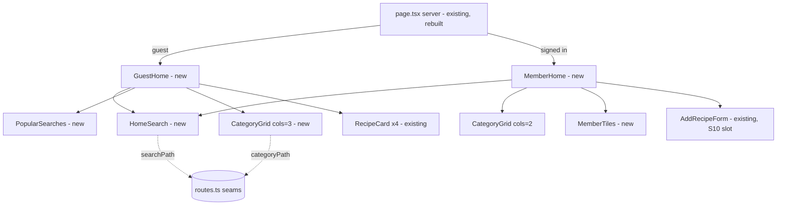

# E01-S04 — Home page: guest and signed-in

> Issue: #207 · Epic: #201 · Backlog: `.ai/specs/backlog-przebudowa.md` (E01-S04, refs A1/A2/C1) · Depends on: S01 (tokens/primitives), S02 (public home) — both live.

## 📝 TLDR

Today `/` is a pre-rebuild page: a guest sees a small orange box with login links and three recent recipes; a signed-in user sees the add-from-link form and a "Zapisane przepisy" button. **Proposed:** the home becomes the variant-1c entry screen — a guest gets a search hero ("Czego dziś szukasz?"), popular searches, an 8-tile category grid, a 2-column "Ostatnio dodane" feed and a sign-up CTA; a signed-in user gets a greeting, the same search field, three shortcut tiles (Moje przepisy / Ulubione / Dodaj przepis) and the category grid. It is the first rebuilt screen and the base S17 widens for desktop.

## 📝 Problem Statement

The home is the first screen every visitor sees, and it is the one most out of line with the E01 rules: 12–14 px grey text (`text-gray-400/500` fails 4.5:1), raw orange hexes instead of tokens, no search entry for a guest, no category entry at all. The target audience includes older people, so the readability rules (19 px body, 56–60 px primary controls, 48 px targets) matter most here.

## 📝 Proposed Solution

Rebuild `src/app/page.tsx` as a server component that branches on the session and composes small home-only components under `src/app/components/home/`. All navigation targets go through **seams** in `src/lib/routes.ts` so later stories (S05 search, S16 category pages, S10 `/dodaj`) repoint one function instead of editing the screen. Data needs are unchanged except the recent-feed limit (3 → 4).

Alternatives considered:
- *Reuse `RecipeSearch` (the `/recipes` live-filter input) for the hero.* Lost: it debounces `router.push` to `/recipes`, is 40 px tall and grey-on-white; the hero needs a plain submit form (60 px, explicit "Szukaj przepisu" button) that works without JS. `RecipeSearch` stays for `/recipes` and is S05's to rework.
- *Build `/szukaj` and `/przepisy/{kategoria}` now so guest taps work.* Lost: that is S05/S16 scope; see Resolved assumption A1.

## 📝 Architecture

- **Primary module:** `src/app/page.tsx` (server). Reads `getCurrentUser()`; guest → `<GuestHome>`, signed-in → `<MemberHome>`.
- **New components** (`src/app/components/home/`):
  - `home-search.tsx` (client) — `<form role="search" method="get" action={SEARCH_PATH}>` with a 60 px `type="search"` input, a labelled mic button (progressive enhancement, Web Speech API `pl-PL`, rendered only when supported — the probe `AddRecipeForm` inlines today is extracted to `isSpeechRecognitionSupported()` in `src/lib/speech.ts` and shared), and a 56–60 px submit "Szukaj przepisu". Works as a plain GET without JS.
  - `popular-searches.tsx` — "Często szukane" pill links (`<Link>`, 48 px, bordered so they read as controls; see UI/UX).
  - `category-grid.tsx` — "Kategorie" tiles from `HOME_CATEGORIES`; `columns: 2 | 3` prop.
  - `member-tiles.tsx` — Moje przepisy (only with full access) / Ulubione / Dodaj przepis.
  - `guest-cta.tsx` — "Załóż konto / Zaloguj się" block.
- **Reused:** `RecipeCard` (links via `recipePath()`, shows `sourceLabel()` — never a login), `buttonClasses()`, tokens from `globals.css`, `AddRecipeForm` (kept on the signed-in home as the S10 slot, see A5; its inline speech probe switches to the shared helper).
- **Seams added to `src/lib/routes.ts`:** `SEARCH_PATH` + `searchPath(q)`, `categoryPath(value)`. `src/lib/recipe-categories.ts` gains `HOME_CATEGORIES` (8 entries) and `src/lib/home.ts` holds `POPULAR_SEARCHES` and `homeGreeting(vocative)`.
- **Layout slots (not implemented):** a `{/* S15: notifications banner */}` slot as the first child of `<main>` (above hero/greeting) and the search seam for S05. S17 widens the same components (no desktop variants here beyond a sane `max-w`).
- **Planned dependencies:** S12 (vocative + gender) and S11 (`hasFullAccess`) are being built in parallel. This story consumes them through two inputs — `vocative: string | null` and `hasFullAccess: boolean` — resolved in `page.tsx` with interim values (A2, A3), so it ships independently.

Takeaway: one server branch, five small presentational components, and all outbound links behind `routes.ts` seams — S05/S16/S10 change targets without touching the screen.

## 📝 Data Model

No schema change, no migration. Queries:
- Guest: `public_recipes` select (existing columns) `order created_at desc limit 4` — was 3; 4 fills a 2-column grid.
- Signed-in: no recipe query on the home (AC lists no feed for C1). `getFailedShares` stays for the header bell.

## 📝 UI/UX

Mobile-first (375 px), container `PageContainer`. Copy is Polish, exactly as below.

**Guest (A1):**
1. *(S15 slot)*
2. Hero — `bg-surface-accent` (`#fff7ed`), H1 „Czego dziś szukasz?” (28–30 px, `text-ink`, bold), `HomeSearch`: label „Szukaj przepisu po nazwie lub składniku” (visible, 17–19 px), input 60 px, 2 px `border-field`, 19 px text, placeholder `text-ink-muted`; mic button „Mów” with icon + text (48 px); submit `buttonClasses('primary','lg')` full width, „Szukaj przepisu”.
3. „Często szukane” — H2 + wrap of pill links (48 px min height, `text-ink`, 2 px `border-border-card-2`), each → `searchPath(term)`.
4. „Kategorie” — H2 + 3-column grid of 8 tiles (min 64 px tall, 17–19 px bold label, `rounded-card`, `border-border-card`), each → `categoryPath(value)`.
5. „Ostatnio dodane” — H2 + 2-column grid of 4 `RecipeCard`s. Hidden when the feed is empty.
6. CTA block — `bg-surface-2`, short copy „Załóż konto, żeby zapisywać ulubione przepisy.”, two full-width buttons: primary „Załóż konto” → `/signup`, outline „Zaloguj się” → `/login`.

**Signed-in (C1/A2):**
1. *(S15 slot)*
2. H1 `homeGreeting(vocative)` → „Dzień dobry, {wołacz}!” or „Dzień dobry!” when unknown.
3. `HomeSearch` (same component, no hero background).
4. Tiles (single column, 72 px min height, icon + label + one-line caption `text-ink-soft` 16 px): „Moje przepisy” → `/recipes` (only when `hasFullAccess`), „Ulubione” → `/ulubione`, „Dodaj przepis” → `/?tab=add`.
5. „Kategorie” — 2-column grid, same tiles.
6. „Dodaj przepis z linku” section (H2, `aria-labelledby`) with the existing `AddRecipeForm` — the S10 slot (A5).

**RecipeCard token pass** (Phase 3 — in scope because the card is on the home and its source line fails contrast; it also changes `/recipes` and `/ulubione`, so it is its own phase with its own visual check): title stays an `h3` (sections are H2) at 19 px `text-ink`, hover `text-action-text` (was `orange-600`); description 16 px `text-ink-soft` (was `text-sm text-gray-500`); source line 16 px `text-ink-soft` (was `text-xs text-gray-400`, ~2.5:1); category badge `bg-surface-accent-2 text-action-text` 14 px bold; card `rounded-card border border-border-card` (was `rounded-lg border-gray-200`); placeholder icon `text-action-text`. Layout and props unchanged.

**Accessibility:** one H1 per state; H2 per section with `aria-labelledby`; every icon has visible text; focus ring from `globals.css`; no horizontal scroll at 320 px (2/3-column grids use `minmax(0,1fr)`, labels wrap); mic button announces state via `aria-pressed` and an `aria-live="polite"` status („Słucham…”); links inside running text underlined, tile/pill links are self-evidently controls (border + text) per the S01 primitives.

Prototype: `.ai/specs/assets/e01-s04-home-page/mockup.html` (illustrative static mockup; the `.dc.html` handoff files are the look authority).

## 📝 Edge Cases & Failure Scenarios

- **`public_recipes` query fails / empty** → „Ostatnio dodane” section is omitted; rest of the page renders (no error state on the home).
- **Speech API absent (Firefox, iOS PWA)** → mic button not rendered; field + submit still work. Recognition error/no-permission → status „Nie udało się rozpoznać mowy.”, field unchanged.
- **Empty search submit** → native `required` on the input prevents a blank navigation.
- **Guest taps search/popular/category before S05/S16** → interim targets are owner-only, so middleware sends the guest to `/login?next=…`; after login they see their own list filtered, not global results (A1, ⚠).
- **Vocative unknown** → „Dzień dobry!” (backlog S12 fallback rule).
- **`add_error` redirects** (`/?add_error=…` from the add action and `/share`) keep landing on the signed-in home where `AddRecipeForm` shows the error.
- **Text size A++ (1.3×)** → tiles/pills wrap; no fixed heights that clip text (use `min-h`).

## 📝 Risks & Impact Review

- **Interim guest dead-end (A1, ⚠)** is the main product risk: until S05/S16 ship, every guest search, popular-search and category tap lands on login, and after login the user sees their own (possibly empty) list, not results. Reversible by changing `searchPath`/`categoryPath`. **Recommended merge order: S04 together with or after S05 (and S16 for categories)**, unless the owner accepts the interim.
- **Full-access interim (A3)** knowingly shows „Moje przepisy” and the add form to every signed-in user. That is today's behaviour (no add gate exists before S11), not a new exposure; S11 flips one input.
- **`RecipeCard` restyle** touches `/recipes` and `/ulubione` visually (props unchanged). S05 later reworks result cards; S07 (in flight) does not edit `recipe-card.tsx` per its scope.
- No schema, RLS, or public-contract change; rollback = revert the PR.

## 📋 Phasing

- **Phase 1 — seams + pure helpers:** `routes.ts` seams, `HOME_CATEGORIES`, `POPULAR_SEARCHES`, `homeGreeting` with unit tests. Ships nothing visible.
- **Phase 2 — home screen:** components + `page.tsx` rebuild; verified on the dev server (guest + signed-in, 375 px and 320 px).
- **Phase 3 — `RecipeCard` token pass:** shared card restyle; visual check on `/`, `/recipes`, `/ulubione`.

## 📋 Implementation Plan

### Phase 1 — seams and helpers
1. `src/lib/routes.ts`: add `SEARCH_PATH = '/recipes'`, `searchPath(q)` (trims, encodes, empty → `SEARCH_PATH`), `categoryPath(value)` → `/recipes?category={value}`; doc comments name S05/S16 as the owners that repoint them. Test: `src/lib/routes.test.ts` cases for encoding, empty query, category.
2. `src/lib/recipe-categories.ts`: export `HOME_CATEGORIES` = the first 8 of `RECIPE_CATEGORIES` (values `obiady, zupy, desery, ciasta, ciasteczka, sniadania, pieczywo, przekaski`). Test: length 8, every value in the enum, order matches `RECIPE_CATEGORIES`.
3. `src/lib/home.ts`: `POPULAR_SEARCHES` (curated, 6 terms) and `homeGreeting(vocative: string | null)` → „Dzień dobry, X!” / „Dzień dobry!” (trims; blank → fallback). Test: `src/lib/home.test.ts`.
3a. `src/lib/speech.ts`: `isSpeechRecognitionSupported(win)` (takes the window-like object so it is node-testable); `AddRecipeForm` uses it. Test: `src/lib/speech.test.ts` (standard, webkit-prefixed, absent).

### Phase 2 — home screen

The unit runner is node-only (no DOM), so components are verified on the dev server; their logic lives in the Phase 1 helpers, which are unit-tested.

4. `src/app/components/home/home-search.tsx` (client): GET form to `SEARCH_PATH`, 60 px input, mic (Web Speech `pl-PL`, `aria-pressed`, live status), submit. Verify: dev server, no-JS submit works, mic hidden where unsupported.
5. `popular-searches.tsx`, `category-grid.tsx` (`columns` prop), `member-tiles.tsx` (`hasFullAccess` prop), `guest-cta.tsx`. Verify: render in both states.
6. `src/app/page.tsx`: branch guest/member; guest feed limit 4; S15 slot comment; `vocative = null` and `hasFullAccess = true` interim inputs with comments pointing at S12/S11; keep `AddRecipeForm` in its own section for members. Verify: `pnpm typecheck && pnpm lint && pnpm test`; dev-server screenshots guest + signed-in at 375 px, 320 px no horizontal scroll.
### Phase 3 — RecipeCard token pass
7. `src/app/components/recipe-card.tsx`: token/size pass per UI/UX (no prop change). Verify: dev-server screenshots of `/`, `/recipes`, `/ulubione`; no text clipped at A++.

## Resolved assumptions (autonomous defaults)

| # | Question | Default chosen | Rationale |
|---|----------|----------------|-----------|
| A1 | Where do search, popular-search and category taps go before S05 (`/szukaj`) and S16 (`/przepisy/{kategoria}`) exist? | Through `searchPath()` / `categoryPath()` seams pointing at the existing `/recipes?q=` / `/recipes?category=` (own-list search). A guest is sent to login by middleware and, after login, sees their own list filtered. **⚠ NEEDS HUMAN CONFIRMATION** — accept this interim, or merge S04 only with/after S05 (+S16). | Smallest working option with no new route or public contract; S05/S16 repoint one function each. It falls short of the epic's „gość przegląda i szuka” until then, so the owner decides the merge order. |
| A2 | Vocative source for „Dzień dobry, {wołacz}” (S12 not merged). | `homeGreeting(vocative)` with `vocative = null` today → „Dzień dobry!”; S12 passes its util's output. | Backlog-defined fallback; no profile/schema change in S04. |
| A3 | „Moje przepisy” only with full access (S11 not merged). | `hasFullAccess` input, `true` for every signed-in user until S11 lands. | Knowingly temporary. Matches today: no add gate exists before S11, every signed-in user can add and owns `/recipes`. S11 flips the input. |
| A4 | Which 8 of the 12 categories? | First 8 in `RECIPE_CATEGORIES` order, exported as `HOME_CATEGORIES`. | Single source of truth in `recipe-categories.ts` as the AC requires; reorder there to change. |
| A5 | Where does adding from a link live on the signed-in home before S10 (`/dodaj`)? | Keep `AddRecipeForm` below the categories (`#dodaj`); tile and header „Dodaj” use `/?tab=add` (already focuses the field). | Removing it would break adding and the `?add_error=` / `/share` redirects. S10 moves it. |
| A6 | Source of „Często szukane” (no search analytics exist). | Curated constant `POPULAR_SEARCHES` (6 terms). | No new tracking/table; replace with data later. |
| A7 | Does the signed-in home show „Ostatnio dodane”? | No. | C1 AC lists greeting, search, tiles, categories only. |
| A8 | Restyle `RecipeCard` here? | Yes, tokens and sizes only, no prop/layout change. | Its source line fails 4.5:1 on the home; fixing it once fixes `/recipes` and `/ulubione` too. |
