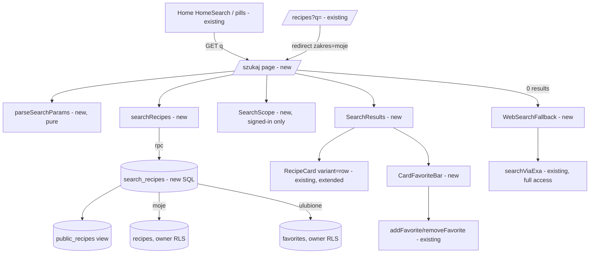

# E01-S05 — One search: results page with scope (All / Mine / Favorites)

> Issue: #208 · Epic: #201 · Backlog: `.ai/specs/backlog-przebudowa.md` (E01-S05, refs C2/A3) · Depends on: S01 (tokens/primitives), S02 (public access + `public_recipes`), S04 (home search field + `searchPath()` seam), S06 (favorites table), S11 (`getFullAccess`). All live on master.

## 📝 TLDR

Today a search lands on the owner-only `/recipes?q=`. A guest who searches from the home, or taps a "Często szukane" pill, is bounced to `/login`. A signed-in user only ever searches their own list, and the search filters in JS over every recipe they have, with the full `ingredients` JSON, on each keystroke. **Proposed:** one public results page, `/szukaj?q=`. It shows the field with "× Wyczyść", the count "N przepisów dla „q”", row cards (96 px thumbnail, 20 px title, "Kategoria · czas", source, favorites bar) and "Pokaż kolejne 14". A signed-in user also gets a "Szukaj w:" segment: Wszystkie / Moje / Ulubione. An empty result offers "Szukaj „q” w internecie". Matching moves into the database: one `search_recipes` RPC over title and ingredient names, with a pg_trgm GIN index. The home's `searchPath()` seam is repointed at `/szukaj`, and `/recipes?q=` redirects there with the Mine scope, so there is one search.

## 📝 Problem Statement

- **Guests cannot search.** The epic promises that a guest browses *and searches* ("gość przegląda i szuka"). S04 shipped the home search field against an interim target, assumption A1, which leaves that promise broken.
- **There is no way to search everyone's recipes, or only the favorites.** `/recipes` is "Moje przepisy" only.
- **The search does not scale.** `/recipes?q=` selects every row of the user with `ingredients` jsonb and filters in JS (`matchesQuery`). The debounced field pushes a navigation every 300 ms while typing. The #225 performance review asked for this to move into the database (comment on #208).
- **Readability.** The current field is 40 px tall with a 14 px grey placeholder and a 16 px unlabelled "×" icon, which breaks the E01 rules (48 px targets, labelled icons, 19 px body text).

## 📝 Proposed Solution

1. A new public route **`/szukaj`** (server component). Its params are `q` (the query), `zakres` (`wszystkie` | `moje` | `ulubione`) and `strona` (1…10, the "show more" depth).
2. A new **`public.search_recipes(p_query, p_scope, p_limit)`** RPC (plpgsql, `security invoker`). It splits the query into words, matches every word against the lower-cased title + ingredient names, ranks title hits first and then newest, and returns the page rows plus a `total_count`. Mine and Favorites scope through the caller's own RLS-visible rows. A guest asking for them gets nothing.
3. A pg_trgm **GIN expression index** on `recipes`. It is built over the same immutable `recipe_search_text(title, ingredients)` function the RPC filters on.
4. **The home search field becomes *the* search field.** `HomeSearch` gains an optional current query, a scope (a hidden field) and the "× Wyczyść" link. `/szukaj` and "Moje przepisy" both use it, and the debounced `RecipeSearch` is deleted.
5. **Seams.** `SEARCH_PATH = '/szukaj'` and `searchPath(q, scope?)` in `routes.ts`. `/szukaj` joins `isPublicRoute`. `szukaj` joins `LIST_KEYS`, so the recipe page shows "← Wyniki wyszukiwania" with prev/next.

Alternatives considered:
- *PostgREST filters on `public_recipes` (`title.ilike`) with no migration.* Lost: PostgREST cannot ILIKE a jsonb column, so ingredient search would be lost. That is today's main use ("co z ziemniaków"). It also cannot express "every word matches".
- *A stored generated `search_text` column on `recipes`, exposed on the view.* Lost: it needs a view change (S07 just appended columns, and S16 may too) plus a backfill, for no gain over an expression index. The RPC also keeps the count, the scope and the paging in one round trip.
- *Full-text search (`tsvector`, `polish` config).* Lost: Supabase ships no Polish dictionary/stemmer, and `simple` FTS loses the substring matches users rely on ("pomidor" → "pomidorowa"). Trigram ILIKE keeps today's substring semantics.
- *Infinite scroll.* Rejected by the AC ("bez infinite scroll"). Older users lose their place, and the footer becomes unreachable.

## 📝 Architecture

- **Route:** `src/app/szukaj/page.tsx` (server) + `src/app/szukaj/layout.tsx` (renders `AppHeader` like `/przepisy`) + `error.tsx` (the shared `RouteErrorFallback`). It reads `getCurrentUser()`, parses the params with `parseSearchParams` (pure), calls `searchRecipes()`, and for a signed-in user loads which result ids are favorites (one `favorites … in (ids)` query).
- **New lib:** `src/lib/search.ts`, pure and unit-tested:
  - `parseSearchParams(raw, isAuthenticated)` → `{ q, scope, page }`. It trims and caps the query at 100 chars; a guest is always `all`; `strona` is clamped to 1…10.
  - `SEARCH_PAGE_SIZE = 14`
  - `searchResultsLabel(n, q)` → "1 przepis dla „q”" / "3 przepisy …" / "5 przepisów …", reusing `recipesNoun`
  - `searchRecipes(supabase, { q, scope, page })` → `{ rows, total } | { error }`, which calls the RPC with `p_limit = 14 * page`
  - `webSearchUrl(q)`
- **Components** (`src/app/components/search/`):
  - `search-scope.tsx`: the "Szukaj w:" segment. Three `<Link>`s styled as a segmented control, `aria-current="page"` on the active one, active `bg-[#111827]` with white text, the rest `text-ink` with a 2 px border. A guest does not get it.
  - `search-results.tsx`: the count (`role="status"`), a `<ol>` of row cards and the "Pokaż kolejne 14" link.
  - `card-favorite-bar.tsx` (client): the favorites bar under each card. A signed-in user gets an optimistic toggle via the existing `addFavorite` / `removeFavorite`. A guest gets a link to `loginPath(favoriteReturnPath(slug))`, the S06 return flow.
  - `web-search-fallback.tsx` (client): the empty state. "Nie ma tego, czego szukasz?" plus a button "Szukaj „q” w internecie". A user with full access gets the existing `searchViaExa` and `ExaResultsPanel`, the latter exported from `add-recipe-form.tsx` and unchanged, so the "Zapisz" action keeps working. Anyone else gets a link to a regular web search (A4).
- **Reused:**
  - `RecipeCard` gains `variant: 'tile' | 'row'` (default `tile`, so existing callers are unchanged) and an optional `meta` line. The `row` variant puts the 96 px thumbnail on the left and the 20 px title, "Kategoria · czas" and source on the right. The favorites bar sits *outside* the link, because a button cannot nest in an anchor.
  - `RecipeListSnapshot` (`listKey="szukaj"`), `recipesNoun`, `formatMinutes`, `getFullAccess`, `HomeSearch`.
- **Changed seams:**
  - `routes.ts`: `SEARCH_PATH = '/szukaj'`; `searchPath(q, scope?)` omits `zakres` for `all`; `isPublicRoute('/szukaj')`.
  - `recipe-list-context.ts`: `LIST_KEYS` += `'szukaj'`.
- **`/recipes`:**
  - `?q=` → `redirect(searchPath(q, 'moje'))`. This keeps bookmarks working and makes it one search.
  - `matchesQuery` and the jsonb select branch are removed.
  - Its field becomes `HomeSearch` with scope `moje`.
- **Home:** no edit beyond the seam. `HomeSearch` already submits to `SEARCH_PATH`, and the popular pills already call `searchPath(term)`.

Takeaway: one route, one RPC, and every entry point reaches it through the `searchPath()` seam. The card and the favorite actions are reused, not forked.

## 📝 Data Model

Migration `supabase/migrations/20261017160000_search_recipes.sql`. It is additive and idempotent, and **owner-applied (not applied by this story)**.

- `public.recipe_search_text(p_title text, p_ingredients jsonb) returns text`, `language sql immutable parallel safe`. It returns `lower(title || ' ' || ingredient names joined by ' ')`. Only array elements that are objects with a string `name` count, so a non-array or malformed `ingredients` contributes `''`.
- `create index if not exists recipes_search_text_trgm_idx on public.recipes using gin (public.recipe_search_text(title, ingredients) gin_trgm_ops)`. `pg_trgm` is already enabled (init migration).
- `public.search_recipes(p_query text, p_scope text default 'all', p_limit int default 14)`:
  - Returns `table(id, slug, title, image_url, category, description, source_type, source_url, source_author, total_time_minutes, prep_time_minutes, cook_time_minutes, created_at, total_count bigint)`.
  - `language plpgsql stable security invoker set search_path = ''`.
  - **Words:** the query is lower-cased and split on whitespace, keeping up to 5 words of up to 50 chars each. `\`, `%` and `_` are escaped, and each word becomes `%word%`. An empty query returns no rows.
  - **Scope:** the scope is validated (`all` | `mine` | `fav`, else an exception, `22023`).
    - `all` reads `public.public_recipes`.
    - `mine` and `fav` return nothing when `public.current_user_id()` is null.
    - `mine` adds `exists (recipes r where r.id = v.id and r.user_id = current_user_id())`. Recipes RLS is owner-only, so this also holds by RLS.
    - `fav` adds `exists (favorites f where f.recipe_id = v.id and f.user_id = current_user_id())`.
    - Each scope is its own `return query` statement, so `anon` never touches `favorites`, which it has no grant on. Postgres checks table privileges per executed statement.
  - **Filter:** `recipe_search_text(v.title, v.ingredients) like v_patterns[1] and … like all (v_patterns)`. The first, indexable predicate lets the planner use the trigram index; the second enforces every word.
  - **Order:** title hits first (`lower(title) like all(patterns)`), then `created_at desc, id desc`. `total_count` is `count(*) over ()`.
  - `p_limit` is clamped to 1…140, so a hand-edited `strona` cannot dump the table.
- Grants: `revoke all on function … from public; grant execute … to anon, authenticated`. `recipe_search_text` stays executable by default; it is pure.
- **No view change, no new table, no data change.** Rollback: `drop function public.search_recipes(text, text, int); drop index public.recipes_search_text_trgm_idx; drop function public.recipe_search_text(text, jsonb);`.
- **Rehearsal:** `.ai/qa/s05-rehearse-search-recipes.sql` runs `begin; <migration>; <assertions as anon / as a user>; rollback;` against production through the Management API. It checks:
  - anon `all` finds rows
  - anon `mine` and `fav` return 0 rows without error
  - a user's `mine` only returns their own rows
  - `fav` only returns their favorites
  - `%` and `_` in the query are literal
  - an ingredient-only match is found
  - the index exists

## 📝 API Contracts

- **RPC** `search_recipes(p_query text, p_scope text, p_limit int)` as above. It is called only from `searchRecipes()` in `src/lib/search.ts`, and `supabase.types.ts` gains its signature (hand-added in the same shape `supabase gen types` emits).
- **URL contract** `/szukaj?q={query}&zakres={wszystkie|moje|ulubione}&strona={n}`. All params are optional. An unknown `zakres` falls back to `wszystkie`, and an out-of-range `strona` is clamped. `searchPath(q, scope)` is the only builder. It omits `zakres` for `wszystkie` and `strona` for 1, so links stay short and canonical.
- **Redirect:** `/recipes?q=x[&category&tag]` → `/szukaj?q=x&zakres=moje` (307). The category and tag filters are dropped (A6).

## 📝 UI/UX

Mobile-first (375 px), inside `PageContainer`. The copy is Polish, exactly as below. Prototype: `.ai/specs/assets/e01-s05-search/mockup.html`.

1. **H1** "Szukaj przepisu" (28 px, `text-ink`). It is visually first, so the screen states what it is even before any query.
2. **Field.** `HomeSearch` with `defaultValue = q`, the label "Szukaj przepisu po nazwie lub składniku", a 60 px input, the mic and the "Szukaj przepisu" submit. A hidden `zakres` input carries the current scope. With a non-empty `q`, a **"× Wyczyść"** link sits under the field, right-aligned. It is 48 px tall, underlined, `text-ink`, has an `X` icon *plus* the text, and goes to `searchPath('', scope)`. The search page keeps the scope, focuses the field (`autoFocus` only when `q` is empty) and shows no results.
3. **"Szukaj w:"** (signed-in only). A 16 px `text-ink-soft` label followed by a three-part segmented control, full width, each segment at least 48 px tall and 18 px bold:
   - The labels are "Wszystkich", "Moich" and "Ulubionych", following the backlog wording; the label reads "Szukaj w: Wszystkich".
   - The active segment is `bg-[#111827] text-white` with `aria-current="page"`; the others are white `text-ink` with a 2 px `border-border-card-2`.
   - Each segment is a `<Link>` to `searchPath(q, scope)`, which resets `strona`.
   - A guest does not see it.
4. **Count.** "**N przepisów dla „q”**" (19 px, `text-ink`, the number bold), in a `role="status"` paragraph so a screen-reader user hears the result after a scope switch. It is hidden when `q` is empty. Plurals: 1 przepis / 2–4 przepisy (except 12–14) / 5+ przepisów.
5. **Results.** An `<ol>` with an 8 px gap between items. Each item is the **row card**:
   - The whole top part is one link to `recipePath(slug, { from: 'szukaj' })`.
   - A 96×96 thumbnail, `rounded-field`, `object-cover`, `alt=""` because the title is right beside it. A missing image gets the accent placeholder.
   - On the right: the title, 20 px bold `text-ink`, line-clamped to 3; "Kategoria · czas", 16 px `text-ink-soft`, e.g. "Zupy · 45 min", with the time omitted when unknown; and the source, 16 px `text-ink-soft`, from `sourceLabel()`, never a login.
   - Below, the **favorites bar** spans the card's full width, outside the link, with a 1 px `border-border-card` top:
     - signed-in, not a favorite: an outline heart + "Dodaj do ulubionych" button, 48 px tall, `text-action-text`, `aria-pressed="false"`
     - a favorite: a filled heart + "W ulubionych", `aria-pressed="true"`
     - a guest: a link "Dodaj do ulubionych" → login → back to the recipe with `?fav=1`
     - an error rolls back and shows "Nie udało się zapisać. Spróbuj ponownie." (`role="alert"`)
   - In the Favorites scope, un-favoriting leaves the card in place, with the button back to "Dodaj do ulubionych". It does not vanish from under the finger; it drops out on the next search.
6. **"Pokaż kolejne 14".** It is shown when `total > rows.length`. It is a full-width outline button link (`buttonClasses('secondary','lg')`, 56 px) to `searchPath(q, scope, page + 1)` with `#wynik-{rows.length + 1}`, so the browser scrolls to the first new card. Each `<li>` has `id="wynik-{n}"`. On the last page it is replaced by nothing; the count already says how many there are. The button reads "Pokaż kolejne {min(14, remaining)}". Past `strona` 10 (140 rows) it is not offered (A5).
7. **Empty result.** In place of the list:
   - H2 "Nie ma tego, czego szukasz?"
   - the copy "Żaden przepis nie pasuje do „q”. Sprawdź pisownię albo poszukaj w internecie."
   - a primary button "Szukaj „q” w internecie" (`buttonClasses('primary','lg')`, full width, with a `Globe` icon and text)
   - When the user has full access, it runs `searchViaExa(q)` in place. The button shows "Szukam…" with `aria-busy`, then renders `ExaResultsPanel` with the existing "Zapisz" action.
   - Otherwise, a guest or a user without full access gets a link that opens `webSearchUrl(q)` (`https://www.google.com/search?q=przepis+{q}`) in a new tab. It carries `rel="noopener noreferrer"` and the visible suffix "(otworzy się w nowej karcie)".
8. **No query** (`/szukaj`): the H1, the field (autofocus), the scope for signed-in users and the hint "Wpisz nazwę dania albo składnik, np. „pierogi” albo „cukinia”." There is no list and no count.
9. `<title>` is "„q” — Szukaj · ZapiszPrzepis", or "Szukaj · ZapiszPrzepis" with no query. `robots: noindex` keeps search pages out of indexes.

**Accessibility:**
- one H1
- the count is a polite live status
- scope links use `aria-current`
- every icon has text beside it
- focus rings come from `globals.css`
- at 320 px nothing scrolls horizontally: the segment labels fit at 18 px in thirds of 288 px, wrapping to two lines if text is scaled up, with no fixed heights
- the row card's title link is the card's single tab stop; the favorites button is the second

## 📝 Edge Cases & Failure Scenarios

- **A guest opens `?zakres=moje` or `ulubione`** (a shared link): this is treated as `wszystkie`, and no segment is shown. There is no login bounce, because the page is public.
- **`q` is only punctuation or wildcards** (`%`, `_`, `\`): these are escaped and matched literally, so the result is usually empty. A query that is whitespace only counts as empty.
- **A very long `q`:** it is cut to 100 chars in `parseSearchParams`; the RPC keeps 5 words of up to 50 chars each.
- **The RPC errors** (migration not applied yet, or the DB is down): the error is logged, and the page shows "Wyszukiwanie chwilowo nie działa. Spróbuj za chwilę." (`role="alert"`) under the field. There is no 500 and no web-search fallback. **The migration must be applied before the implementation deploys** (it is additive, so applying it early is safe).
- **A favorite toggle while signed out in another tab:** the action returns `unauthenticated`, and the bar rolls back with the error.
- **Scope switch with a stale `strona`:** the segment links drop `strona`, so the user returns to page 1.
- **The Exa fallback without full access:** `searchViaExa` returns `no_access`. This is not reachable from the UI (the link variant is rendered instead), but the panel shows the generic error if it happens.
- **A recipe deleted between search and click:** the recipe page 404s as today.
- **A++ text scale (1.3×):** the row card's text column wraps, and the thumbnail stays 96 px with `shrink-0`.

## 📝 Risks & Impact Review

- **Deploy order (medium).** The page depends on an unapplied RPC. Applying the migration first is safe, because nothing else references the new objects. Deploying first would show the "chwilowo nie działa" alert on every search. *Mitigation:* the PR body and hand-off state the migration-first order. The rehearsal proves the migration applies cleanly on production data, rolled back.
- **The "Moje przepisy" search loses category/tag + query combinations** (A6). *Mitigation:* the scope segment and the Mine results cover the common case. S16 owns the richer category listing.
- **Index cost:** one GIN trigram index over a few hundred rows is negligible on write. `recipe_search_text` is immutable, so a future change to the ingredient shape needs a reindex (noted in the function comment).
- **Diacritics:** "zurek" does not find "żurek". `unaccent` is not immutable, so it cannot back the index without a wrapper, and it is out of scope here (Non-goal; follow-up if users ask).
- **S06/S16 overlap:** S06 owns favorites semantics, and this story only reuses its actions. S16 (category tags) touches `/przepisy` and possibly `recipe-card.tsx`. The `variant` prop is additive, so callers merge cleanly.
- **Security:** the RPC is `security invoker`, so the caller's RLS applies. The `all` scope reads the same guest-safe view the home already reads, and no new column is exposed.

## 📋 Non-goals

- Search ranking beyond "title hit first, then newest" (no trigram similarity score, no typo tolerance).
- Diacritic-insensitive matching (`unaccent`).
- Category or tag filters on `/szukaj` (S16).
- Search analytics, or data-driven "Często szukane" (S04 A6 stays curated).
- Desktop layout beyond a sane `max-w` (S17).

## 📋 Phasing

- **Phase 1: database.** The migration, the rolled-back rehearsal and the types. Nothing user-visible.
- **Phase 2: search lib + seams.** `src/lib/search.ts`, `routes.ts` and `LIST_KEYS`, with unit tests.
- **Phase 3: the `/szukaj` page.** The route, the scope, the results, the row card, the favorites bar and the web fallback. Verified on the dev server.
- **Phase 4: one search.** `/recipes?q=` redirect, `HomeSearch` on "Moje przepisy", `RecipeSearch` removed.

## 📋 Implementation Plan

The unit runner is node-only (no DOM), so components are verified on the dev server. Their logic lives in pure helpers, which are unit-tested.

### Phase 1 — database
1. `supabase/migrations/20261017160000_search_recipes.sql` as in Data Model, with a header comment covering rollback and ordering: independent of S11's `20261017140000` and S07's `20261017150000`, and it touches no view.
2. `.ai/qa/s05-rehearse-search-recipes.sql` is the rolled-back rehearsal. Run it against production via the Management API (`begin … rollback`), never applied. Record the results in the PR.
3. `src/lib/supabase.types.ts`: add `search_recipes` under `Functions`.

### Phase 2 — lib and seams
4. `src/lib/routes.ts`:
   - `SEARCH_PATH = '/szukaj'`
   - `SearchScope = 'wszystkie' | 'moje' | 'ulubione'`
   - `searchPath(q, scope = 'wszystkie', page = 1)`
   - `isPublicRoute` covers `/szukaj`
   - Test: `routes.test.ts` covers encoding, the default scope omitted, page 1 omitted and `/szukaj` public.
5. `src/lib/recipe-list-context.ts`: add `'szukaj'` to `LIST_KEYS`. Test: `parseListKey('szukaj')`.
6. `src/lib/search.ts`:
   - `parseSearchParams`, `SEARCH_PAGE_SIZE`, `searchResultsLabel`, `webSearchUrl`, `toRpcScope`
   - `searchRecipes(supabase, …)`, which maps the RPC rows and `total_count` and returns `{ error }` on failure
   - Test: `src/lib/search.test.ts`, with a mocked `rpc`, covering the guest scope forced to all, clamping, plurals (1/2/5/12/22) and the error path.

### Phase 3 — `/szukaj`
7. `src/app/components/recipe-card.tsx`: add `variant` and `meta`, with `tile` unchanged. Verify `/`, `/recipes` and `/ulubione` are unchanged.
8. `src/app/components/search/search-scope.tsx`, `search-results.tsx`, `card-favorite-bar.tsx` and `web-search-fallback.tsx`. Export `ExaResultsPanel` from `add-recipe-form.tsx`, otherwise unchanged.
9. `src/app/components/home/home-search.tsx`: optional `defaultValue`, `scope` (a hidden input when not `wszystkie`), `autoFocus`, and the "× Wyczyść" link when `defaultValue` is set. The home call sites are unchanged.
10. `src/app/szukaj/{page,layout,error}.tsx`. Verify on the dev server at 375 px and 320 px:
    - guest: results, empty → Google link, `?zakres=moje` ignored
    - signed-in: scope switch, favorite toggle, "Pokaż kolejne 14"
    - `pnpm typecheck && pnpm lint && pnpm test`

### Phase 4 — one search
11. `src/app/(authenticated)/recipes/page.tsx`: `q` → `redirect(searchPath(q, 'moje'))`; remove `matchesQuery` and the jsonb branch. `recipes-content.tsx`: use `HomeSearch` with `scope="moje"` in place of `RecipeSearch`, and drop the search-specific empty copy. Delete `src/app/components/recipe-search.tsx`.
12. Grep for leftovers: `'/recipes?q'`, `RecipeSearch`, `matchesQuery`. Final gate plus a dev-server pass across `/`, `/szukaj` and `/recipes`.

## Resolved assumptions (autonomous defaults)

| # | Question | Default chosen | Rationale |
|---|----------|----------------|-----------|
| A1 | How does matching work? | A trigram ILIKE over the lower-cased title + ingredient names; every word must match; title hits are ranked first, then newest. | It keeps today's substring semantics (`matchesQuery`) and moves them into the DB as the issue asks. FTS has no Polish stemmer on Supabase. |
| A2 | What does "Moje" mean? | Recipes whose `user_id` is me, i.e. those I added first (CLAUDE.md model). | It matches `/recipes` and the global-dedup model (S03a). |
| A3 | Can a guest open the Mine/Favorites scope by URL? | No: it silently falls back to All, and the segment is hidden. | The AC hides the segment for guests. A public link should never bounce to login. |
| A4 | What is the web fallback for guests and users without full access? Exa is paid and full-access only (S11). | Full access: in-page Exa results with "Zapisz". Otherwise: a Google search link (`przepis {q}`) in a new tab. | It reuses the existing Exa path without opening a paid API to guests, and still answers "Szukaj „q” w internecie" for everyone. |
| A5 | How is "Pokaż kolejne 14" paged? | A server-rendered link `strona=n+1` that re-renders with `limit 14·n` and jumps to `#wynik-{first new}`. It is capped at 10 pages (140). | It works without JS, survives back/refresh, and has no infinite scroll. One cheap query per click. |
| A6 | What happens to search on "Moje przepisy" (`/recipes?q=`)? | It redirects to `/szukaj?q=&zakres=moje`, and its field submits there. Category/tag + query combinations are dropped. | "One search" (the issue title). It removes the JS filter flagged in #225. |
| A7 | What do the scope labels say? | "Szukaj w:" + "Wszystkich / Moich / Ulubionych"; URL values `wszystkie / moje / ulubione`. | The backlog wording; Polish URLs like `/szukaj`, `/przepis`. |
| A8 | Is there a favorites bar on result cards, given S06 Q1 put the heart only on the recipe page? | Yes. A compact bar (48 px) reusing `addFavorite`/`removeFavorite`, with the guest login-return link. | The S05 AC lists "pasek ulubionych". S06 Q1 deferred the card bar to the S04/S05 card redesign. |
| A9 | Does the `category-filter.tsx` named in the issue scope change? | No change. `/szukaj` has no category filter (Non-goal, S16). | The AC has no category control on the results page. |
