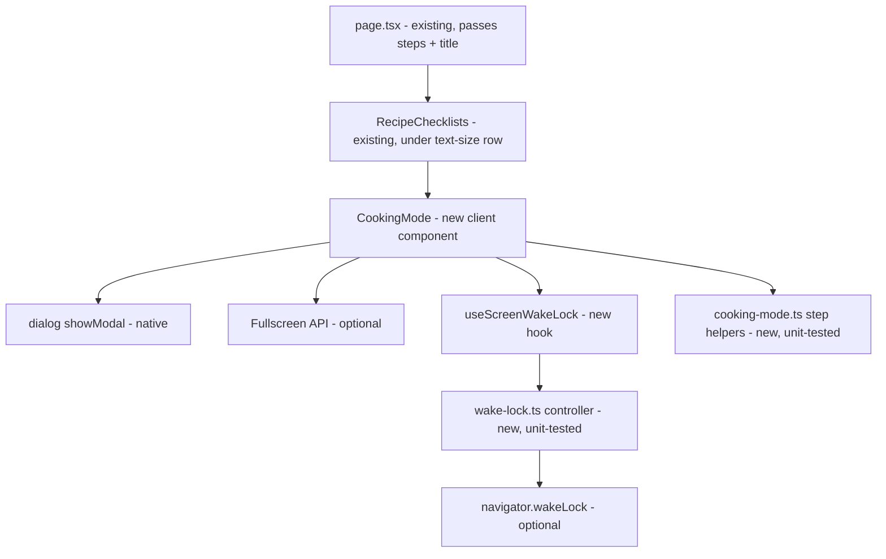

# E01-S08 — Cooking mode (fullscreen, Wake Lock)

> Issue: #211 · Epic: #201 · Backlog: `.ai/specs/backlog-przebudowa.md` (E01-S08, screen C4) · Depends on: S01 (tokens, `Button` `xl` = 72 px), S07 (recipe page, the reserved slot in `recipe-actions.tsx`). Both are live in production.

## 📝 TLDR

Today the recipe page lists every step at once, and the phone screen goes dark while the user's hands are busy with dough. **Proposed:** a "Tryb gotowania" button on the recipe page opens a dark (`#111827`) screen that shows one step at a time. It has a segmented progress bar, "Krok N z M", 30 px step text, 72 px "← Wstecz" / "Dalej →" buttons and "× Zakończ". While it is open the app asks the browser to keep the screen on (`navigator.wakeLock.request('screen')`), takes the lock again after the tab returns to the foreground, and releases it on exit. It also asks for real fullscreen. Both APIs are optional: where either is missing the mode still works as a full-viewport overlay. Client-only. No schema change, no new route, no server code.

## 📝 Problem Statement

People cook with the recipe open on a phone or tablet propped on the counter. Two things break that today:

1. **The screen sleeps.** After 30 s to 2 min the device dims and locks, and unlocking with floury or wet hands is exactly what the user cannot do.
2. **The page is dense for this situation.** Steps are 19 px in a long list, with the header, the heart, the video and the similar recipes around them. Reading from an arm's length away, especially for older users (CLAUDE.md's audience), needs one big step at a time and big targets.

## 📝 Proposed Solution

A client component **`CookingMode`** rendered by `RecipeChecklists`, directly under the text-size row (C3 item 7; S07 had reserved a slot in `RecipeActions`, but the handoff places the entry under "Wielkość tekstu"). It renders:

- **The entry button** "Tryb gotowania" (with an icon and a visible label, full-width 58 px on `bg-ink`, see UI/UX), shown only when the recipe has at least one step.
- **The cooking screen**: a native `<dialog>` opened with `showModal()`, the pattern `AppMenu` (S09) already uses. `showModal()` puts it in the top layer and makes the page behind it inert. It also traps focus, closes on Escape and returns focus to the trigger, with no hand-written focus code. The dialog fills the viewport (`fixed inset-0`, `100dvh`) on `bg-surface-dark`.

Opening the mode, from the same click (the user gesture both APIs need):

1. `dialog.showModal()`.
2. **Fullscreen (best effort):** `document.documentElement.requestFullscreen({ navigationUI: 'hide' })` when `document.fullscreenEnabled` is true. A rejection, or no API (iPhone Safari has no element fullscreen), is ignored. The overlay already covers the viewport, so the screen looks the same apart from the browser's own bars.
3. **Wake Lock (best effort):** `navigator.wakeLock.request('screen')` when `'wakeLock' in navigator`. The browser drops the sentinel when the page is hidden, so on `visibilitychange` → `visible`, while the mode is still open, the lock is requested again. A rejection (battery saver, a permissions policy, no secure context) is ignored, and the user is told once on the screen (see UI/UX).

Closing ("× Zakończ", Escape, "Gotowe" on the last step, or the system Back gesture): release the sentinel, remove the `visibilitychange` listener, `document.exitFullscreen()` when `document.fullscreenElement` is set, and `dialog.close()`. The user is back on the recipe page with focus on the "Tryb gotowania" button.

**Wake-lock util:** `src/lib/wake-lock.ts` is a framework-free controller, `createScreenWakeLock(env)`, with `acquire()`, `release()` and `isSupported`. It owns the re-acquire-on-visible rule and is unit-tested with a fake `navigator`/`document`. A thin React hook `useScreenWakeLock(active)` in `src/app/przepis/[slug]/_components/` wires it to the mode's open state and releases it on unmount.

Alternatives considered:
- *A separate route `/przepis/{slug}/gotowanie`.* Lost: the Fullscreen request must come from a user gesture, and a client navigation can outlive the transient activation window, so fullscreen would fail at random. A second server fetch of the same steps, a second layout without the AppShell header and a second canonical URL add cost for no user gain. The overlay keeps the recipe page underneath, so exit is instant and lands at the same scroll position.
- *A hand-rolled `div role="dialog"` with a focus trap.* Lost: `<dialog>` + `showModal()` already does it, and the codebase uses it (`AppMenu`).
- *The NoSleep.js video trick for browsers without Wake Lock.* Lost: it plays a hidden looping video, which drains battery and can start audio focus on some phones. Wake Lock covers Chrome/Edge/Samsung Internet (84+), Safari 16.4+ and Firefox 126+. On older browsers the mode works and the screen may still dim.

## 📝 Architecture

- **New:** `src/lib/wake-lock.ts` (+ `wake-lock.test.ts`) — `createScreenWakeLock({ navigator, document })`:
  - `isSupported` — `'wakeLock' in navigator`;
  - `acquire()` — marks the lock *wanted*, requests a sentinel when the page is visible and none is held, starts listening to `visibilitychange`, and never throws (a rejection resolves to `false`);
  - `release()` — marks it *not wanted*, releases the sentinel, stops listening. Idempotent;
  - on `visibilitychange` → `visible` while wanted and not held, it requests again. A sentinel's own `release` event (the system dropped it) clears the held reference, so the next `visible` takes it again.
- **New:** `src/lib/cooking-mode.ts` (+ test) — pure step navigation: `clampStep(index, total)`, `stepLabel(index, total)` → "Krok N z M", `isLastStep`, and `progressSegments(index, total)` → done/current/todo per segment.
- **New:** `src/app/przepis/[slug]/_components/cooking-mode.tsx` (`'use client'`) — entry button + `<dialog>`, fullscreen calls, keyboard (`←`/`→`), and the hook `useScreenWakeLock`.
- **Edited (minimal):** `recipe-checklists.tsx` renders `<CookingMode title steps />` under the text-size row (new `title` prop). `page.tsx` passes `title`. `recipe-actions.tsx` drops the S07 placeholder comment. `globals.css` gets one token, `--color-border-dark: #6b7280`. S06's heart, S14's author line and S16's "Podobne" are untouched.
- **Reused:** `parseSteps` (already run by the page), tokens `bg-ink`, `bg-surface-dark`, `bg-progress`, `text-accent-dark`, `bg-orange-bright` (only with dark text), the global `:focus-visible` rule.

Takeaway: one new client island under the text-size row of `RecipeChecklists`. Every browser API is behind a support check, and the pure logic is unit-tested outside React.

## 📝 Data Model

None. No schema change, no migration, no new query, no write. The steps are the `steps` array the page already parses. The current step lives in React state only, and opening the mode again starts at step 1 (A3).

## 📝 UI/UX

Mockup (pre-handoff draft; the handoff's C4 supersedes its colours and placement): `.ai/specs/assets/e01-s08-cooking-mode/mockup.html` (rendered: `mockup-01-step.png` mid-recipe, `mockup-02-last.png` last step). Current recipe page: `current-01-recipe-actions.png`.

**Design authority:** the owner's handoff `.ai/design/przebudowa-handoff/` (1c), screens C3 item 7 and C4. It reached master after this spec was first written. Where the two differ, the handoff wins. Departures are listed under *Handoff alignment* below.

**Entry** (C3 item 7): directly under "Wielkość tekstu" and above "Składniki", a full-width 58 px button, white on `#111827` (`bg-ink`), with a `ChefHat` icon (`aria-hidden`) + "Tryb gotowania", `aria-haspopup="dialog"`. It is not rendered when the recipe has no steps. `RecipeChecklists` already owns the text-size row, so it renders the button (a new `title` prop), and `RecipeActions` keeps only the heart.

**Cooking screen** (C4; `bg-surface-dark` #111827, white text, no horizontal scroll at 320 px), top to bottom:
1. **Top bar:** the recipe name, 17 px bold `#e5e7eb` (one line, ellipsis), and "× Zakończ", a borderless 56 px button with a 26 px X icon and an 18 px bold label.
2. **Progress:** a segmented bar of M segments, 8 px high with 6 px gaps (`role="progressbar"`, `aria-valuemin=1`, `aria-valuemax=M`, `aria-valuenow=N`, `aria-valuetext="Krok N z M"`, `aria-label="Postęp przepisu"`). Done and current segments are `#fb923c`; the rest are `#374151`. Past 20 steps it becomes one continuous fill (A4). The `#374151` track is below 3:1 against the background, but it is decorative: "Krok N z M" carries the same information as text.
3. **"Krok N z M"**, 22 px bold `#fdba74`.
4. **Step text**: 30 px, weight 600, line-height 1.45, white. It scrolls vertically when a step is long, and the buttons stay pinned. It sits in `aria-live="polite"` together with the step label.
5. **Wake-lock line**, 17 px `#d1d5db`. While the lock is held: ☀ "Ekran nie wygaśnie podczas gotowania" (C4). When it is refused or unsupported: "Ekran może się wygasić — ta przeglądarka nie pozwala go podtrzymać." (A5). Nothing shows before the first answer.
6. **Bottom buttons**, 72 px, in a 1 : 1.4 grid. "← Wstecz" has a 2 px `#6b7280` border (new token `border-dark`, 3.7:1) on the dark background, with white 20 px text and an arrow icon. "Dalej →" is `#ea580c` with **dark** `#111827` 22 px text (5.0:1; this orange never takes white text). On step 1 "Wstecz" is `disabled`. On the last step "Dalej" becomes "Gotowe ✓" and ends the mode.

**Handoff alignment** (what this spec keeps that C4 does not show): the refused-lock line (C4 only shows the "won't dim" promise, which would be false there), "Gotowe ✓" on the last step (C4 shows only the middle state), and the merged bar past 20 steps.

Keyboard: `→` / `←` move between steps (`PageDown`/`PageUp` too, for presentation clickers), Escape ends (native `cancel` on the dialog), Tab cycles inside the dialog. Focus moves to the dialog's heading on open, and returns to the trigger on close. On a touchscreen the buttons are the only navigation: no swipe gesture in this story (A6).

Accessibility (WCAG 2.2 AA, CLAUDE.md): text ≥ 4.5:1 on #111827, UI parts ≥ 3:1, targets ≥ 48 px (the main ones 72 px), visible 3 px focus (the global `#1d4ed8` outline is too dark on #111827 at 2.1:1, so inside the dialog the outline colour is overridden to `#fdba74`, which components may do per the globals.css rule "may override color, not remove it"), every icon has a visible label, `prefers-reduced-motion` respected (the only motion is the progress fill transition, disabled under reduced motion).

## 📝 Edge Cases & Failure Scenarios

- **No steps** → no entry button (nothing to cook through). **One step** → no "Wstecz", "Gotowe ✓" straight away, a single segment.
- **No Wake Lock API** (older Firefox, Safari < 16.4, insecure origin) → the mode works, and the note from UI/UX #6 shows. Tested on a browser without the API (Phase 2 verification).
- **Wake Lock rejected** (`NotAllowedError`: battery saver, permissions policy, page hidden at request time) → same as missing. A later `visibilitychange` → `visible` retries silently, and the note clears if it succeeds.
- **No Fullscreen API / rejected** (iPhone Safari, an iframe without `allowfullscreen`) → overlay only. Nothing is shown to the user, because the screen looks the same.
- **User leaves fullscreen with the browser's own Esc/gesture** → the mode stays open as an overlay. The browser consumes the first Escape, so a second Escape ends the mode. The lock is kept.
- **Tab hidden and shown again** (a phone call, switching apps) → the lock is re-requested on `visible`. Requests while hidden are skipped (they would reject).
- **System Back gesture while the mode is open** (Android): opening pushes one history entry with the same URL, and `popstate` closes the mode instead of leaving the recipe. Every other close path ("× Zakończ", Escape, "Gotowe ✓") goes `history.back()` to consume that entry, so a later Back leaves the page as expected instead of doing nothing. If Next's router turns out to interfere with a same-URL entry, the fallback (decided during implementation, recorded on the PR) is no history entry: Back then leaves the page, which is the current behaviour (A7).
- **Unmount while open** (the page behind the modal is inert, so this only happens on a programmatic navigation or a Back past the history entry) → the hook releases the lock and exits fullscreen in its cleanup.
- **Very long step** (some extracted steps are 600+ characters) → the step area scrolls and the buttons stay put. **Very many steps** (30+) → merged progress fill (A4).

## 📝 Risks & Impact Review

- **Blast radius:** one client island on the recipe page plus a `title` prop pass (`page.tsx` → `RecipeChecklists`). No server, RLS, schema or URL contract. Removing it means deleting the component and restoring the placeholder.
- **Parallel stories:** S06/S14/S16 edited `recipe-header.tsx`, the heart and `similar-recipes.tsx`. This story touches none of them, only `recipe-checklists.tsx` (the entry under the text-size row), the placeholder comment in `recipe-actions.tsx` and the `RecipeChecklists` call in `page.tsx`. S17 (desktop layouts, #275) also edits `recipe-checklists.tsx` and the recipe `page.tsx`, so whichever lands second merges by hand; the entry is a self-contained block and takes no layout assumptions.
- **Battery:** the lock lives only while the dialog is open and is released on every exit path, including unmount. That is the one property tested beyond the happy path.
- **History entry (A7):** the only interaction with Next's router. It is verified in the browser at implementation, with a documented fallback.

## 📋 Phasing

Phase 1 — pure logic: `wake-lock.ts` and `cooking-mode.ts` with unit tests (no visible change).
Phase 2 — the component, the slot wiring, browser verification (with and without Wake Lock / Fullscreen).

## 📋 Implementation Plan

### Phase 1 — pure logic
1. `src/lib/wake-lock.ts` + `src/lib/wake-lock.test.ts`: `createScreenWakeLock`. Tests: unsupported → `acquire()` resolves `false` and never throws; supported → requests `'screen'`; rejection → `false`; re-acquire on `visible` while wanted; no request while hidden; no re-acquire after `release()`; `release()` idempotent and releases the sentinel; a system-released sentinel is re-taken on the next `visible`; listener removed on release.
2. `src/lib/cooking-mode.ts` + `src/lib/cooking-mode.test.ts`: `clampStep`, `stepLabel`, `isLastStep`, `progressSegments` (1 step, many steps, merge threshold, out-of-range indexes).

### Phase 2 — the screen
3. `src/app/przepis/[slug]/_components/cooking-mode.tsx`: the entry button, `<dialog>`, top bar, progress bar, step, buttons, wake-lock note, keyboard, fullscreen enter/exit, a history entry with a `popstate` close (A7), and `useScreenWakeLock`.
4. `recipe-checklists.tsx` (render the entry under the text-size row, new `title` prop), `recipe-actions.tsx` (drop the placeholder comment), `page.tsx` (pass `title`).
5. Verify on the dev server: a guest on a multi-step recipe (open, next/back, last → "Gotowe", Escape, × Zakończ, focus return, Back gesture), a recipe with one step and with none, 320 px width, and a browser **without** Wake Lock / Fullscreen (both APIs deleted via an init script) → mode works and the note shows. Full gate: `pnpm typecheck`, `pnpm lint`, `pnpm test`.

## Resolved assumptions (autonomous defaults)

| # | Question | Default applied | Why |
|---|----------|-----------------|-----|
| A1 | A separate route or an overlay on the recipe page? | **Overlay** (`<dialog>` + `showModal()`). | Fullscreen needs the click's user activation, the steps are already on the page, exit is instant and keeps the scroll position, and the S09 menu uses the same pattern. |
| A2 | Who sees the entry? | Everyone (guest and signed-in) on any recipe with ≥ 1 step. | Reading a recipe is public (S02). Cooking mode only reads. |
| A3 | Remember the current step between openings or sync it with the "Przygotowanie" ticks? | **No.** Every opening starts at step 1, and the ticks are not changed. | Keeps the two features independent and avoids surprising jumps. Resume-where-I-left is a cheap follow-up if users ask. |
| A4 | Segments for very long recipes? | Segments up to 20 steps, then one continuous fill. | Keeps every visible part ≥ a few px wide on a 320 px phone; "Krok N z M" carries the exact count. |
| A5 | Tell the user when the screen cannot be kept on? | Yes, a calm one-line note, only on failure. | Otherwise the screen dims and the user doesn't know why. No error styling, because the mode itself works. |
| A6 | Swipe between steps? | **Not in this story.** Buttons and keys only. | Accidental swipes with wet hands. The 72 px buttons are the reliable path, and swipe can follow if requested. |
| A7 | Should the system Back gesture end cooking mode? | Yes, via one same-URL history entry, verified at implementation, with a documented fallback (no entry) if Next's router interferes. | On Android, Back is the most natural "exit". Leaving the recipe by accident is worse. |
| A8 | Show ingredients inside cooking mode? | **No.** Steps only, per the backlog's C4 screen. | The ingredients remain on the page behind it. An "ingredients" panel is a separate follow-up. |
