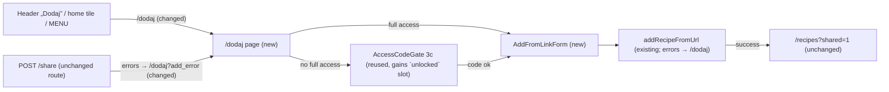

# E01-S10 — Add recipe on a dedicated `/dodaj` page

Issue: #213 · Epic: #201 · Backlog: `.ai/specs/backlog-przebudowa.md` (E01-S10, ref A7) · Design authority: `.ai/design/przebudowa-handoff/README.md` (A7, „Nagłówek (mobile, 1c)”), `designs/Propozycja A.dc.html` · Depends on: E01-S01 (tokens, `Button`), E01-S11 (`getFullAccess`, `AccessCodeGate`)

## 📝 TLDR

A signed-in user adds a recipe today through a small tabbed form ("Dodaj przepis z linku") at the bottom of the home page, reached by `/?tab=add`. **Proposed:** a dedicated `/dodaj` page in the 1c style. It shows a „Z linku” source tile (active) and a greyed „Ze zdjęcia — wkrótce” tile, a labelled „Link do przepisu” field with a „Wklej” (paste) button, a 56 px „Dodaj przepis” button and a three-step "how it works" list. Users without full access get the access-code screen 3c on the same URL. The header „Dodaj” becomes the 1c icon-over-label button. It, the home tile, the MENU entry and every add error now lead to `/dodaj`.

## 📝 Problem Statement

- The add form is tuned for desktop: 14 px text, an unlabelled field (`aria-label` only), a raw `bg-orange-500` button with white text at 2.8:1 contrast, and a tab switch to web search. That breaks the E01 rules (19 px body text, 56 px primary buttons, `#c2410c` action colour, visible labels).
- Adding has no address of its own. The header, the home tile and the MENU all point at `/?tab=add`, a query-param trick that scrolls and focuses a form further down the home. Older users can't bookmark it, and the home grows with every new story.
- Every add error (`?add_error=…` from the action and from the Web Share Target) lands on `/`, so the message appears far from where the user acted.

## 📝 Proposed Solution

A new server-rendered route `src/app/dodaj/` that:

1. **Guest:** isn't on the `isPublicRoute` allowlist, so middleware already sends them to `/login?next=/dodaj`. They come back to `/dodaj` after login (E01-S06 `next` handling). No code is needed.
2. **Signed in, no full access:** renders `AccessCodeGate` (screen 3c), with the notice line when `?add_error=no_access`. When a code is accepted, the gate's success state shows the new `/dodaj` add panel in place of the old home form.
3. **Signed in, full access:** renders the add panel (A7).

`addRecipeFromUrl` stays the single server entry point. Only its error redirect target changes, from `/` to `/dodaj`. The server-side access check (`getFullAccess` + RLS) is unchanged. The page check only decides which screen to show.

**Alternatives considered:**
- *Restyle the home form in place:* keeps the query-param address and leaves the home crowded. Rejected, because the backlog asks for a separate route.
- *Reuse `AddRecipeForm` on `/dodaj`:* it carries the web-search tab, voice input and the Exa panel, which A7 doesn't have, plus non-token styling. A small new client component is cheaper than a mode flag. `AddRecipeForm` stays on the home until a follow-up removes it (see A2).

## 📝 Architecture

Takeaway: one new page and one new form component. Everything else is a changed link or redirect target. Extraction, dedup and access rules are untouched.

- **New:** `src/app/dodaj/layout.tsx` (wraps `AppShell`, like `/szukaj`), `src/app/dodaj/page.tsx` (server: user + `getFullAccess`), `src/app/dodaj/add-from-link-form.tsx` (client), `src/lib/routes.ts` → `ADD_RECIPE_PATH = '/dodaj'` and `addRecipeErrorPath(code)`.
- **Shared helper:** move `firstUrl()` from `src/app/share/route.ts` to `src/lib/extract-url.ts` (`extractFirstUrl`). The share route and the „Wklej” button both use it, so pasted text like "Zobacz to https://…" yields the bare link.
- **Header „Dodaj” (1c):** in `app-header.tsx`, the pre-E01 horizontal pill (`bg-orange-500`, white text at 2.8:1, about 32 px tall) becomes the handoff's stacked button. It's 64×56, `bg-action`, radius 12, with a 24 px plus icon over a 13 px bold „Dodaj” label and `aria-label` „Dodaj przepis”. It shows on every signed-in screen and at every width. Users without full access see it too, and it takes them to `/dodaj`, which shows 3c. The bell's „Powiadomienia” label belongs to S15 (#217), the „MENU” button keeps its S09 form, and the desktop header (A8) belongs to S17 (#219).
- **Changed links:** `home/member-tiles.tsx` (`ADD_RECIPE` and the locked tile), `app-menu-model.ts` (`ADD_RECIPE_HREF`, `ACCESS_GATE_HREF`), all pointing at `ADD_RECIPE_PATH`. The home page's own JSX isn't touched (S15 and S17 are editing it in parallel).
- **Changed redirects:** `add-recipe-action.ts` and `share/route.ts` error targets go from `/?add_error=X` to `/dodaj?add_error=X`. The share route's "not authenticated → `/login`" and every success path stay as they are.
- **`AccessCodeGate`** gains an optional `unlocked?: ReactNode` prop. It defaults to today's `<AddRecipeForm autoFocus />`, so the home keeps working unchanged. `/dodaj` passes `<AddFromLinkForm autoFocus />`.

## 📝 Data Model

None. No migration.

## 📝 API Contracts

- `GET /dodaj[?add_error=empty|invalid_url|server|no_access]`: a page, `robots: noindex`, title „Dodaj przepis · ZapiszPrzepis”. An unknown `add_error` shows the generic server message. The page strips the param after the first render (`stripSearchParam`), as the home does today.
- `addRecipeFromUrl(formData)`: same input (`url`), same success redirects (`/przepis/{slug}?duplicate=1`, `?in_favorites=1`, `/recipes?duplicate=pending`, `/recipes?shared=1`). Only the error redirect target changes to `/dodaj?add_error=…`.
- `POST /share`: same contract for the Web Share Target (`public/manifest.json` unchanged). Only the error redirect target changes to `/dodaj?add_error=…`.

## 📝 UI/UX

Mobile-first, `PageContainer`, tokens only (`bg-action`, `text-ink`, `text-ink-soft`, `border-field`, `rounded-card`, `bg-surface-accent`):

1. **Heading** `h1` „Dodaj przepis” (28–30 px, like `/szukaj`).
2. **Source tiles:** a two-item list labelled „Skąd dodajesz przepis?”. Neither tile is a button, because there's nothing to choose yet. Inventing a toggle with one live option would mislead screen-reader users.
   - „Z linku”: 2 px `border-action` on `bg-surface-accent`, a link icon, caption „Facebook, YouTube, blog”.
   - „Ze zdjęcia”: dashed `border-field`, `bg-surface-3`, a camera icon, caption „Zrzut ekranu lub książka” and a „wkrótce” badge. The word, not only the grey, says it isn't available (WCAG 1.4.1). The text stays `text-ink-soft` (≥ 4.5:1). The tile is *greyed* by its background and border, not by low-contrast text.
3. **Form:** a visible `<label>` „Link do przepisu” (19 px bold), then a 56 px input (`type="text"`, `inputMode="url"`, `autoComplete="off"`, placeholder „https://…”). The server keeps the error wording, so the browser's English URL validation never fires. Next to it, an outline „Wklej” `Button` (48 px, clipboard icon plus visible text).
   - **„Wklej”** calls `navigator.clipboard.readText()`, puts `extractFirstUrl(text) ?? text.trim()` into the field and focuses it. The button is rendered only when `navigator.clipboard?.readText` exists (probed after mount, like the speech probe). If permission is refused or the read fails, a `role="status"` hint appears: „Nie udało się wkleić. Przytrzymaj pole i wybierz »Wklej«.”
   - **„Dodaj przepis”** is a full-width primary `Button` (56 px, `bg-action`). While pending it's disabled with the label „Dodaję…”.
   - **Errors:** a `role="alert"` paragraph (17 px bold `text-danger`), linked to the input by `aria-describedby`, with `aria-invalid` and a `border-danger` frame. Messages are the existing `ADD_ERROR_MESSAGES` wording, except `empty` → „Wklej link do przepisu.” (this page has no name search).
4. **„Jak to działa”:** an `h2` and an `<ol>` of three 19 px steps, worded as in the handoff:
   1. „Wklejasz link, my spisujemy przepis po polsku.”
   2. „Trwa to 1–3 minuty. Możesz zamknąć stronę.”
   3. „Gotowy przepis pojawi się w „Moje przepisy”, a dzwonek da znać o problemie.”

   Below the list, a 16 px hint: „Na telefonie możesz też użyć „Udostępnij → ZapiszPrzepis” prosto z Facebooka lub YouTube.”
5. **No full access:** the existing 3c `AccessCodeGate` under the same `h1`. After a successful code, the success status line and `AddFromLinkForm` with focus in the link field.

Focus: the global `3px #1d4ed8` outline. No horizontal scroll at 320 px: the field and „Wklej” stack below `sm`.

Prototype: `.ai/design/przebudowa-handoff/designs/Propozycja A.dc.html` (A7) is the design authority; `.ai/specs/assets/e01-s10-add-page/mockup.html` is this spec's earlier static sketch.

## 📝 Edge Cases & Failure Scenarios

- **Clipboard holds no URL:** the raw trimmed text goes into the field. On submit the server answers `invalid_url` and the alert shows on `/dodaj`.
- **Clipboard API missing (older Safari/Firefox, insecure origin):** no „Wklej” button. Long-press paste still works and step 2 still reads correctly.
- **Link already in the catalogue:** unchanged dedup. The user's own recipe → recipe page `?duplicate=1`. Someone else's → favorites `?in_favorites=1`, which works even without full access, as today.
- **Access revoked between render and submit:** the action's `getFullAccess` → `/dodaj?add_error=no_access` → the page re-checks and shows 3c with the notice. RLS refuses the insert regardless.
- **`has_full_access()` RPC fails:** `getFullAccess` fails closed, so 3c is shown. The user can't add, and nothing leaks.
- **Old `/?tab=add` bookmarks:** still focus the home form, which stays for now (A2).
- **Share Target, signed out:** `/login` as today. Signed in without access: `/dodaj?add_error=no_access` shows 3c with the notice.

## 📝 Risks & Impact Review

- Low blast radius: no schema, no new dependency, no public API change. The Share Target contract (`manifest.json`, `POST /share`) is unchanged. Only its error landing page moves.
- Tests that assert `/?add_error=…` (`add-recipe-action.test.ts`, `share/route.test.ts`) must be updated in the same commit.
- Rollback: revert the PR. The links and redirects go back to `/`, and `/dodaj` disappears (a guest would see 404, a signed-in user the home).
- Coordination: S15 (#217) and S17 (#219) edit `page.tsx` and `app-header.tsx`. In `app-header.tsx` this story changes only the „Dodaj” link (href and styling), and it changes nothing in `page.tsx`.

## Resolved assumptions (autonomous defaults)

| # | Question | Default | Rationale |
|---|---|---|---|
| A1 | Where do add errors land? | Always `/dodaj?add_error=…`, from both the action and `/share`. | One place shows add errors next to the form. No caller-supplied `return_to` (no open-redirect surface to validate). |
| A2 | Remove the add form from the home now? | No. Keep the home `AddRecipeForm` / 3c section. Only links change. Removal is a follow-up once S15/S17 land. | S15 and S17 are editing `page.tsx` in parallel, and the brief limits home edits to links. Fully reversible. |
| A3 | Are the source tiles interactive? | No. Two static status tiles; „wkrótce” marks the unavailable one in words. | One live option. A fake toggle adds ARIA surface for no function. The photo path is a backlog non-goal. |
| A4 | When is „Wklej” shown? | Only when `navigator.clipboard.readText` exists, with a status hint when it fails. | Never show a button that can't work. Long-press paste stays the fallback. |
| A5 | What goes into the field on paste? | The first http(s) URL in the clipboard text, else the trimmed text. | Mobile apps copy "text + link". The same rule as the Share Target, via one shared helper. |
| A6 | What are the three steps? | The handoff's A7 wording (see UI/UX §4), plus the share-sheet hint. | Taken from the design handoff (#266), which is the authority. |
| A8 | What happens to the header „Dodaj” on mobile? | It stays: the 1c stacked 64×56 `bg-action` button on every signed-in screen, without full access too (leads to 3c). The bell label and MENU are left to S15/S09, desktop to S17. | The handoff's final decision „Nagłówek zalogowanego: Dodaj · Powiadomienia · MENU z podpisami (1c)”. It also fixes the 2.8:1 contrast and the sub-48 px target. |
| A7 | Is `/dodaj` indexable? | No (`robots: noindex`). It's behind login. | Same as `/szukaj` and the account pages. |

## 📋 Phasing

One phase, shippable on its own: the `/dodaj` page, the shared URL helper, the repointed links and redirects, and tests.

## 📋 Implementation Plan

**Phase 1: `/dodaj` page**

1. **Shared URL helper.** Add `src/lib/extract-url.ts` (`extractFirstUrl`) and move `firstUrl` out of `share/route.ts`. Unit tests: url first, then text, then title fallback, and trailing-punctuation trimming. `share/route.test.ts` stays green.
2. **Routes.** Add `ADD_RECIPE_PATH` and `addRecipeErrorPath(code)` to `src/lib/routes.ts`, with tests.
3. **`AddFromLinkForm`** (`src/app/dodaj/add-from-link-form.tsx`): label, field, „Wklej”, submit, alert and pending state. Testing Library tests: label association, the error alert plus `aria-invalid`, the paste fill (mocked `navigator.clipboard`), the paste failure status, and no „Wklej” without the API.
4. **`AccessCodeGate` `unlocked` slot.** Defaults to `AddRecipeForm`. The test asserts the slot renders on `ok`.
5. **Page** (`src/app/dodaj/layout.tsx` + `page.tsx`): signed in with access → tiles + form + steps. Without access → 3c (notice on `no_access`). Metadata noindex. Tests for both branches, with `getFullAccess` mocked.
6. **Repoint links and redirects; restyle the header „Dodaj” (1c):** header „Dodaj”, member tiles, MENU model (`ADD_RECIPE_HREF`, `ACCESS_GATE_HREF`), the add action and share route error targets. Update the existing tests that assert `/?add_error`.
7. **Verify:** `pnpm typecheck`, `pnpm lint`, `pnpm test`. On the dev server, check `/dodaj` as `qa-full` (form, paste, error states via `?add_error=`) and as `qa-free` (3c), plus a guest redirect to login. Don't add a recipe as a QA account.
