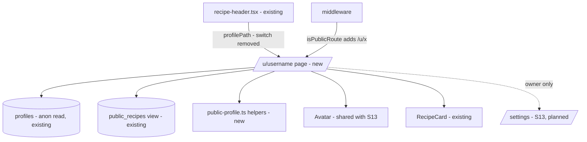

# E01-S14 — Public profile (`/u/{username}`)

> Issue: #216 · Epic: #201 · Backlog: `.ai/specs/backlog-przebudowa.md` (E01-S14, screen 7) · Depends on: S02 (public access, `public_recipes`), S03 (one recipe per link, `recipes.user_id` = first adder), S18 (`profiles.display_name` + immutable `username`), S07 (the "Dodane przez" author line, waiting behind `PROFILE_PAGES_LIVE`). All are live in production, including the `public_recipes.author_username` column (migration `20261017150000`, verified through the anon REST API on 2026-10-17).

## 📝 TLDR

Today there is no profile page: the recipe page's "Dodane przez {nazwa}" is plain text, because `profilePath()` returns `null` until this story ships. **Proposed:** a public, server-rendered `/u/{username}` that a guest or a signed-in visitor can open. It shows the person's letter avatar, display name, how many recipes they added, since when they are on ZapiszPrzepis, category chips (only categories they have recipes in) and the recipes they added as the first person, 12 at a time with "Pokaż kolejne". The owner also sees "Tak widzą Twój profil inni." with a link to `/settings`. An empty profile renders an empty state and is `noindex`. No migration: every field comes from data that is already anon-readable.

## 📝 Problem Statement

The author link is the only place on a recipe that names a person, and CLAUDE.md makes it a link to `/u/{username}` ("Dodała/Dodał {nazwa}" with a link). Without the page the link cannot be switched on, and a visitor who liked one person's recipes has no way to see the others. The page must not leak anything private: CLAUDE.md and the issue forbid showing the e-mail, the first name used for the greeting, the gender or the favourites.

## 📝 Proposed Solution

A new App Router route `src/app/u/[username]/page.tsx` (server component) under the shared `AppShell`, reading only:

- `profiles` (anon-readable by S18 RLS): `id, display_name, username, created_at`, looked up by `username`;
- `public_recipes` (guest-safe view, S02/S07): filtered by `author_username`. The view joins `profiles` on `recipes.user_id`, and since S03 `user_id` is the person who added the link first, so this filter is the same ownership S03 uses for "Moje przepisy" ("added by me as the first person"). Recipes a person only saved to Favourites never appear. Two S03 rules make ownership differ from a literal "first click" and the profile follows them on purpose: the one-off duplicate collapse kept `@uzytkownik-5`'s copy as canonical where one existed (S03 Q2), and an account deletion hands shared recipes to the oldest favouriter (S03 Q6).

The page is wired in three small edits outside the new route: `profilePath()` drops the `PROFILE_PAGES_LIVE` switch, `isPublicRoute()` admits `/u/{username}`, and the middleware needs no change of its own (it already delegates to `isPublicRoute`). The recipe page itself is not edited: its author line already calls `profilePath()` and becomes a link the moment the switch goes.

Alternatives considered:
- *A `security definer` RPC returning the whole profile (counts, categories, page) in one call.* Lost: a new public contract and a migration (owner-gated) for data the client can already read through RLS-protected surfaces. Two plain selects on a few hundred rows at most are cheap.
- *Filtering `public_recipes` by `user_id`.* Not possible and not wanted: the view deliberately omits `user_id`. `author_username` is unique and immutable (S18 trigger), so it is a stable key.
- *Client-side "Pokaż kolejne" (fetch + append).* Lost: needs a client component, an API route or a browser Supabase query, and loses position on back navigation. A server link `?strona=N` that renders the first `N × 12` recipes works without JavaScript, is shareable, and keeps every earlier card on screen.

## 📝 Architecture

- **Route:** `src/app/u/layout.tsx` (wraps children in `AppShell`, like `src/app/przepisy/layout.tsx`) and `src/app/u/[username]/page.tsx` (server). Unknown username → `notFound()`.
- **Pure helpers (new, unit-tested):** `src/lib/public-profile.ts`
  - `PROFILE_PAGE_SIZE = 12`;
  - `parseProfilePage(raw)` → integer ≥ 1 (garbage, negatives, arrays → 1; capped at `MAX_PROFILE_PAGE` = 83, the deepest page whose `page × 12 + 1` rows fit one 1000-row PostgREST response — the largest profile already has ~670 recipes, so a lower cap hides its oldest ones; "Pokaż kolejne" is hidden at the cap);
  - `categoryCounts(rows)` → `{ value, label, count }[]` in `RECIPE_CATEGORIES` order, only non-zero, unknown values dropped;
  - `memberSinceLabel(profileCreatedAt, oldestRecipeCreatedAt)` → "października 2026" (Polish genitive month + year) from the **earlier** of the two dates (see Data Model);
  - `profileCategoryHref(username, category | null)` and `profileMoreHref(username, category, page)`;
  - `isUsernameShape(raw)` — the S18 generator's shape (`^[a-z0-9]+(-[a-z0-9]+)*$`, ≤ 64 chars), checked before any query;
  - `isProfileOwner(userId, profileId)` and `profileRobots(total)` (`{ index: false }` when 0), so owner gating and `noindex` are unit-tested rather than only checked by hand.
- **Avatar — reuse S13's API, no second avatar:** `src/lib/avatar.ts` (`AVATAR_COLORS`, `avatarColorIndex(userId, stored)`, `avatarInitial`) and `src/app/components/ui/avatar.tsx` (`<Avatar src name colorIndex size>`), copied byte-for-byte from S13 (#263) so whichever story merges second takes S13's superset with a trivial add/add resolution. The colour is derived from the **user id** (same as /settings), not the username. Until S13 ships, the profile passes `src={null}` and `stored=null`; once `profiles.avatar_path` / `avatar_color` exist, the profile selects and passes them (follow-up). 88 px, decorative (`aria-hidden`).
- **Reused:** `RecipeCard` (links through `recipePath()`, shows `sourceLabel()` — never a login), `PageContainer`, `categoryLabel` / `RECIPE_CATEGORIES` / `isRecipeCategory`, `buttonClasses()`, `getCurrentUser()` (React-cached; owner check only), design tokens.
- **Edited:** `src/lib/routes.ts` (`profilePath`, `PROFILE_PAGE_RE`, `isPublicRoute`), `src/app/przepis/[slug]/_components/recipe-header.tsx` — **comment only** (the "until E01-S14" note becomes stale). S06 and S16 edit that file in parallel; this story touches no markup there.

Takeaway: one new public route that reads two already-public surfaces; the only shared-code change is the routing seam S07 left for it.

## 📝 Data Model

No schema change, no migration, no production data change.

Queries per request (anon or authenticated client, RLS unchanged):
1. `profiles.select('id, display_name, username, created_at').eq('username', username).maybeSingle()` — `null` → 404.
2. `public_recipes.select('category, created_at').eq('author_username', username)` — all rows (tens today, hundreds at most), for the total, the chip counts and the oldest date. Ceiling: PostgREST returns at most 1000 rows per request (Supabase default `max-rows`), so counts would undercount past 1000 recipes for one person. The largest profile already has ~670 recipes (checked during implementation), so the summary is read in 1000-row batches (capped at 10 requests). If profiles grow far past that, the follow-up is a `count: 'exact', head: true` total plus a grouped count RPC.
3. `public_recipes.select('id, slug, title, image_url, category, description, source_type, source_url, source_author')` (an explicit list — never `*`).eq('author_username', username)[.eq('category', c)].order('created_at', desc).order('id').range(0, page × 12)` — one row more than shown, to know whether "Pokaż kolejne" is needed. Skipped when (2) returned nothing.

"W ZapiszPrzepis od {miesiąc rok}": `profiles.created_at` is the S18 backfill time for every account created before S18 (all five rows read 2026-10-16), while some of those people added recipes in June 2026. The label therefore uses the earlier of `profiles.created_at` and the oldest recipe's `created_at`. `auth.users.created_at` would be more exact but is not anon-readable, and exposing it would need a migration for a cosmetic gain.

Sensitive data: nothing private is read. `profiles_private` (gender), the S13 first name, the e-mail and `favorites` are never queried. The owner check compares `getCurrentUser().id` with `profiles.id` on the server and only toggles a static block.

## 📝 UI/UX

Prototype: `.ai/specs/assets/e01-s14-public-profile/mockup.html` (rendered: `mockup.png`; owner and empty states in the same file).

Order of the page (mobile first, one column, `PageContainer`):
1. **Owner block** (owner only, top): bordered panel `bg-surface-accent` / `border-border-accent`, text "Tak widzą Twój profil inni." (19 px) and a secondary link-button "Zmień nazwę lub obrazek" → `/settings` (`buttonClasses`, min 56 px).
2. **Header:** `Avatar` 88 px; `h1` display name (28–32 px, `text-ink`); "Dodane przepisy: N" (19 px); "W ZapiszPrzepis od października 2026" (17 px, `text-ink-soft`). See A1 for the wording.
3. **Category chips** (only when the person has recipes in 2+ categories): `nav aria-label="Kategorie przepisów"`, links styled like `Chip` (min 48 px, pill, 2 px border); first chip "Wszystkie · N". The active chip is dark (`bg-ink text-white`, "✓ " prefix) with `aria-current="page"`. Links, not toggle buttons, because each one is a URL (`?kategoria=obiady`) and works without JS.
4. **List:** `h2` "Przepisy" (or the category label when filtered), grid `grid-cols-2 sm:grid-cols-3` of `RecipeCard`, newest first.
5. **"Pokaż kolejne"** — a full-width secondary link-button (56 px) to `?strona=N+1` (keeps `?kategoria`), shown only when more recipes exist. The link carries the fragment `#wiecej`, and the first newly shown card is preceded by an element with that id, so after navigation the page scrolls to the new content instead of the top.
6. **Empty state** (no recipes): "{nazwa} nie dodał(a) jeszcze…" would be gendered, so the copy is "Na tym profilu nie ma jeszcze przepisów." plus a link "Wróć na stronę główną". Header still shows avatar, name and "od …"; no count, no chips.

Metadata: title `{display_name} · ZapiszPrzepis`; description "Przepisy dodane przez {display_name} w ZapiszPrzepis."; `robots: { index: false }` when the profile has no recipes; `alternates.canonical` without `?strona` / `?kategoria` (the filtered and paged variants are not separate documents for search engines). Unknown username → the app's 404.

Accessibility (WCAG 2.2 AA per CLAUDE.md): text contrast ≥ 4.5:1 (S13's six avatar colours are all ≥ 4.5:1 with white: `#c2410c`, `#1d4ed8`, `#15803d`, `#7e22ce`, `#be185d`, `#0f766e`), chip and button targets ≥ 48 px / 56 px, visible focus from the global `:focus-visible` rule, links underlined (text links) or shaped as buttons, no horizontal scroll at 320 px (chips wrap).

## 📝 Edge Cases & Failure Scenarios

- **Unknown or malformed username** (`/u/nie-ma`, `/u/Tola`, `/u/%00`, `/u/a%2Fb`): anything failing `isUsernameShape` is a 404 **before** querying (a NUL byte would otherwise make Postgres raise and land on the error boundary); a well-formed but unknown one → lookup returns null → 404. The value only ever travels as a bound query parameter. `/u/tola/` follows Next's trailing-slash redirect to `/u/tola`.
- **Profile with recipes in one category only:** no chip row (a single chip filters nothing).
- **`?kategoria=` invalid or a category the person has no recipes in:** ignored; the unfiltered list renders with "Wszystkie" active. (Not a 404 — a stale shared link should still show the person's recipes.)
- **`?strona=` beyond the end:** renders everything there is, no "Pokaż kolejne".
- **Display name "Użytkownik"** (accounts that never set a name): rendered as is; the avatar letter is "U". Fixing names is S13's job.
- **Recipe whose author account was deleted:** `profiles` row gone (cascade) → the view's `author_username` is null → the recipe is simply not on any profile, and the recipe page's author line is hidden (existing S07 behaviour).
- **Query error** on (2) or (3): thrown to the route error boundary (same pattern as `/przepisy/{kategoria}`), never shown as an empty profile.
- **Signed-in visitor viewing someone else's profile:** identical to a guest; no owner block.

## 📝 Risks & Impact Review

- **Public URL contract:** `/u/{username}` becomes a linked, indexable URL. `username` is immutable (S18 trigger), so links stay stable. Reversal: put the switch back in `profilePath()` and drop the route; nothing persists.
- **Indexing:** profiles with recipes are indexable with the display name in the title — the same name already printed on every recipe page. No sitemap exists today and none is added. Usernames are enumerable through the anon `profiles` read already (S18); the page adds no new enumeration surface.
- **Privacy:** the page widens what a guest can *browse*, not what they can *read* — every field is already readable through `profiles` / `public_recipes` with the anon key. The review must confirm no query touches `profiles_private`, `favorites` or `auth`.
- **Parallel stories:** S06 and S16 edit `recipe-header.tsx` (comment-only edit here); S13 owns `/settings` and avatar upload (this story only links to it and defines the shared letter avatar). S05/S16 add `LIST_KEYS`; this story does not add a `from` key for the profile (see A4).
- **Product direction call (A1):** the backlog wording "Dodała/Dodał N przepisów" needs gender, which S12 made owner-only on purpose. The spec ships neutral wording; changing that is a product decision, not a code defect.

## 📋 Phasing

Phase 1 — helpers and routing seam (no visible change: the route does not exist yet, `profilePath` stays off).
Phase 2 — the page, layout and avatar; switch `profilePath` on and admit the route as public.

## 📋 Implementation Plan

### Phase 1 — helpers and routing seam
1. `src/lib/public-profile.ts` + `public-profile.test.ts`: `PROFILE_PAGE_SIZE`, `parseProfilePage`, `categoryCounts`, `memberSinceLabel`, `profileCategoryHref`, `profileMoreHref`, `isUsernameShape`, `isProfileOwner`, `profileRobots`. Tests cover garbage page params, category order and unknown values, genitive months for all 12 months, the earlier-date rule (an account without recipes shows its profile date, approximate for pre-S18 accounts), username shapes (`%00`, upper case, slashes), owner vs guest vs other user, and `noindex` only at 0.
2. `src/lib/routes.ts`: export `PROFILE_PAGE_RE = /^\/u\/[^/]+$/` and add it to `isPublicRoute`; tests in `routes.test.ts` (`/u/tola` public, `/u` and `/u/tola/x` not).

### Phase 2 — the page
3. Avatar: `src/lib/avatar.ts` + `src/app/components/ui/avatar.tsx`, identical to S13's (#263); colour `avatarColorIndex(profile.id, null)`.
4. `src/app/u/layout.tsx` (AppShell) and `src/app/u/[username]/page.tsx` with `generateMetadata` (title, description, canonical, `noindex` when empty), queries per Data Model, owner block, header, chips, grid, "Pokaż kolejne", empty state.
5. In the same commit as step 4 (the link and its target ship together): `src/lib/routes.ts`: remove `PROFILE_PAGES_LIVE`; `profilePath(username)` returns `/u/{encoded}` or `null` for a missing username. Update `routes.test.ts`. Update the stale comment in `recipe-header.tsx` (comment only).
6. Verify on the dev server (against the production DB, read-only): `/u/tola` (many recipes, chips, paging), `/u/uzytkownik` (empty → `noindex`), `/u/nie-ma` (404), a recipe page author link, guest vs owner. Full gate: `pnpm typecheck`, `pnpm lint`, `pnpm test`.

## Resolved assumptions (autonomous defaults)

| # | Question | Default applied | Why |
|---|----------|-----------------|-----|
| A1 | The backlog says "Dodała/Dodał N przepisów", but gender lives in `profiles_private`, owner-only by S12's design. Expose a gendered verb publicly? | **No.** Neutral wording: "Dodane przepisy: N" (matches S07's "Dodane przez"). Empty state also neutral. | Showing "Dodała" to strangers discloses the gender the issue itself says not to show; it would need a new public projection and a migration (owner-gated). A follow-up can add it if the owner decides the verb form is acceptable to publish. |
| A2 | Avatar: S13 (photo upload + colour) is not merged. | Reuse S13's `Avatar` + `avatarColorIndex(userId, null)` (identical files); photo/stored colour wired in once S13 lands. | One avatar system; the same colour on /settings and the profile; no schema change. |
| A3 | "Pokaż kolejne" mechanism. | Server link `?strona=N` showing the first `N × 12` recipes. | Works without JS, keeps earlier cards, shareable, no API route. |
| A4 | Recipe page list bar ("← Profil Toli", prev/next) for cards opened from a profile? | **Deferred.** No `from` key. | `LIST_KEYS` is being edited by S05/S16 in parallel; adding a key is a small follow-up. |
| A5 | Category chips: filter in place or link to `/przepisy/{kategoria}`? | Filter the profile in place (`?kategoria=`). | The backlog places the chips on the profile list; leaving the profile would show other people's recipes. |
| A6 | "W ZapiszPrzepis od" source date. | Earlier of `profiles.created_at` and the oldest recipe. | `profiles.created_at` is the S18 backfill time for older accounts; `auth.users` is not anon-readable. |
