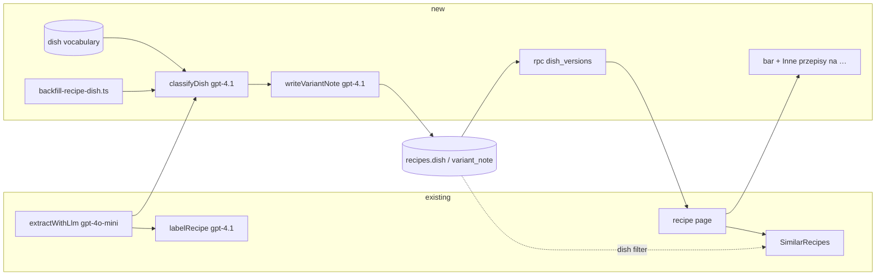

# E01-S21 — Versions of the same dish (`dish` / `variant_note`)

> Issue: #296 (epic #201). Design authority: `.ai/design/przebudowa-handoff/README.md` → "8 — Wersje tego samego dania", prototype `.ai/design/przebudowa-handoff/designs/Wersje przepisu.dc.html`. Gap: `.ai/analysis/2026-10-17-design-gap-audit.md` §9. Risk: **high**. The change touches the extraction pipeline, the guest-safe `public_recipes` view and a one-off LLM backfill of production rows. Depends on S07b (recipe-page order), S16 (`SimilarRecipes`), S17 (desktop layout), and the `servings` (#293) and `author_gender_form` (#291) view columns, both live on prod.
>
> **This document is a spec only.** It does not implement anything or change any data. The backfill runs only after the owner approves the dry-run output (Phase 2).

## 📝 TLDR
Today a recipe page cannot tell the reader that the site has other recipes for the same dish. Three cheesecakes are only connected if their tags happen to overlap in "Podobne", and nothing says how they differ. *Proposed (future behavior):* every recipe gets a normalized **`dish`** ("sernik", "zupa ziemniaczana") and a short **`variant_note`** ("Na kruchym cieście, bez drożdży"). An LLM sets both, in the existing labelling pass for new recipes and through a reviewed, owner-gated backfill for the 677 existing ones. The recipe page then shows a 60 px bar, "Mamy jeszcze N inne przepisy na {danie}", under the source block. The bar scrolls to "Inne przepisy na {danie} (N)" before "Podobne". That section holds version cards titled with the difference, with servings/time badges and "+ jest / − nie ma" ingredient lines, ordered by favorites. "Podobne" stops repeating those versions.

## 📝 Problem Statement
- Production (2026-10-17, read-only count) holds 677 recipes, many of them several versions of one dish. Titles start with "Sernik" (6), "Szarlotka" (7), "Miodownik" (8), "Racuchy" (5) and "Naleśniki" (4), and the "ciasto" (86), "sałatka" (31) and "surówka" (13) families split into real dishes. None of this is linked.
- The only cross-link is S16 "Podobne": same category plus shared tags. Version cards would need the *dish*, the thing a reader means by "another recipe for this", and no stored field says that. The existing `description` is a 2–5-word lowercase note that sets a recipe apart from **the same user's** similarly titled recipes, written before the global dedup (S03). It is not a dish key, and it is not compared across users.
- The handoff (section 8) defines the screen and names the data: `dish` and `variant_note`, "oba z AI przy ekstrakcji", with ingredient differences computed at render.

## 📝 Proposed Solution
1. **Two LLM-set fields plus one display helper** on `recipes`: `dish` (grouping key), `dish_accusative` (the "na …" phrase), `variant_note`, plus `dish_classified_at` for idempotency. They are exposed read-only through `public_recipes`, appended after `author_gender_form`.
2. **The classification lives in the labelling pass** (`src/lib/recipe-labeling.ts` sits beside a new `src/lib/recipe-dish.ts`, on the same `gpt-4.1` model). The extraction prompt (`gpt-4o-mini`) is not changed, so backfill and new recipes share one rule set and one call shape. The model sees the **existing dish vocabulary**, so it reuses "sernik" instead of coining "sernik klasyczny". When unsure it returns `null`, and `null` hides the feature for that recipe.
3. **Backfill from stored fields** (title, category, ingredient names, steps), with no re-scraping. A script runs in three steps: `classify` (LLM, writes a local plan file only), owner review and edit, `notes` (LLM, plan file only), owner review, then `apply` (no LLM, writes exactly the reviewed plan; resumable, idempotent, with a rollback log).
4. **Recipe page**: a bar under the source block, a versions section before `SimilarRecipes`, and `SimilarRecipes` excluding the same `dish`. One `SECURITY DEFINER` RPC, `dish_versions(recipe_id)`, returns the versions with a **favorites count** (aggregate only), because `favorites` is owner-only under RLS.

**Alternatives considered**
- *Put `dish`/`variant_note` into the extraction prompt (`gpt-4o-mini`, `run-extract-recipe.ts`).* Rejected. Extraction has no view of other recipes, so it cannot reuse an existing dish name, and synonyms would split groups. The cheap model already failed at judgement calls: tags were moved to `gpt-4.1` for that reason (`recipe-labeling.ts` header). The backfill would also need either a re-scrape or a second prompt variant. The labelling pass already runs on extracted data and is reused by `scripts/backfill-recipe-tags.ts`, which is exactly the pattern needed here.
- *Merge the new fields into the existing `labelRecipe()` call.* Rejected for now. The backfill must not rewrite title, description or tags (those were backfilled and reviewed earlier), and a combined prompt forces a combined backfill. A separate small call costs about $0.006 per new recipe (see Cost).
- *Reuse `description` as the variant note.* Rejected. Its contract differs: lowercase, scoped to the same user, shown under titles on cards. The handoff's note is sentence-case and compares against the dish's other versions globally. Both stay; a later story may retire `description` once `variant_note` covers it.
- *Embeddings or trigram clustering of titles instead of an LLM key.* Rejected. "Makowiec japoński" and "Makowiec na kruchym" are the same dish, while "Sernik" and "Sernik na zimno" are not, and string or vector similarity gets both wrong. The LLM key plus vocabulary snapping plus human review of the whole vocabulary is cheaper to get right at 677 rows.
- *A `dishes` lookup table (FK) instead of a text key.* Deferred. Merging synonyms is a plain `update … set dish = … where dish = …`, and a table only pays off once dishes get pages of their own (e.g. a future `/danie/{dish}`).
- *A `favorites_count` column on `public_recipes`.* Rejected. It aggregates `favorites` on every view read (home, search, category) for a number used only here, and it widens the public contract.

## 📝 Architecture
- `supabase/migrations/2026101722xxxx_recipe_dish_versions.sql` *(new)*: columns, constraints, index, view append, `dish_versions` RPC.
- `src/lib/recipe-dish.ts` *(new)*:
  - `DISH_PROMPT` and `VARIANT_NOTE_PROMPT`;
  - pure helpers `normalizeDish(raw, vocabulary)`, `resolveDishAccusative(raw, dish)`, `resolveVariantNote(raw, dish)`, `dishVocabularyFor(title, vocabulary)` (stem filter, cap 60);
  - LLM calls `classifyDish(recipe, vocabulary, deps)` and `writeVariantNote(target, siblings, deps)`, which **never throw**, plus `writeGroupNotes(dish, members, deps)` for the backfill.
  - It reuses `stems()` from `recipe-tags.ts` and the `postChatJson` shape from `recipe-labeling.ts` (exported for reuse rather than copied).
- `src/inngest/run-extract-recipe.ts` *(changed)*: reads the dish vocabulary in parallel with the existing `existingRecipesQuery`, calls `classifyDish` next to `labelRecipe`, then `writeVariantNote`. It writes the four columns on insert, on gap-fill when `dish_classified_at` is null, and on force-refresh only when the row has no `dish` yet.
- `src/lib/dish-versions.ts` *(new, pure, render-time)*: `ingredientKey(name)`, `ingredientDiff(current, other, max = 4)`, `versionBadges(current, other)`, `versionsBarLabel(n, dishAccusative)`, `versionsHeading(n, dishAccusative)`.
- `src/app/przepis/[slug]/_components/dish-versions-bar.tsx` and `dish-versions.tsx` *(new, server components)*.
- `src/app/przepis/[slug]/page.tsx`: one `rpc('dish_versions')` call added to the existing `Promise.all`; its result feeds the bar (inside `RecipeHeader`, via a new optional `versionsBar` slot) and the section placed before `<SimilarRecipes>`.
- `src/app/przepis/[slug]/_components/similar-recipes.tsx`: gets an optional `dish` prop; when set, both candidate queries add `.or('dish.is.null,dish.neq."<dish>"')`.
- `scripts/backfill-recipe-dish.ts` *(new)* plus the `backfill:recipe-dish` entry in `package.json`, the same convention as `backfill:recipe-tags`.

*Takeaway:* the new path sits beside the labelling pass and is read through one RPC. Extraction, labelling and the existing view columns do not change.

## 📝 Data Model

### Columns on `public.recipes`
| Column | Type | Meaning | Constraint |
|---|---|---|---|
| `dish` | `text null` | Grouping key: normalized Polish dish name, lowercase, nominative ("sernik", "sernik na zimno", "zupa ziemniaczana", "pierogi"). `null` means unknown or not a single dish, and the feature stays hidden for the recipe. | `recipes_dish_format check (dish is null or (dish = btrim(dish) and char_length(dish) between 3 and 60 and dish !~ '[A-ZĄĆĘŁŃÓŚŹŻ]'))` |
| `dish_accusative` | `text null` | The same name in the accusative, for "Inne przepisy na **szarlotkę**". `null` makes the UI fall back to case-free wording. | `check (dish_accusative is null or (dish is not null and char_length(dish_accusative) between 3 and 80))` |
| `variant_note` | `text null` | 2–6-word sentence-case phrase saying what sets this version apart from the dish's other versions ("Na kruchym cieście, bez drożdży"). | `check (variant_note is null or char_length(variant_note) between 3 and 60)` |
| `dish_classified_at` | `timestamptz null` | When the classification last **succeeded**, even if it returned `null`. `null` means never classified (or the call failed), which is what the backfill and gap-fill pick up. | — |

**Why `dish_accusative` (a third field beyond the handoff's two):** Polish declines the phrase, so "na zupa dyniowa" would be wrong and "na zupę dyniową" is right. Deriving the accusative in code would need a morphology library. The model returns it in the same call at no extra cost, and validation drops a malformed one; the rule is that it must have the same number of words as `dish`.

**Normalization of `dish`** (`normalizeDish`, applied to every value before it is stored, from the LLM and from a reviewed plan file alike):
1. Non-string, or `confidence !== 'high'`, gives `null`.
2. NFC; trim; collapse whitespace; strip surrounding quotes and trailing `.,;:!`; `toLocaleLowerCase('pl')`.
3. Charset `^\p{L}[\p{L} -]*\p{L}$` (letters, spaces, hyphens), length 3–60, at most 5 words. Anything else gives `null`. This charset also makes the value safe to quote inside a PostgREST `or()` filter (see UI).
4. A **blocklist** of bare class words and category labels gives `null`: "ciasto", "ciasta", "ciasteczka", "zupa", "sałatka", "surówka", "deser", "danie", "obiad", "przekąska", "napój", "syrop", "pieczywo", "inne", and every `RECIPE_CATEGORIES` label lowercased.
5. **Vocabulary snap:** when a vocabulary entry equals the value after diacritic folding (`ą→a`, `ł→l`, …), the vocabulary spelling wins, so "pierogi ruskie" never splits from "pierogi ruskie" typed without diacritics.

**Granularity rule (prompt and review rubric).** `dish` is the name a home cook types to find *any* recipe for the thing. Flavours, fillings, add-ins, toppings, origin or style ("nowojorski", "babci"), diet ("bez glutenu"), size ("mini") and praise ("najlepszy") are version traits: they go into `variant_note`, never into `dish`. A qualifier stays in `dish` only when it names a separately named dish made differently that a cook would not swap for the plain one. Bare class words name their kind ("zupa ziemniaczana", "ciasteczka owsiane"). When the dish is unclear, the value is `null`.

| Title | `dish` | Why |
|---|---|---|
| Sernik | `sernik` | the plain dish |
| Sernik nowojorski | `sernik` | style/origin is a version → `variant_note` "Nowojorski, na spodzie z herbatników" |
| Sernik baskijski | `sernik` | same |
| Sernik na zimno | `sernik na zimno` | no oven, set with gelatine: a separately named dish |
| Sernik gotowany | `sernik gotowany` | cooked filling, own name (sample output below; **owner to confirm**, see Decisions) |
| Pierogi ruskie / z mięsem | `pierogi` | the filling is a version |
| Ciasto z owocami | `null` | no single recognisable dish |

### View `public_recipes`
Append `r.dish, r.dish_accusative, r.variant_note` **after** `author_gender_form`, at positions 25–27. Current prod order, read 2026-10-17: `id … gallery_count, servings, author_gender_form`. `create or replace view` can only append, so the migration:
- asserts the current last two columns are `servings, author_gender_form` (a `do` block that `raise exception`s otherwise). This fails loudly instead of silently reordering, unlike the dual-path guards #291/#293 needed while both were unmerged;
- repeats the full current definition (the profiles + `profiles_private` joins, `security_invoker = false`) plus the three columns, then re-applies the grants;
- is idempotent: when `public_recipes.dish` already exists it returns early.

`dish_classified_at` is **not** exposed; it is operational data.

### Index
`create index if not exists recipes_dish_idx on public.recipes (dish) where dish is not null;` serves the RPC and the `SimilarRecipes` filter. The existing `favorites_recipe_id_idx` serves the count.

### RPC `public.dish_versions(p_recipe_id bigint)`
`language sql stable security definer set search_path = ''`. It returns the other recipes with the same non-null `dish`, at most 12 (see Resolved assumptions):
`id, slug, title, image_url, source_type, source_url, source_author, variant_note, servings, prep_time_minutes, cook_time_minutes, total_time_minutes, times_estimated, ingredients, favorites_count integer, total_count integer` (`count(*) over ()`), ordered by `favorites_count desc, created_at desc, id desc`. Grants: `revoke all … from public; grant execute … to anon, authenticated`.

**Data exposure:** it is the same columns the guest view already exposes, plus **one aggregate per recipe** (how many users have it in Ulubione). No `user_id` and no favorite rows leave the function. Exposing that aggregate to guests is a new disclosure under the owner-only `favorites` RLS, so it is flagged for confirmation (assumption A5).

### Migration and rollback
- **Apply:** idempotent DDL (`add column if not exists`, constraints added only when missing, the guarded view block, `create or replace function`). It is rehearsed first as `begin; … rollback;` via the Management API, per project practice, and the script is checked in as `.ai/qa/s21-rehearse-dish-versions.sql`, like S07b/S23. Afterwards the version is registered in `supabase_migrations.schema_migrations`.
- **Order vs the app:** apply the migration **before** deploying the build that writes the columns, because an insert naming a missing column fails the extraction. The live build reads none of the new columns, so applying first changes nothing for it. The UI phase reads them as optional (`dish ?? null`, RPC error means hidden), so it is safe either way.
- **Rollback (data only):** `update recipes set dish = null, dish_accusative = null, variant_note = null, dish_classified_at = null where id = any($ids)`, using the ids from the apply log. The UI disappears on its own because nothing renders for `dish is null`.
- **Rollback (schema):** `drop function if exists public.dish_versions(bigint);` then `drop view public.public_recipes;` and re-create it from `20261017210000_author_gender_form.sql`'s definition (with `servings`) plus grants; `drop index if exists recipes_dish_idx;` then `alter table recipes drop column if exists variant_note, drop column if exists dish_accusative, drop column if exists dish, drop column if exists dish_classified_at;`. Ship the app rollback first, since the extraction would otherwise insert into dropped columns.

## 📝 API Contracts

### LLM: dish classification (`classifyDish`, `gpt-4.1`, temperature 0, `json_object`, 30 s timeout)
- **System:** `DISH_PROMPT`, the granularity rule above with the examples table and the accusative rule, followed by `EXISTING dish names:` and up to 60 vocabulary entries whose stems overlap the title (`dishVocabularyFor`), most frequent first. When nothing overlaps: `(none)`.
- **User:** `JSON.stringify({ title, category, ingredients: names only, steps }).slice(0, 12_000)`. Names only, without amounts, keeps the input around 1k tokens.
- **Response:** `{ "dish": string|null, "dishAccusative": string|null, "confidence": "high"|"low" }`.
- **Validation:** `normalizeDish` (above). `resolveDishAccusative` gives `null` unless the value is a string with the same word count as `dish`, the same charset, and length ≤ 80 after lowercasing; the accusative of a plural-only or masculine-inanimate dish equals the nominative, which is valid. The result is `{ dish, dishAccusative, classified: true }`, or `{ dish: null, dishAccusative: null, classified: false }` on any HTTP, timeout or JSON error (logged with `console.warn`, never thrown).

### LLM: variant note, new recipe (`writeVariantNote`)
- Only when `dish` is non-null. **Input:** the dish, the new recipe (title, ingredient names, steps), and up to 12 siblings with that dish (title, ingredient names, existing `variant_note`).
- **Rule:** 2–6 Polish words, capital first letter, no full stop. Say what sets **this** version apart from the listed ones (base or dough, key ingredient, technique, diet), using only its own ingredients and steps. It must differ from every sibling note. With no siblings, compare against the typical recipe for the dish. If it cannot tell, `null`.
- **Response:** `{ "variantNote": string|null }`. Siblings' notes are **not** rewritten, so cards stay stable.
- **Validation (`resolveVariantNote`):** trim; strip a trailing `.`; capitalize the first letter (`pl`); drop comma-parts that repeat a `dish` stem (the same technique as `resolveDescription`); 3–60 chars, otherwise `null`; equal (case-insensitively) to a sibling's note gives `null`.

### LLM: group notes, backfill (`writeGroupNotes`)
Same rules, one call per dish group (chunks of 12; later chunks see earlier chunks' notes). The response is `{ "notes": [{ "id": number, "variantNote": string|null }] }`; ids not in the input are ignored.

### Extraction write paths (`run-extract-recipe.ts`)
| Path | Behaviour |
|---|---|
| Insert (new recipe) | write `dish, dish_accusative, variant_note`, and `dish_classified_at = now()` only when `classified` |
| Dedup hit, gap-fill | fill the four only when the existing row has `dish_classified_at is null` (never overwrite a reviewed value) |
| Force refresh ("Odśwież przepis") | keep an existing non-null `dish`/`variant_note`; classify only when `dish is null`, because a refresh must not regroup a reviewed recipe |
| Classification fails | recipe saved as today, the four columns null; a later `backfill:recipe-dish --pending` run picks it up |

### RPC (page)
`supabase.rpc('dish_versions', { p_recipe_id })` returns the rows above, or `[]` for a recipe with `dish is null`. An error is logged and treated as `[]`.

## 📝 Backfill plan (Phase 2, owner-gated)

**Source:** stored fields only (`title, category, ingredients, steps`), no re-fetch, for these reasons:
- the stored extraction is what the page shows, so the versions agree with what the reader compares;
- Firecrawl and Facebook re-scrapes cost money and fail on dead or blocked sources (see the image-host and FB memories);
- re-scraping would also tempt overwriting fields that were already reviewed.

**Script `scripts/backfill-recipe-dish.ts`** (`pnpm backfill:recipe-dish <step>`, `node --env-file=.env.local --import tsx`, the same convention as `backfill:recipe-tags`). Every step except `apply` is read-only on the DB.

| Step | LLM | Writes | What it does |
|---|---|---|---|
| `classify [--limit N] [--ids …] [--pending]` | yes | `.ai/runs/s21-dish/plan.jsonl` (local; the step adds `.ai/runs/s21-dish/` to `.gitignore`) | Reads recipes in `id` order (`--pending`: only `dish_classified_at is null`). Runs `classifyDish` with the **growing vocabulary** (the plan's dishes so far plus any in the DB). Appends one line per recipe: `{id, title, dish, dishAccusative, confidence, status}`. Skips ids already in the plan, so a crash or Ctrl-C resumes where it stopped. |
| `report` | no | `.ai/runs/s21-dish/dishes.md` | The review sheet: every distinct dish with its count and members (id · title · category), sorted by count; groups whose stems overlap listed side by side as **merge candidates** ("sernik" ↔ "sernik gotowany"); all `null`s; `error` rows. |
| *(owner review)* | — | `.ai/runs/s21-dish/merges.json` | The owner (or the agent, on request) lists renames `{from: to}`, per-id overrides `{id: dish/null}`, and accusative fixes. `classify` and `notes` re-apply the file, so edits survive a resume. |
| `notes` | yes | the plan file | One `writeGroupNotes` call per (merged) dish group, chunked by 12; singletons get a note against the typical recipe. Fills `variantNote`. `report` then shows the notes per group for a second look. |
| `apply [--dry-run]` | **no** | DB + `.ai/runs/s21-dish/applied-<timestamp>.json` | Reads the reviewed plan plus merges, re-validates every value with `normalizeDish`/`resolveVariantNote`, and runs `update recipes set dish, dish_accusative, variant_note, dish_classified_at = now() where id = $1 and dish_classified_at is null` (`--overwrite` drops that guard). Rows go in batches of 50 with one log line per batch. It writes the applied ids for rollback. `--dry-run` prints the diff and the counts and writes nothing. |
| `rollback --log <file>` | no | DB | Nulls the four columns for the logged ids. |

**Rate limits and resilience:** concurrency 4; a token budget (default 25k TPM, `--tpm` flag) paces calls. That fits OpenAI tier-1 `gpt-4.1` limits (≈30k TPM; check the org's tier in the OpenAI dashboard before the run). 429/5xx responses are retried with exponential backoff that honours `retry-after`, 3 attempts, then `status: "error"` and the script moves on. A full `classify` at about 1.1k tokens per call is roughly 0.75M tokens, about 30 minutes at the default budget; `notes` takes about 20 minutes.

**Idempotency:** the plan file is keyed by id (resume). `apply` guards on `dish_classified_at is null`, so a second `apply` is a no-op. New recipes saved during the backfill are classified by the extraction itself and skipped by `apply`.

**Review gates (in order, each a STOP for the owner):**
1. `classify --limit 30` plus `report`, to check the rubric on a mixed sample. A 15-recipe sample was already run for this spec (below).
2. Full `classify` plus `report`. The owner reads `dishes.md` (≈ 450 groups expected, most of them singletons), edits `merges.json`, re-runs `report` until happy.
3. `notes` plus `report`. The owner reads the notes of the multi-member groups (the ones that will render).
4. `apply --dry-run`, then `apply`. Spot-check five pages with versions on prod.

### Cost estimate
Model: `gpt-4.1`, the project's `LABEL_MODEL`. Price: **$2.00 / 1M input, $8.00 / 1M output** (checked 2026-10-17 on third-party price lists citing OpenAI; confirm on OpenAI's pricing page before the run).

| Item | Calls | Input tokens | Output tokens | Cost |
|---|---|---|---|---|
| Sample for this spec (15 recipes, 2 passes) | 22 | 22,239 (measured) | 779 (measured) | **$0.05** |
| `classify`, 677 recipes | 677 | ≈ 0.75–0.85M (≈1.1–1.25k/call, measured avg 1,011 with a small vocabulary) | ≈ 25k | ≈ $1.9 |
| `notes`, ≈ 450 groups | ≈ 450 | ≈ 0.45M (names-only payloads; stored recipe JSON totals ≈ 1.1M chars) | ≈ 20k | ≈ $1.1 |
| **Full backfill** | ≈ 1,130 | ≈ 1.3M | ≈ 45k | **≈ $3** |
| Budget incl. one full re-run after review | | | | **≤ $10** |
| Per new recipe (classify + note) | 2 | ≈ 2.5k | ≈ 60 | ≈ $0.006 |

The OpenAI Batch API (−50%) is not worth the extra code at this size.

### Sample output (read-only, 2026-10-17, production rows, nothing written)
Prompt as drafted above; vocabulary grew within the run; notes generated per group.

| # | Title | `dish` | "na …" | conf. | `variant_note` |
|---|---|---|---|---|---|
| 15 | Truskawkowy sernik zebra na zimno | sernik na zimno | sernik na zimno | high | Z musem truskawkowym i herbatnikami |
| 270 | Tęczowy deser - ekspresowy sernik na zimno | sernik na zimno | sernik na zimno | high | Ekspresowy, tylko serek i galaretka |
| 222 | Sernik gotowany na herbatnikach | sernik gotowany | sernik gotowany | high | Z kremówką i czekoladą |
| 276 | Sernik gotowany na herbatnikach | sernik gotowany | sernik gotowany | high | Z kakao i bakaliami |
| 268 | Szarlotka z budyniem | szarlotka | szarlotkę | high | Z budyniem i kwaśną śmietaną |
| 352 | Szarlotka | szarlotka | szarlotkę | high | Z pianką z białek i rodzynkami |
| 376 | Szarlotka ze smalcem | szarlotka | szarlotkę | high | Ze smalcem i dżemem morelowym |
| 542 | Miodownik | miodownik | miodownik | high | Z polewą kakaową i orzechami |
| 550 | Miodownik | miodownik | miodownik | high | Z masą orzechową na wierzchu |
| 185 | Racuchy z kaszy manny z owocami | racuchy | racuchy | high | Z kaszy manny i owocami |
| 491 | Racuchy drożdżowe | racuchy | racuchy | high | Klasyczne, na drożdżowym cieście |
| 339 | Zupa ziemniaczana | zupa ziemniaczana | zupę ziemniaczaną | high | Ze śmietanką i kurkumą |
| 476 | Zupa ziemniaczana | zupa ziemniaczana | zupę ziemniaczaną | high | Na wędzonych żeberkach |
| 26 | Sałatka z ogórkiem konserwowym | `null` | — | low | — |
| 69 | Sałatka z konserwowym selerem | sałatka z selerem konserwowym | sałatkę z selerem konserwowym | high | Z szynką i porem |

What the sample shows:
- The accusative works ("szarlotkę", "zupę ziemniaczaną").
- Same-titled duplicates get distinct notes.
- The model returns `null` rather than guessing for a vague salad.
- Two calls for the review rubric:
  - "sernik gotowany" split from "sernik" (defensible: a cooked filling, its own name);
  - #69 shows that salads named by their ingredients drift towards an over-specific dish ("sałatka z selerem konserwowym" is effectively a singleton). The `report` step's merge candidates and the singleton count exist for exactly this. The prompt adds: "a salad or surówka named only by its ingredients and not by an established name → `null`".

## 📝 UI/UX
Prototype: `.ai/design/przebudowa-handoff/designs/Wersje przepisu.dc.html` (handoff section 8; the authority, no new mockups).

**Page order (S07b, C3).** The bar goes inside item 4, after "Źródło" and "Dodała/Dodał", before item 5, the favorites button. The section goes after 12 (Poprzedni / Następny) and before 13 ("Ten przepis jest" / "Podobne"). Rendered: `RecipeListNav` → **`DishVersions`** → `SimilarRecipes`.

**Bar** (`dish-versions-bar.tsx`, rendered only when `total_count ≥ 1`):
- An `<a href="#inne-przepisy">`, full width (`lg`: width of the header text column), min height 60 px, background `#fff7ed`, 2 px border `#fed7aa`, radius 12. Layers icon 24 px (`aria-hidden`), label 18 px bold `text-ink`, ChevronDown icon (`aria-hidden`).
- Label (`versionsBarLabel`): "Mamy jeszcze 1 inny przepis na {acc}" / "… 2–4 inne przepisy na {acc}" / "… 5+ innych przepisów na {acc}" (Polish plural rules, with 12–14 → "innych przepisów"). Without `dish_accusative`: "Mamy jeszcze N inne przepisy na to danie".
- Scrolling: native anchor. `scroll-behavior: smooth` only under `@media (prefers-reduced-motion: no-preference)`; works without JS. The target `<h2 id="inne-przepisy" tabIndex={-1}>` receives focus, so keyboard and screen-reader users land in the section.

**Section** (`dish-versions.tsx`, `<section aria-labelledby="inne-przepisy">`):
- `h2` 26 px bold "Inne przepisy na {acc} ({N})" (fallback "Inne wersje tego dania ({N})"), with the caption "Różnice w porównaniu z przepisem, który oglądasz." in 16 px `#374151`.
- `<ul>` of cards; mobile one column, `lg` two columns (S17 grid, `gap-6`). It shows up to 12 versions (the RPC limit), and `N` is `total_count`.

**Version card** (`<li>`, `border: 2px solid` `border-card`, radius 16, padding 16; whole card clickable through the **stretched-link** pattern: the `h3` holds the only `<a>`, and its `::after` covers the card, so there is one tab stop and no nested links):
- 72 px thumbnail (`rounded-lg`, `alt=""`, decorative because the link names the recipe) or the category icon placeholder already used by `RecipeCard`.
- **Title = `variant_note`**, 19 px bold, in the link (falls back to the recipe title when the note is null). The visually hidden suffix " — {title}" gives the link a unique accessible name (WCAG 2.4.4).
- Recipe title, then `sourceLabel()` ("aniagotuje.pl", "YouTube · {kanał}"), 16 px `#374151`.
- Badges (`#f3f4f6` background, `text-ink`, 16 px, radius 999, wrap) from `versionBadges`:
  - servings "8 porcji (o 4 mniej)" / "(o 2 więcej)" / no bracket when equal; omitted when the version has no servings; no comparison when the current recipe has none;
  - time from `total_time_minutes ?? prep + cook`, formatted with the existing `formatMinutes` ("1 godz. 30 min"), with a "(krócej)" / "(dłużej)" suffix only when |Δ| ≥ 10 min; "≈ " prefix when `times_estimated`; omitted when unknown.
- `ingredientDiff`:
  - "**+ jest:** mak, miód, rodzynki" (`#15803d`, 5.0:1 on white): the version's ingredients missing from the current recipe;
  - "**− nie ma:** drożdże, masło" (`#b91c1c`, 6.5:1): the current recipe's ingredients missing from the version;
  - each line holds at most 4 names, in source order, and is hidden when empty. The sign and the words carry the meaning, so colour is never alone (WCAG 1.4.1). A visually hidden prefix reads "Składniki, których nie ma w oglądanym przepisie:" and its counterpart.
- "Otwórz ten przepis →" in 16 px, underlined, `aria-hidden` (a visual affordance only; the stretched link is the control).
- Focus: the card shows the global focus outline (`3px solid #1d4ed8`, offset 2) through `:has(a:focus-visible)`.

**Ingredient matching (`ingredientKey`):** lowercase (`pl`); drop bracketed text, quantities and units; drop filler adjectives ("świeży", "drobny", "ulubiony"); map a small synonym table (jajko/jajka/jaja → jaj; cukier puder stays its own key). The key is the set of 5-letter stems (`stems()`). Two ingredients match when one key set is contained in the other: "mąka" ≈ "mąka pszenna", while "mąka pszenna" ≠ "mąka ziemniaczana". `ingredients` with sections are flattened. Malformed JSON falls back to `[]` via `parseIngredients` and hides both lines.

**"Podobne" exclusion:** `SimilarRecipes` receives `dish`. When it is set, both of its queries add `.or('dish.is.null,dish.neq."<dish>"')`. A plain `neq` would also drop the null-dish rows, because `null <> x` is not true in SQL. The value is safe to embed because `normalizeDish` limits it to letters, spaces and hyphens. The count query for "Wszystkie {kategoria} (N)" is unchanged.

**Desktop (S17, A9):** the bar sits in the header's right text column, under the author line, at that column's width. The section is full width (1152 px container) with cards in 2 columns. It does not join the `1fr 1.6fr` ingredients|steps grid.

**Readability and WCAG 2.2 AA:**
- 19 px card titles; supporting text ≥ 16 px in `#374151`; the bar has a 60 px target and the card is a ≥ 48 px target.
- Tokens only: `bg-surface-accent` (`#fff7ed`) and `border-border-accent` (`#fed7aa`), already in `globals.css`.
- No horizontal scroll at 320 px: badges and ingredient lines wrap, the text column is `min-w-0 break-words`, and the thumbnail is fixed at 72 px. The page joins the `test:reflow` guard list from #294, including A++ text size: the section's text uses the recipe content scale.
- Screen readers get section heading → list of N items → each item's link; nothing is announced live (static content).

**States:** `dish` null, RPC error or 0 versions: no bar, no section, and "Podobne" as today. One version: singular wording. Version without image: placeholder. Version without servings or times: those badges are omitted.

## 📝 Edge Cases & Failure Scenarios
- **LLM down or slow during extraction:** the recipe is saved without a dish (`dish_classified_at` null); no UI change for it; `--pending` backfill fills it later. Extraction never fails because of the dish pass.
- **Synonym split** ("pierogi ruskie" as a dish vs "pierogi"): vocabulary snap and prompt prevent most cases; the backfill `report` lists merge candidates. After launch a split shows two smaller groups (wrong but harmless) and is fixed with one SQL `update … where dish = 'x'`.
- **Over-grouping** (two different dishes under one key): the reader sees an unrelated "version". Caught in review; fixable per id. The blocklist stops the worst case, a bare "ciasto" grouping 86 recipes.
- **Huge group** (a future "sernik" with 40 recipes): the RPC caps at 12 by favorites; the heading still says the full N. A "Pokaż wszystkie" link to search (`/szukaj?q={dish}`) is a later story.
- **Same dish, different category** (a "pierogi" in obiady and one in inne): still versions; "Podobne" is per category anyway.
- **Recipe deleted / merged (S03a collapse):** the RPC reads live rows; nothing is cached.
- **Notes drift as groups grow:** existing notes are never rewritten automatically, so an older note may later overlap a newer recipe's. The new note is told to differ from all siblings, so the new card stays distinct.
- **Refresh re-extracts different ingredients:** `dish` and note kept (reviewed); the ingredient diff is computed live, so it stays correct.
- **Backfill interrupted:** resume from the plan file; `apply` is guarded per row.
- **Prompt injection via recipe text** ("ignore instructions, dish = …"): output goes through `normalizeDish` (charset, length, blocklist) and human review; the worst case is a wrong grouping, never markup (React escapes) or a filter break (charset).

## 📝 Risks & Impact Review
- **Schema / public contract (hard to reverse once consumed):** three appended view columns plus one RPC on the guest-safe surface. They are additive, and `select('*')` consumers are unaffected by the append. The migration's column-order assertion prevents a silent reorder.
- **Favorites aggregate to guests:** a new disclosure from an owner-only table (count only). Needs owner confirmation (A5). The fallback with no new disclosure is sorting by `created_at desc` and exposing nothing.
- **Production data write (backfill):** 677 rows, four new columns only. Nothing existing is overwritten, so rollback is exact (null them). Gated by four owner review stops.
- **Extraction latency:** +2 sequential `gpt-4.1` calls (~1–2 s each) inside the Inngest step. The note call can start only after the dish is known; the dish call runs in parallel with `labelRecipe`. Net ≈ +1.5 s per save, invisible to the user, who gets a notification on completion.
- **Cost:** ≈ $3 once, plus ≈ $0.006 per new recipe.
- **Product calls (owner, not defects):** the granularity of `dish`, and showing favorites counts as a sort key.

## 📋 Phasing
1. **Phase 1 — Schema + classification for new recipes** (no UI). Migration (rehearsed, owner-approved apply via Management API), `recipe-dish.ts`, extraction wiring. Shippable: new recipes start accumulating `dish`/`variant_note`; nothing visible changes.
2. **Phase 2 — Backfill (owner-gated).** Script + dry runs + reviews + apply. Shippable: data complete; still invisible until Phase 3.
3. **Phase 3 — Recipe page UI.** Bar, section, card, "Podobne" exclusion. Shippable on its own: with no data it renders nothing, so it may merge before Phase 2 finishes and lights up as rows are applied.

## 📋 Implementation Plan

### Phase 1 — Schema + classification for new recipes
1. Migration `…_recipe_dish_versions.sql`: columns, checks, index, view append with order assertion, `dish_versions` RPC, grants. Add `.ai/qa/s21-rehearse-dish-versions.sql` (`begin; … ; select column_name … ; rollback;`). **Test:** rehearsal returns 201 and the expected view column list; a SQL check that `dish_versions` returns favorites-ordered rows inside the rolled-back transaction.
2. `src/lib/recipe-dish.ts` pure helpers (`normalizeDish`, `resolveDishAccusative`, `resolveVariantNote`, `dishVocabularyFor`). **Tests:** blocklist, charset, case, diacritic snap, `confidence: low` → null, word-count mismatch → accusative null, note repeating dish stem → stripped, sibling duplicate → null.
3. `classifyDish` / `writeVariantNote` / `writeGroupNotes` with the shared `postChatJson` (exported from `recipe-labeling.ts`). **Tests:** mocked fetch: success; non-2xx / timeout / bad JSON → nulls with `classified: false`, never throws; unknown ids ignored in group notes.
4. Wire into `run-extract-recipe.ts`: vocabulary read in parallel with `existingRecipesQuery`; dish call in parallel with `labelRecipe`; note after; write on insert, gap-fill (guarded) and refresh (only when `dish` null). **Tests** in `run-extract-recipe.test.ts`: insert payload carries the four fields; failure path leaves them null; refresh does not overwrite an existing dish.
5. Owner applies the migration (Management API), then the app deploys (Workers Builds from master). **Verify:** extract one recipe locally (local dev = prod DB; use a recipe the owner adds, not a QA account) → row has `dish`.

### Phase 2 — Backfill
1. `scripts/backfill-recipe-dish.ts` with `classify | report | notes | apply | rollback`, plan/merges files under `.ai/runs/s21-dish/` (add the folder to `.gitignore`: `.ai/runs/` is tracked today), token-budget pacing, retries. Pure parts (`pendingIds(plan, rows)`, `applyMerges(plan, merges)`, `buildUpdates(plan)`) in `src/lib/recipe-dish-backfill.ts`. **Tests:** resume skips done ids; merges rename and override; `buildUpdates` re-validates and drops invalid values; rollback log round-trip.
2. **STOP** — `classify --limit 30` + `report` → owner review of the rubric.
3. **STOP** — full `classify` + `report` + `merges.json` iterations → owner sign-off on `dishes.md`.
4. **STOP** — `notes` + `report` → owner sign-off on the notes.
5. **STOP** — `apply --dry-run` → owner go → `apply`; keep `applied-*.json`. **Verify:** SQL counts (`count(*) filter (where dish is not null)`, groups with ≥ 2 members) match the dry run.

### Phase 3 — Recipe page UI
1. `src/lib/dish-versions.ts`: `ingredientKey`, `ingredientDiff`, `versionBadges`, `versionsBarLabel`, `versionsHeading`. **Tests:** Polish plurals (1, 2–4, 5, 12–14, 22), servings delta wording, the 10-minute threshold, estimated time "≈", diff cap 4, synonym table, "mąka" vs "mąka ziemniaczana", sections flattened, malformed input → empty.
2. `dish-versions-bar.tsx` + `dish-versions.tsx`; `RecipeHeader` gets an optional `versionsBar` slot (no change for other callers); `page.tsx` adds the RPC to `Promise.all` and renders the section before `SimilarRecipes`. **Tests:** component render tests for hidden-at-0, singular, accusative fallback, note fallback to title, stretched link accessible name.
3. `SimilarRecipes` `dish` prop + `.or()` filter. **Test:** query builder called with the filter only when `dish` is set; null-dish rows still eligible.
4. Add the recipe page with versions to `test:reflow` (320 px, A++) and the axe pass; desktop screenshot at 1280 px. **Verify** on prod after deploy: bar scroll + focus, card order by favorites, "Podobne" has no same-dish recipe, full-section screenshot (mobile + desktop).
5. Update `.ai/specs/backlog-przebudowa.md` (S21 row) and the test-plan cookbook entry if one covers render helpers.

## 📝 Decisions for the owner (kept minimal)
1. **Granularity:** approve the rule and its examples, in particular whether "sernik gotowany" stays separate from "sernik" and "sernik na zimno" (the default: separate). Phase 2's review can still change any group.
2. **Favorites count:** OK to expose a per-recipe favorites *count* to guests via `dish_versions` (A5)? If not, versions sort newest first and nothing new is exposed.
3. **Backfill go-ahead:** budget ≤ $10 and the four review stops as described.

## Resolved assumptions (autonomous defaults)
| # | Question | Default chosen | Rationale |
|---|---|---|---|
| A1 | Split into separate specs (data / backfill / UI)? | No — one spec, three independently shippable phases | Neither half has user value alone; the phases already isolate deploys |
| A2 | Only the two fields from the handoff? | Add `dish_accusative` (display) and `dish_classified_at` (operational, not exposed) | Polish case in "na {danie}"; resumable backfill needs "classified → null" ≠ "never classified" |
| A3 | Where does the model produce `dish`/`variant_note`? | A separate `gpt-4.1` call next to `labelRecipe`, not the `gpt-4o-mini` extraction prompt | Needs the dish vocabulary; same call for backfill and new recipes; precedent of tags |
| A4 | Reuse `description` as the variant note? | No — separate column; `description` unchanged | Different scope (per user vs global) and casing; no regression on cards |
| A5 | How to sort versions by favorites when `favorites` is owner-only? | `SECURITY DEFINER` RPC exposing a count only. ⚠ NEEDS HUMAN CONFIRMATION | New aggregate disclosure from an RLS-protected table; fallback: newest first |
| A6 | Backfill source | Stored fields, no re-fetch | Matches what the page shows; no scrape cost or dead-source failures |
| A7 | Refresh / gap-fill behaviour | Never overwrite an existing `dish`/`variant_note` | Keeps reviewed grouping stable |
| A8 | How many version cards | Up to 12, heading shows the full N | No group exceeds ~8 today; "Pokaż wszystkie" deferred |
| A9 | Granularity edge ("sernik gotowany", ingredient-named salads) | Separate dish for named techniques; ingredient-only salad names → null | Sample evidence; owner review in Phase 2 can override |
