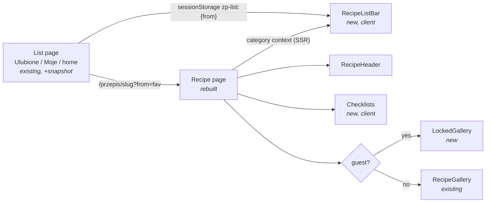

# Recipe page rebuild (E01-S07)

Issue: #210 · Epic: #201 · Design authority: `.ai/specs/backlog-przebudowa.md` (E01-S07, refs C3/A4/A5)

## 📝 TLDR

Every visitor of `/przepis/{slug}` (guests and signed-in users, many of them older) today
gets a page that cannot be walked as a list, hides who added the recipe behind small
grey text, and gives no way to tick off ingredients or steps while cooking. **Proposed:**
the page gains a list bar (`← {list}` + `N z M` + Poprzedni/Następny), a rebuilt header
(4:3 photo, breadcrumbs, 32 px title, `Kategoria · czas`, `Źródło: …` + `Otwórz oryginał`,
author line), 32 px checkboxes for ingredients and steps kept in `sessionStorage`,
`Krok N z M` labels, the existing `Wielkość tekstu` control, and a locked gallery teaser
for guests. Everything is built on the S01 tokens and primitives and meets WCAG 2.2 AA.

## 📝 Problem Statement

- A visitor who opens a recipe from Ulubione, Moje przepisy or the home list has to go
  back and re-scan the list to open the next one. That is many taps and a lost scroll
  position, which is worst for the target group.
- The header uses raw orange/grey Tailwind colours (`text-gray-500`, `text-orange-500`
  icons, `text-xs` tags) that fail the project's readability rules (helper text ≥ 16 px
  `#374151`, CLAUDE.md).
- Ingredients and steps are plain lists. In the kitchen, users lose their place.
- A guest never learns that the recipe has a photo gallery. The gallery is a login perk
  (decision Q3), but nothing advertises it, so it never works as one.

## 📝 Proposed Solution

One rebuilt server page, `src/app/przepis/[slug]/page.tsx`, composed of small, focused
components in `src/app/przepis/[slug]/_components/`. Only the list bar and the checklists
are client components.

**List context ("where did I come from").** The two options from the backlog are
combined:

1. A list page that wants prev/next writes a **snapshot** of what it rendered to
   `sessionStorage` (`zp-list:{from}` → `{ label, href, items: [{ slug, title }] }`),
   using a tiny client component, `<RecipeListSnapshot>`, and links its cards with
   `recipePath(slug, { from })`, which adds `?from={from}`.
2. The recipe page reads `?from`, but only **whitelisted keys** count (`fav`, `moje`,
   `home` now; S05/S16 add `szukaj`, `kat`). Any other value is ignored, and prev/next links
   never echo it. If a snapshot exists for a valid key **and contains the
   current slug**, the client bar shows `← {label}`, `N z M` and Poprzedni/Następny
   (preserving `?from`). Otherwise it falls back to the **category context**, which the
   server computes from `public_recipes` (same category, `created_at desc, id desc`):
   `{Kategoria} · N z M` plus prev/next.

Alternatives considered:
- *Server-only recompute of the source list from `?from=` + its filters* would SSR the
  bar, but it couples the recipe page to every list's query: home (S04), search (S05),
  category (S16), Ulubione and Moje each have their own filters and pagination. Three of
  those are being rebuilt in parallel right now. Rejected.
- *sessionStorage only, no `?from`* cannot tell "came from a list" apart from "opened a
  shared link in a tab that once visited a list". The result would be a stale bar. Rejected.

**Checklists.** Two client components, `IngredientChecklist` and `StepChecklist`, use
native `<input type="checkbox">` elements (32 px visual box, label row ≥ 48 px). The ticked
indexes are kept in `sessionStorage` under `zp-check:{recipeId}`. Ticking is personal and
per tab. It is never sent to the server.

**Gallery teaser.** A signed-in visitor gets the existing `RecipeGallery` grid unchanged.
A guest gets `<LockedGallery count>`: a lock icon, `Galeria {N} zdjęć po zalogowaniu` and a
`Zaloguj się` button (`loginPath(recipePath(slug))`). To show it without leaking the
images, `public_recipes` exposes only the **count** (see Data Model).

## 📝 Architecture

- **Primary module:** `src/app/przepis/[slug]/` (page + `_components/`). The layout,
  `AppShell` and `error.tsx` are unchanged.
- **Reused:** `ui/button.tsx`, `ui/chip.tsx`, `ui/text-size-controls.tsx` +
  `use-text-scale.ts` (`.text-scalable`), `RecipeGallery`, `FavoriteButton` (unchanged
  props and behaviour), `sourceLabel`, `categoryLabel`, `formatMinutes`, `parseIngredients`,
  `groupBySection`, `parseSteps`, `loginPath`, `recipePath`.
- **Changed shared code:**
  - `src/lib/routes.ts` — `recipePath(slug, opts?: { from?: string })` gains an optional
    `from`, so existing callers are unaffected. A new `categoryListPath(category)` returns
    `null` until S16 (#218) ships `/przepisy/{kategoria}`, and a new `profilePath(username)`
    returns `null` until S14 (#216) ships `/u/{username}`. These are the two single switches the
    later stories flip.
  - `src/lib/recipe-list-context.ts` (new) — a pure module: the snapshot type, the key
    format, `parseSnapshot` (defensive JSON → typed or `null`) and `locate(snapshot, slug)`
    → `{ index, total, prev, next } | null`. Unit-tested.
  - `RecipeCard` gains an optional `from` prop that is passed to `recipePath`.
- **List sources wired in this story:** Ulubione (`/ulubione`, label `Ulubione`), Moje
  przepisy (`/recipes`, label `Moje przepisy`) and the home list (`/`, label
  `Ostatnio dodane`). S05 (search) and S16 (category) adopt the same two-line API
  (`<RecipeListSnapshot>` + `from`) when they land.
- **Extension points left on the page (no behaviour now):**
  - `RecipeActions`, the header action row, renders `FavoriteButton` (S06, #209, owns its
    behaviour) and reserves the slot where S08 (#211) mounts the „Tryb gotowania” button.
  - A `{/* E01-S16: <SimilarRecipes …/> */}` slot after the steps, so S16 #218 adds
    „Ten przepis jest” + „Podobne” without restructuring the page.
- **SEO:** `generateMetadata` adds `alternates.canonical = recipePath(slug)`, so `?from=`
  variants never compete with the canonical URL.

Takeaway: list pages and the recipe page share only a storage key format and a pure
helper, so the S04/S05/S16 rebuilds can adopt it without touching the recipe page.

## 📝 Data Model

One additive, owner-gated migration, `supabase/migrations/20261017130000_public_recipes_author_username_gallery_count.sql`:
`create or replace view public.public_recipes` keeps every current column in its current
order and **appends** two columns:

| Column | Source | Why |
|---|---|---|
| `author_username` | `p.username` | The author link `/u/{username}` (S14). `profiles` is already anon-readable, so this is no new exposure. |
| `gallery_count` | `coalesce(cardinality(r.image_urls), 0)` | The guest teaser `Galeria N zdjęć`. A count only: the URLs stay login-only (decision Q3). |

- The grants are re-applied exactly as before (`revoke all` + `grant select` to `anon,
  authenticated`).
- **Deploy order:** the app reads the view with `select('*')` and treats both fields as
  optional, so the code ships safely **before** the migration. Until the migration runs,
  a guest sees no gallery teaser (today's behaviour) and the author name stays plain text.
- **Rollback:** re-run the previous view definition (`20261016230000`). The two columns
  disappear, and the app degrades as described above.
- **Rehearsal:** `.ai/qa/s07-rehearse-public-recipes-view.sql` runs the migration in a
  single transaction against production (there is no local DB). It only redefines the view
  and reads; it touches no rows, and the transaction is always rolled back and asserts that the columns exist, that the grants are
  intact, and that a sample count matches `cardinality(image_urls)`. It ends with
  `rollback`. The migration is **not applied** by this work (owner-gated).

## 📝 UI/UX

Mobile-first, single column (desktop layout is S17, #219). Order top to bottom:

1. **List bar** (sticky below the header is *not* required. It stays in flow so it does not
   eat screen height for low-vision zoom.) Row 1: `← {label}` link (underlined, ≥ 48 px
   target) and `N z M` (`aria-label="Przepis N z M na liście {label}"`). Row 2: two
   buttons, `← Poprzedni` / `Następny →`, each ≥ 56 px tall, with the neighbour's title
   as a visible second line. They are disabled (not hidden) at the list ends, with
   `aria-disabled`. Category fallback: the label is the category name. The `←` link renders
   only when `categoryListPath` is non-null (after S16). The bar is omitted when the recipe
   is the only one in its context.
2. **Header:** 4:3 photo (`aspect-[4/3]` at every width; `priority`; `alt` = title).
   Breadcrumbs `nav[aria-label="Okruszki"]`: `Strona główna › {Kategoria} › {tytuł}`. The
   category crumb is a link only when `categoryListPath` is non-null, and the last crumb has
   `aria-current="page"`. Title: `h1` at 32 px, `text-ink`. Meta line: `{Kategoria} · {czas}`
   (`total_time_minutes`, else prep + cook, `≈` when estimated, omitted if unknown), 17 px
   `text-ink-soft`. Source row: globe icon + `Źródło: {sourceLabel}` and an underlined
   `Otwórz oryginał` link (`target=_blank`, with the visible `(otwiera nową kartę)` in
   sr-only text). Author line: `Dodane przez {author}`, gender-neutral until S12 (#205) supplies
   gender. It is a link to `profilePath(author_username)` when that is non-null.
   `description` / `meta_description` stay below in 19 px. Tags stay as `Chip`s. Their
   S16 rework is out of scope.
3. **Action row** (`RecipeActions`): `FavoriteButton` (unchanged), plus the reserved S08
   slot.
4. **Wielkość tekstu** control (`TextSizeControls` + `useTextScale`), placed before the
   ingredients. It scales the ingredient and step lists (`.text-scalable`).
5. **Składniki** (`h2`): one checkbox row per ingredient. Section headings (`h3`) are kept.
   A ticked row gets `line-through` + `text-ink-soft`, so the state is never shown by colour
   alone. Below the heading sits a `Wyczyść zaznaczenia` text button, shown only when
   something is ticked.
6. **Przygotowanie** (`h2`): an `ol` of steps. Each step has a visible label
   `Krok N z M` (16 px bold) plus a checkbox labelled `Zrobione: krok N`.
7. Video (unchanged), then the **gallery**: grid for signed-in users. For guests:
   `LockedGallery` when `gallery_count > 1` (matching today's "a gallery of one repeats the
   cover" rule).
8. `{/* E01-S16 slot */}`, then the owner-only refresh/delete row, restyled with tokens.
   Its behaviour is unchanged.

States: no photo → no image box (no placeholder art); no steps → `Brak kroków
przygotowania.` in `text-ink-soft`; empty or invalid `sessionStorage` → everything unticked.

Accessibility: checkboxes are native and labelled by the row text. The focus ring is the
global `outline: 3px solid #1d4ed8; offset 2px`. Every icon has a visible text label. No
horizontal scroll at 320 px. Contrast uses tokens only (`text-ink`, `text-ink-soft`,
`bg-action` with white text).

Prototype: `.ai/specs/assets/recipe-page-rebuild/mockup.html` (static, illustrative;
rendered as `mockup-mobile.png`).

## 📝 Edge Cases & Failure Scenarios

- **Stale snapshot** (the list changed after it was rendered): prev/next go to slugs that
  may no longer exist, and that recipe page 404s through the normal `notFound()`. That is
  acceptable. The snapshot is refreshed the next time the list page renders.
- **The slug is not in the snapshot** (a shared link carrying `?from=`, or a different
  tab): fall back to the category context and never show a wrong `N z M`.
- **`sessionStorage` is unavailable or throws** (private mode, blocked storage): every read
  and write is wrapped. The list bar falls back to the category context, and the checklists
  work without persistence.
- **Malformed snapshot JSON:** `parseSnapshot` returns `null`, so the page falls back.
- **A paginated list** only snapshots the page the user saw. `N z M` counts within that
  page. This is documented and acceptable for MVP. S05's "Pokaż kolejne" appends to the
  snapshot.
- **A category context query fails:** the bar is omitted. The page still renders, because
  the bar is non-critical. The error is logged.
- **The migration has not been applied yet:** `author_username` and `gallery_count` are
  `undefined`. The author is plain text and guests get no teaser.
- **Hydration / layout shift:** when `?from` holds a valid key, the server renders the
  bar as a neutral placeholder with the same fixed `min-height` as the finished bar (two
  rows: 48 px + 56 px, plus padding) and no numbers. After mount the client fills it from
  the snapshot or, failing that, from the category context, which the server passes down as
  props. When `?from` is absent, the server renders the category bar complete, so there is
  no client swap at all. No `N z M` value is ever shown and then replaced.
- **New tab / Ctrl+click** from a list: `sessionStorage` is per tab, so the new tab has no
  snapshot and falls back to the category context while `?from` stays in the URL. This is
  intended and covered by a unit test of the fallback decision.
- **An unknown `?from` value** (a hand-edited or crafted URL): it is ignored and treated
  as absent, which a test covers. It never reaches a storage key or a rendered link.

## 📝 Risks & Impact Review

- **View migration (owner-gated, additive):** `create or replace view` can only append
  columns. Column order is preserved, so existing `select('*')` consumers (home, Ulubione,
  `supabase.types.ts`) are unaffected. Rollback means re-running the previous definition.
- **`recipePath` signature:** the change is additive (an optional second argument). All
  current call sites keep their output.
- **Category context cost:** four small parallel queries per page view (two `count: exact, head`
  for total and position, two `limit 1` for the neighbours) on `public_recipes(category, created_at)`. That is fine at the current data size. If needed
  later, an index on `recipes(category, created_at desc)` is a follow-up, not part of this
  story.
- **Product direction call, not a defect:** the `←` back link in the category fallback and
  the author link both wait for S16 and S14. Linking to routes that do not exist yet would
  break the "never link to a 404" rule set in S03b.

## 📋 Phasing

All three phases ship on **one implementation PR** (the S07 story). Each phase is a
separate commit that leaves the app working, and each phase's app code is safe to deploy
before the Phase 3 migration is applied.

- **Phase 1 — Header, checklists and text size** (no data change): the rebuilt header,
  action row with the extension slots, checklists, `Krok N z M`, text-size control, token
  restyle, canonical metadata. *Done when:* the checklist unit tests pass, and on the dev
  server ticking survives a reload but not a new tab, and A/A+/A++ scale both lists.
- **Phase 2 — List context:** the `recipe-list-context` lib, `recipePath(…, { from })`,
  `RecipeListSnapshot`, the snapshot wiring in Ulubione / Moje / home, the category
  fallback query, and `RecipeListBar`. *Done when:* the `locate`/`parseSnapshot`/whitelist
  unit tests pass; opening a recipe from Ulubione shows `← Ulubione · N z M`; Poprzedni is
  disabled on the first item and Następny on the last; and a direct link shows the
  category context.
- **Phase 3 — Gallery teaser and author link** (owner-gated migration): migration +
  rehearsal file, `LockedGallery`, the author link via `profilePath`. The app code ships
  before the migration and degrades gracefully. *Done when:* the rehearsal passes and is
  rolled back; a guest on a recipe with ≥ 2 gallery photos sees the teaser with the right
  N (verified against the rehearsal's sample, since the view is unchanged on prod until the
  owner applies it); and a signed-in user still sees the grid.

## 📋 Implementation Plan

### Phase 1 — Header, checklists and text size
1. Add `src/lib/recipe-checklist.ts` (pure: storage key, `parseChecked`, `toggle`) with
   unit tests.
2. Add `_components/recipe-header.tsx` (photo, breadcrumbs, h1, meta line, source row,
   author line as plain text; Phase 3 adds the link) and `_components/recipe-actions.tsx` (FavoriteButton + S08 slot comment).
   Wire them into `page.tsx` and remove `TimeBadge`/`MaybeLink`. Add a unit test for the
   `Kategoria · czas` formatter.
3. Add `_components/recipe-checklists.tsx` (client: `IngredientChecklist`, `StepChecklist`
   with `Krok N z M`, the text-size control, `Wyczyść zaznaczenia`). Replace the two
   sections in `page.tsx`.
4. Add `alternates.canonical` to `generateMetadata`. Restyle the owner row and the toasts'
   surroundings with tokens. The gate stays green.

### Phase 2 — List context
5. Add `src/lib/recipe-list-context.ts` (snapshot type, `listStorageKey`, `parseSnapshot`,
   `locate`) with unit tests. Extend `recipePath` with `{ from }`, and add
   `categoryListPath`/`profilePath` (both `null` for now). Extend `routes.test.ts`.
6. Add `src/app/components/recipe-list-snapshot.tsx` (client, writes the snapshot on
   render). Add the `from` prop to `RecipeCard`. Wire Ulubione (`fav`), Moje (`moje`) and
   home (`home`).
7. Add a server helper `loadCategoryContext(recipe)` in the page folder, plus
   `_components/recipe-list-bar.tsx` (client: SSR category fallback, upgraded to the
   snapshot after mount). Mount it at the top of the page.

### Phase 3 — Gallery teaser and author link
8. Write the migration `…_public_recipes_author_username_gallery_count.sql` and the
   rehearsal `.ai/qa/s07-rehearse-public-recipes-view.sql`. Run the rehearsal (rolled back).
   Do **not** apply the migration.
9. Add `_components/locked-gallery.tsx`. In `page.tsx`, read `gallery_count` and
   `author_username` as optional fields: the guest gets the teaser when `gallery_count > 1`,
   and the author becomes a link when `profilePath(author_username)` is non-null. Update
   `PublicRecipe` typing accordingly.
10. Verify against the dev server as a guest and as a signed-in user, at 375 px and on
    desktop. Check these explicitly:
    - prev/next from Ulubione at the first, a middle and the last item;
    - a direct link (category context);
    - an unknown `?from`;
    - checklist persistence across a reload;
    - no horizontal scroll at 320 px;
    - the teaser and the grid.

    Run the full gate. Browser e2e coverage of these flows belongs to the test-plan
    rollout (Module 3, Lesson 4), not this story.

## Resolved assumptions (autonomous defaults)

| # | Question | Default chosen | Rationale |
|---|---|---|---|
| Q1 | Is S07 one spec, or should list navigation be split off? | One spec in three phases, one implementation PR, with one commit per phase | The backlog sizes S07 as one story, and the issue tracks it as one. Each phase's app code is deploy-safe before the owner-gated migration, so the migration needs no PR of its own. The owner can still apply it separately. |
| Q2 | How is the source list carried: `?from=` or sessionStorage? | Both: `?from` names the list, a sessionStorage snapshot holds its order. Category fallback is computed server-side | Avoids coupling the page to three lists that are being rebuilt in parallel, and avoids a stale bar on shared links. |
| Q3 | How does a guest learn `N` for `Galeria N zdjęć` when the gallery is login-only? | Append `gallery_count` (count only) to `public_recipes`. Owner-gated migration; the app degrades without it | Keeps decision Q3: no URLs are exposed to anon. This is the smallest schema change that satisfies the AC. Applying it stays an owner decision (owner-gated migration), which is the human checkpoint. |
| Q4 | Should the author line link to `/u/{username}` before S14 exists? | No. Plain text until `profilePath` is switched on by S14. `author_username` is added to the view now | Never link to a 404 (S03b rule). One switch for S14. |
| Q5 | "Dodała / Dodał" gendered form? | Gender-neutral `Dodane przez` until S12 supplies gender | The S12 story owns gender. This keeps the current behaviour. |
| Q6 | Where does `← {Kategoria}` go before S16's category page exists? | The back link is hidden in the category fallback. `N z M` and prev/next still work | No route to link to yet. `categoryListPath` is the single switch. |
| Q7 | Cooking-mode button and „Podobne” section? | Reserved slots only (S08, S16 own them) | They are explicitly separate stories. |
| Q8 | Should checkbox state persist across sessions/devices? | No: `sessionStorage` per tab, as the AC states | Matches the AC. No new server state. |
