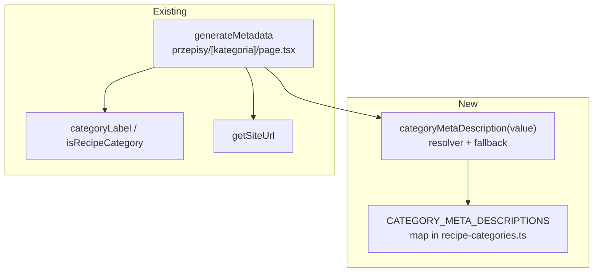

# Meta description for category pages

> Risk: **low** (metadata-only change on one existing public route; no schema, no migration, no data
> read added to the hot path). Extends S09/S16/S22's `/przepisy/{kategoria}`
> (`.ai/specs/2026-10-17-category-tags-similar.md`) and the SEO work in
> `.ai/specs/2026-10-20-sitemap-and-md-alternates.md` (#363/#364/#366).

## 📝 TLDR
Every category listing at `/przepisy/{kategoria}` (12 categories: Obiady, Zupy, Desery, Ciasta …)
currently emits **no `<meta name="description">`** and no Open Graph / Twitter tags. Its
`generateMetadata` (`src/app/przepisy/[kategoria]/page.tsx:29`) sets only `title` and `alternates`, so
all 12 pages inherit the one generic root-layout description — "Archiwum przepisów udostępnianych z
mediów społecznościowych." *(Proposed future behavior:)* give each category a **hand-written, unique
one-sentence description** and bring the page up to the full recipe-page metadata pattern
(`description` + `openGraph` + `twitter`), so search snippets and link-preview cards describe the
actual category instead of repeating one generic line twelve times.

## 📝 Problem Statement
- `generateMetadata` for the category route returns `{ title, alternates }` and **no `description`**
  (`src/app/przepisy/[kategoria]/page.tsx:29-40`). Recipe pages (`przepis/[slug]/page.tsx:38-60`) and
  profile pages (`u/[username]/page.tsx:109`) both set one, plus OG/Twitter on recipes; category pages
  are the gap.
- Result: Google and social cards show the same generic sentence from `src/app/layout.tsx:7` for all
  12 category URLs. Every category looks identical in a SERP and none says what it lists — a direct
  loss on 12 of the site's most linkable, highest-intent landing pages.
- The recent SEO work (sitemap + `.md` alternates, #363/#364/#366) made these pages discoverable and
  canonical; a real on-page description is the remaining basic SEO signal they lack.

## 📝 Proposed Solution
Store **one hand-written Polish sentence per category** in a map keyed by the category value, next to
`RECIPE_CATEGORIES` in `src/lib/recipe-categories.ts`, and read it from the category route's
`generateMetadata`. The route gains `description`, `openGraph` (title + description + a site-level
image) and `twitter` (summary card), mirroring the recipe page so the three stay consistent.

No new route, no schema change, and **no DB read added** — the description is static content derived
from the category enum, resolved synchronously. The `canonical` already points at the bare category
URL for every request (the current code never reads `searchParams`), so filtered/paged variants
(`?tag=…`, `?strona=…`) inherit the same description with zero extra work — confirmed by the owner:
filter variants canonicalize to the main category.

**Alternatives considered**
- *One shared template* (`Przepisy z kategorii {Kategoria}…`) — rejected per Q1: 12 near-identical
  snippets are exactly what a SERP penalizes; the editorial cost of 12 sentences is trivial and
  one-off.
- *Dynamic description with the live recipe count* (`Ciasta: 203 przepisy…`) — rejected: couples
  metadata to a DB read, and a page is statically-rendered/edge-cached while the count drifts, so the
  snippet and the visible count disagree. The count already shows in the page body; it does not belong
  in a cached `<meta>`.
- *Per-category Open Graph image (generated card)* — deferred to a follow-up: categories have no single
  dish photo, and generating 12 branded OG images is its own task. This spec uses the existing site
  icon as a modest brand image so cards are not image-less.

## 📝 Architecture
Single-file data + single-function wiring; no new modules.



Takeaway: the only new surface is a static copy map plus a tiny pure resolver in the file that already
owns category identity (`recipe-categories.ts`). `generateMetadata` goes from `{ title, alternates }`
to `{ title, description, alternates, openGraph, twitter }` — the same shape recipe pages already
return. Nothing else imports or changes.

## 📝 Data Model
No tables, columns, relations, or migrations. The "data" is a compile-time constant:

```ts
// src/lib/recipe-categories.ts
export const CATEGORY_META_DESCRIPTIONS: Record<RecipeCategory, string> = {
  obiady: '…',   // one hand-written sentence each, 12 entries
  zupy: '…',
  // … all 12, keyed by RecipeCategory so a new enum value fails typecheck until copy is added
}
```

Because the map is a `Record<RecipeCategory, string>`, adding a 13th category to the
`recipe_category` enum **fails `pnpm typecheck`** until its sentence is written — the copy can never
silently go missing. A defensive resolver still guards the runtime path:

```ts
export function categoryMetaDescription(value: RecipeCategory): string
// returns the mapped sentence; if somehow empty, a templated fallback
// `Przepisy z kategorii ${categoryLabel(value)} w aplikacji Zapisz Przepis.`
```

**Copy rules** (each sentence): Polish; ≤ ~155 characters (so Google does not truncate); leads with the
category noun; names what the category lists and the "zapisane z mediów społecznościowych" angle; no
recipe count (would drift); unique wording per category. Brand name "Zapisz Przepis" per project rules.
Draft set below (owner edits freely before merge):

| value | label | draft sentence |
|---|---|---|
| obiady | Obiady | Pomysły na obiad zapisane z mediów społecznościowych — sprawdzone przepisy na dania główne krok po kroku. |
| zupy | Zupy | Przepisy na zupy zapisane z sieci — od rosołu po kremy, prosto i krok po kroku. |
| desery | Desery | Przepisy na desery zebrane z mediów społecznościowych — słodkości na każdą okazję, krok po kroku. |
| ciasta | Ciasta | Przepisy na ciasta zapisane z sieci — od drożdżówek po torty, sprawdzone i opisane krok po kroku. |
| ciasteczka | Ciasteczka | Przepisy na ciasteczka i kruche wypieki zapisane z mediów społecznościowych, krok po kroku. |
| sniadania | Śniadania | Pomysły na śniadanie zapisane z sieci — od owsianek po jajka, szybko i krok po kroku. |
| pieczywo | Pieczywo | Przepisy na chleb i domowe pieczywo zapisane z mediów społecznościowych, krok po kroku. |
| przekaski | Przekąski | Przepisy na przekąski i dania na imprezę zapisane z sieci, krok po kroku. |
| salatki | Sałatki | Przepisy na sałatki zapisane z mediów społecznościowych — lekkie i sycące, krok po kroku. |
| napoje | Napoje | Przepisy na napoje i koktajle zapisane z sieci, krok po kroku. |
| syropy | Syropy i napary | Przepisy na syropy i napary zapisane z mediów społecznościowych — domowe sposoby krok po kroku. |
| inne | Inne | Pozostałe przepisy zapisane z mediów społecznościowych, które nie trafiły do innych kategorii. |

## 📝 API Contracts
No HTTP contract changes. The page's emitted `<head>` gains tags; the `Metadata` object returned by
`generateMetadata` changes shape:

```ts
// before
{ title, alternates }
// after
{
  title,                       // unchanged: `${categoryLabel(category)} · Zapisz Przepis`
  description,                 // categoryMetaDescription(category)
  alternates,                  // unchanged (canonical + text/markdown .md)
  openGraph: { title, description, type: 'website', images: [SITE_OG_IMAGE] },
  twitter:   { card: 'summary', title, description },
}
```

- `SITE_OG_IMAGE` = absolute `${getSiteUrl()}/icons/icon-512x512.png` (the existing PWA icon; the only
  site-level image available). `twitter.card: 'summary'` because it is a logo, not a wide hero.
- `openGraph.title` omits the `· Zapisz Przepis` suffix or keeps it? → keeps `categoryLabel(category)`
  alone as the OG title (cleaner card headline), with the site name carried by `openGraph.siteName`
  if we add one; `title` (the `<title>`) keeps the suffix. (Minor; implementer may align to recipe
  page, which uses the bare `recipe.title` as OG title.)
- Unknown category: `generateMetadata` already early-returns `{}` for a non-category
  (`!isRecipeCategory`) → stays `{}`, no description. Unchanged.

## 📝 UI/UX
No visible UI. The change is entirely in `<head>`. Verification is by reading the rendered metadata
(View Source / `read_page`) and a unit test, not a screenshot.

## 📝 Edge Cases & Failure Scenarios
- **Non-category slug** (`/przepisy/xyz`): `generateMetadata` returns `{}` (guarded by
  `isRecipeCategory`), the page `notFound()`s — unchanged, no description leaked.
- **New enum value added later**: `Record<RecipeCategory, string>` makes `pnpm typecheck` fail until
  copy exists → cannot ship a category with a missing description. Runtime fallback covers the
  impossible-but-defensive empty-string case.
- **Filtered / paged variant** (`?tag=kruche`, `?strona=3`): same description as the bare category,
  because `generateMetadata` ignores `searchParams` and `canonical` already collapses the variant onto
  the main category URL. Intended.
- **Sentence too long**: a sentence over ~160 chars is silently truncated by Google; mitigated by the
  copy rule and a test asserting every sentence is ≤ 160 characters.

## 📝 Risks & Impact Review
- **Reversibility**: fully reversible — revert one commit; no data or schema touched.
- **Blast radius**: one route's `generateMetadata` + one constant. No runtime data path, no auth, no
  new query. Cannot affect page rendering or guest access.
- **SEO impact is positive but not instant**: snippets update only after Google re-crawls; the sitemap
  (#364) already nudges that. No risk of deindexing (canonical and robots unchanged).
- **Editorial accuracy**: the draft sentences are the owner's to approve/rewrite before merge; wrong
  copy is a text edit, not a code change.
- **Image choice**: using the PWA icon as the OG image is a deliberate stopgap; a per-category branded
  card is a named follow-up, not a blocker.

## 📋 Phasing
Single phase — the change is atomic (map + wiring + test land together; a half-done version would ship
some categories without copy, which the typed `Record` forbids anyway).

## 📋 Implementation Plan

**Phase 1 — Category meta descriptions**

1. **Add the copy map + resolver.** In `src/lib/recipe-categories.ts`, add
   `CATEGORY_META_DESCRIPTIONS: Record<RecipeCategory, string>` (all 12 draft sentences) **and** the
   `categoryMetaDescription(value)` resolver that reads it. Both are new exports in a file that is
   already imported — no cross-file import/usage split, so the edit-discipline rule is satisfied
   in-file. Leaves the app working (nothing consumes the new exports yet).
2. **Wire `generateMetadata`.** In `src/app/przepisy/[kategoria]/page.tsx`, import
   `categoryMetaDescription` and add `description`, `openGraph`, `twitter` to the returned `Metadata`
   in one edit (import + usage together, per the edit-discipline rule). Reuse `getSiteUrl` (already
   imported) for the absolute OG image URL. App works; pages now emit the tags.
3. **Unit test the copy + resolver.** In `src/lib/recipe-categories.test.ts`: every `RecipeCategory`
   has a non-empty mapped sentence; each sentence ≤ 160 chars; sentences are unique; the fallback
   returns the template for an empty mapping. (Testable without HTTP — the resolver is pure.)
4. **Verify rendered metadata.** Run the dev server, open two category pages (e.g. `/przepisy/ciasta`,
   `/przepisy/zupy`), read the `<head>` and confirm distinct `<meta name="description">`,
   `og:description`, `twitter:description`, and that the canonical is still the bare category URL.
5. **Gate.** `pnpm typecheck && pnpm lint && pnpm test`; land via branch → PR per project rules.
