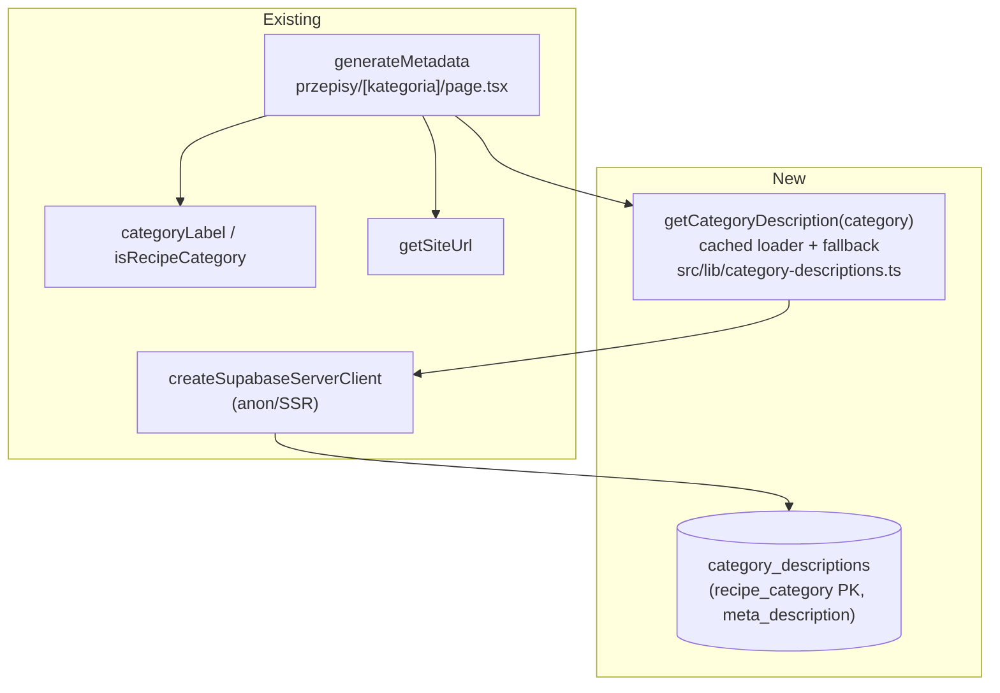
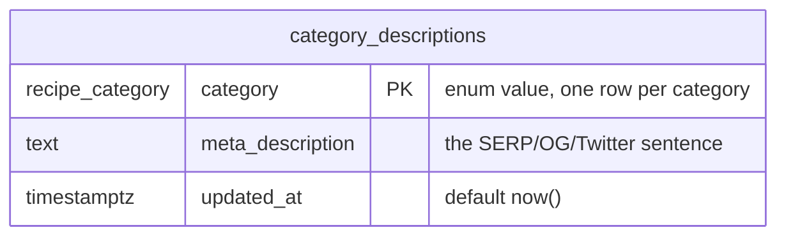

# Meta description for category pages

> Risk: **low–medium** (metadata-only behavior on one existing public route, plus one new
> single-column lookup table seeded via the Management API — no change to existing tables, no change
> to rendering or guest access). Extends S09/S16/S22's `/przepisy/{kategoria}`
> (`.ai/specs/2026-10-17-category-tags-similar.md`) and the SEO work in
> `.ai/specs/2026-10-20-sitemap-and-md-alternates.md` (#363/#364/#366).

## 📝 TLDR
Every category listing at `/przepisy/{kategoria}` (12 categories: Obiady, Zupy, Desery, Ciasta …)
currently emits **no `<meta name="description">`** and no Open Graph / Twitter tags. Its
`generateMetadata` (`src/app/przepisy/[kategoria]/page.tsx:29`) sets only `title` and `alternates`, so
all 12 pages inherit the one generic root-layout description — "Archiwum przepisów udostępnianych z
mediów społecznościowych." *(Proposed future behavior:)* store a **unique per-category description in
the database** (a new `category_descriptions` table the owner edits in Supabase without a deploy),
read it in `generateMetadata`, and bring the page up to the full recipe-page metadata pattern
(`description` + `openGraph` + `twitter`) — so search snippets and link-preview cards describe the
actual category, and the copy can be tuned without shipping code.

## 📝 Problem Statement
- `generateMetadata` for the category route returns `{ title, alternates }` and **no `description`**
  (`src/app/przepisy/[kategoria]/page.tsx:29-40`). Recipe pages (`przepis/[slug]/page.tsx:38-60`) and
  profile pages (`u/[username]/page.tsx:109`) both set one, plus OG/Twitter on recipes; category pages
  are the gap.
- Result: Google and social cards show the same generic sentence from `src/app/layout.tsx:7` for all
  12 category URLs. Every category looks identical in a SERP and none says what it lists — a direct
  loss on 12 of the site's most linkable, highest-intent landing pages.
- SEO copy is marketing content that gets tuned repeatedly; routing every tweak through a PR + build
  is friction the owner wants to avoid, so the text should live as **data, not code**.

## 📝 Proposed Solution
Add a new table `category_descriptions`, keyed by the `recipe_category` enum, with one
`meta_description` text column. A small cached loader (`src/lib/category-descriptions.ts`) reads it;
the category route's `generateMetadata` calls the loader and sets `description`, `openGraph`
(title + description + a site-level image) and `twitter` (summary card), mirroring the recipe page so
the three stay consistent.

Reading the DB inside `generateMetadata` is already how the recipe page works
(`loadRecipe` is called from both its `generateMetadata` and its render, wrapped in React `cache()` so
one request hits the DB once); this spec follows the same pattern. The read is a single primary-key
lookup on a 12-row table.

A **templated fallback** (`Przepisy z kategorii {Kategoria} w aplikacji Zapisz Przepis.`) covers any
category with no row and any read error, so a page is **never** description-less and a DB hiccup never
turns a metadata read into a 500.

The `canonical` already points at the bare category URL for every request (the current code never
reads `searchParams`), so filtered/paged variants (`?tag=…`, `?strona=…`) inherit the same description
— confirmed by the owner: filter variants canonicalize to the main category.

**Alternatives considered**
- *Typed `Record<RecipeCategory,string>` in the repo* — rejected per the owner: copy edits would need a
  PR + Cloudflare build each time. The repo map's one real advantage (typecheck forces all 12 to
  exist) is replaced here by a seed migration that inserts all 12 and a guaranteed fallback.
- *One shared template for all 12* — rejected: 12 near-identical snippets are what a SERP penalizes.
  The template survives only as the safety fallback, not as the primary content.
- *Dynamic description with the live recipe count* — rejected: couples the snippet to a volatile number
  and makes a cached `<meta>` disagree with the visible count.
- *Admin UI to edit descriptions in-app* — declined by the owner; editing happens directly in the
  Supabase dashboard, as other owner-only data edits already do.
- *Per-category Open Graph image* — deferred to a follow-up: categories have no single dish photo;
  this spec uses the existing site icon so cards are not image-less.

## 📝 Architecture



Takeaway: one new table and one cached loader. `generateMetadata` goes from `{ title, alternates }` to
`{ title, description, alternates, openGraph, twitter }` — the same shape recipe pages already return —
and gains one PK read that degrades to a template on miss or error. No existing table, view, or route
changes; the render path is untouched (the description lives only in `<head>`).

## 📝 Data Model



One new table; no relations (the key is the `recipe_category` enum, which has no backing table), no
change to any existing table or to `public_recipes`.

```sql
create table if not exists public.category_descriptions (
  category public.recipe_category primary key,
  meta_description text not null check (char_length(meta_description) between 1 and 160),
  updated_at timestamptz not null default now()
);
alter table public.category_descriptions enable row level security;
-- SEO copy is public; generateMetadata runs as the anonymous SSR client for crawlers.
create policy if not exists category_descriptions_public_read
  on public.category_descriptions for select to anon, authenticated using (true);
-- No insert/update/delete policy: only the service role / dashboard writes, as with other owner data.
```

- **RLS**: read-only for `anon` + `authenticated` (crawlers are anonymous; the route uses the guest SSR
  client). No write policy — edits are owner-only through the Supabase dashboard / Management API,
  matching how QA accounts and other owner data are handled (`CLAUDE.md`, dev-qa-login memory).
- **The 160-char `check`** enforces the SERP length rule at the data layer, so a too-long paste is
  rejected on write rather than silently truncated by Google.
- **Applied as an idempotent migration through the Supabase Management API** and registered in
  `schema_migrations`, per the project's migration convention (apply-prod-migrations-via-management-api
  memory; Management-API-UTF-8-via-stdin memory — the Polish seed text has `ł/ó/ą`, so send the SQL as
  a UTF-8 file on stdin, never via `jq --arg`).
- **Seed** (same migration, idempotent `insert … on conflict (category) do nothing` so a later owner
  edit is never overwritten by a re-run): the 12 draft sentences below. Owner edits them freely in the
  dashboard afterwards.

| category | label | seed sentence |
|---|---|---|
| obiady | Obiady | Pomysły na obiad zapisane z mediów społecznościowych — sprawdzone przepisy na dania główne krok po kroku. |
| zupy | Zupy | Przepisy na zupy zapisane z sieci — od rosołu po kremy, prosto i krok po kroku. |
| desery | Desery | Przepisy na desery zebrane z mediów społecznościowych — słodkości na każdą okazję, krok po kroku. |
| ciasta | Ciasta | Przepisy na ciasta zapisane z sieci — od drożdżówek po torty, sprawdzone i opisane krok po kroku. |
| ciasteczka | Ciasteczka | Przepisy na ciasteczka i kruche wypieki zapisane z mediów społecznościowych, krok po kroku. |
| sniadania | Śniadania | Pomysły na śniadanie zapisane z sieci — od owsianek po jajka, szybko i krok po kroku. |
| pieczywo | Pieczywo | Przepisy na chleb i domowe pieczywo zapisane z mediów społecznościowych, krok po kroku. |
| przekaski | Przekąski | Przepisy na przekąski i dania na imprezę zapisane z sieci, krok po kroku. |
| salatki | Sałatki | Przepisy na sałatki zapisane z mediów społecznościowych — lekkie i sycące, krok po kroku. |
| napoje | Napoje | Przepisy na napoje i koktajle zapisane z sieci, krok po kroku. |
| syropy | Syropy i napary | Przepisy na syropy i napary zapisane z mediów społecznościowych — domowe sposoby krok po kroku. |
| inne | Inne | Pozostałe przepisy zapisane z mediów społecznościowych, które nie trafiły do innych kategorii. |

## 📝 API Contracts
No HTTP contract changes. The page's emitted `<head>` gains tags; two new internal surfaces:

```ts
// src/lib/category-descriptions.ts
export const getCategoryDescription = cache(
  async (category: RecipeCategory): Promise<string> => { /* PK read → row.meta_description, else fallback */ }
)
export function fallbackCategoryDescription(category: RecipeCategory): string
//   `Przepisy z kategorii ${categoryLabel(category)} w aplikacji Zapisz Przepis.`
```

```ts
// generateMetadata return, before → after
// before: { title, alternates }
// after:
{
  title,                       // unchanged: `${categoryLabel(category)} · Zapisz Przepis`
  description,                 // await getCategoryDescription(category)
  alternates,                  // unchanged (canonical + text/markdown .md)
  openGraph: { title: categoryLabel(category), description, type: 'website', images: [SITE_OG_IMAGE] },
  twitter:   { card: 'summary', title: categoryLabel(category), description },
}
```

- `SITE_OG_IMAGE` = absolute `${getSiteUrl()}/icons/icon-512x512.png` (the existing PWA icon, the only
  site-level image). `twitter.card: 'summary'` because it is a logo, not a wide hero.
- Unknown category: `generateMetadata` already early-returns `{}` for a non-category
  (`!isRecipeCategory`) → stays `{}`; the loader is never called for one. Unchanged.

## 📝 UI/UX
No visible UI (the owner edits rows in the Supabase dashboard; no in-app admin screen — declined).
The change is entirely in `<head>`. Verification is by reading the rendered metadata (View Source /
`read_page`) and unit tests, not a screenshot.

## 📝 Edge Cases & Failure Scenarios
- **No row for a category** (table seeded partially, or a new enum value added before its row exists):
  loader returns `fallbackCategoryDescription(category)` → the templated sentence. Never empty.
- **DB read fails / table absent** (e.g. route deployed before the migration): loader catches, logs,
  returns the fallback. Metadata degrades to the template; the page still renders. No 500.
- **Non-category slug** (`/przepisy/xyz`): `generateMetadata` returns `{}` (guarded by
  `isRecipeCategory`); the loader is not called; the page `notFound()`s. Unchanged.
- **Filtered / paged variant** (`?tag=kruche`, `?strona=3`): same description as the bare category —
  `generateMetadata` ignores `searchParams` and `canonical` collapses the variant onto the main URL.
- **Over-long edit**: the `check (char_length … between 1 and 160)` rejects the write; the owner sees
  the constraint error in the dashboard instead of a truncated SERP snippet.
- **Polish diacritics in the seed** (`ł`, `ó`, `ą`): the Management-API call must send UTF-8 via stdin
  (project memory) or the characters mangle to `U+FFFD`/HTML entities.

## 📝 Risks & Impact Review
- **Reversibility**: code reverts in one commit; the table is dropped with `drop table if exists
  public.category_descriptions` (idempotent down-migration). No existing data touched.
- **Blast radius**: one route's `generateMetadata` + one new isolated table. The render path and guest
  access are unchanged; the worst failure mode is "falls back to the template", not a broken page.
- **New DB read in `generateMetadata`**: one PK lookup on a 12-row table, React-`cache()`d per request
  and edge-cacheable with the page. Negligible, and the same pattern the recipe page already uses.
- **RLS correctness is the one thing to get right**: the read must succeed for the anonymous SSR
  client (crawlers), so the public-read policy is load-bearing. A test / manual check confirms a guest
  request gets the real description, not the fallback.
- **Migration ordering**: because the loader falls back on a missing table, app and migration can land
  in either order without breaking; still, apply + seed the migration so the real copy appears. Verify
  on production per the verify-on-production memory (the live Cloudflare build, not just local dev).
- **SEO impact is positive but not instant**: snippets update after Google re-crawls; the sitemap
  (#364) nudges it. Canonical and robots unchanged, so no deindex risk.

## 📋 Phasing
Single phase — but with a clear **migration-then-wire** order inside it. The table + seed is applied
first (owner-run Management-API step), then the loader + `generateMetadata` ship as code. The code is
safe to deploy even if the migration is delayed, thanks to the fallback.

## 📋 Implementation Plan

**Phase 1 — Category descriptions in the DB**

1. **Migration + seed (data step, Management API).** Author an idempotent migration: `create table if
   not exists category_descriptions`, enable RLS, add the public-read policy, `insert … on conflict do
   nothing` the 12 seed rows. Apply it through the Supabase Management API (UTF-8 via stdin for the
   Polish text) and register the version in `schema_migrations`. Provide the exact SQL + down-migration
   in the PR body so the owner can review/run it. Regenerate Supabase types if the repo commits them.
2. **Loader (`src/lib/category-descriptions.ts`).** Add `getCategoryDescription` (React `cache()`, PK
   read via `createSupabaseServerClient`, returns `meta_description` or `fallbackCategoryDescription`)
   **and** `fallbackCategoryDescription`, with the import and first usage in the same edit per the
   edit-discipline rule. Leaves the app working (nothing consumes it yet).
3. **Wire `generateMetadata`.** In `src/app/przepisy/[kategoria]/page.tsx`, import
   `getCategoryDescription` and add `description` (awaited), `openGraph`, `twitter` to the returned
   `Metadata` in one edit (import + usage together). Reuse the already-imported `getSiteUrl` for the
   absolute OG image URL. App works; pages now emit the tags.
4. **Tests.** Unit-test the loader with a mocked Supabase client: returns the row's text on a hit;
   returns the template on a miss and on a thrown error; `fallbackCategoryDescription` is non-empty and
   ≤ 160 chars for every `RecipeCategory` (iterate `RECIPE_CATEGORIES`). Pure where possible; mock only
   the client boundary.
5. **Verify.** Local dev against the (seeded) prod DB: open `/przepisy/ciasta` and `/przepisy/zupy`,
   read the `<head>`, confirm distinct `<meta name="description">`, `og:description`,
   `twitter:description`, and that canonical is still the bare category URL. Then confirm a guest
   (anon) request gets the real row text, not the fallback (RLS check).
6. **Gate.** `pnpm typecheck && pnpm lint && pnpm test`; land via branch → PR per project rules; note in
   the PR that the migration must be applied to prod (owner-gated) and verify on the live build.
