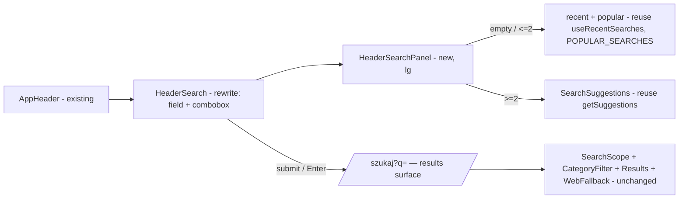

# Desktop header search — one visible field that opens a search panel

> Epic: E01 (przebudowa) · Supersedes: S17 resolved assumption **A8** ("Signed-in header search … Rendered everywhere") · Touches: `components/app-header.tsx`, `components/header-search.tsx` (rewrite), new `components/header-search-panel.tsx`, and the desktop state of `szukaj/page.tsx`.
> Design reference: `.ai/design/przebudowa-handoff/designs/Propozycja A.dc.html` (A8 header), `ISSUE_lupa_szukaj.md` (mobile full-screen search — reused here as the desktop panel's content).
> Decisions settled with the owner (2026-10-20): visible field that opens a panel (not icon-only, not a plain field); header search on every signed-in page; guests unchanged; `/szukaj` desktop reworked so nothing duplicates the field.

## 📝 TLDR

Today, a **signed-in** desktop user (`lg` ≥ 1024 px) sees a full search input in the header on **every** page, including the two pages that already carry their own big search field — `/szukaj` and the member home — so two search fields stack on one screen (the „nieład"). **Proposed (future behavior):** the desktop header keeps **one** visible search field for signed-in users, and that field becomes the single search surface: on focus it opens an anchored **panel** (the desktop twin of the mobile full-screen search — recent + popular + live suggestions + „Powiedz"). `/szukaj` on desktop drops its own big field and becomes a results surface driven by the header field. No second field renders anywhere. Guests are unchanged (search via „Przepisy" and the home hero). Everything below `lg` is untouched: the mobile „Szukaj" icon-link and the full-screen `/szukaj` view ship exactly as today.

## 📝 Problem Statement

Current desktop (`lg`+) behavior, from the code:

| Page | Signed-in header | Page's own search | Result |
|---|---|---|---|
| `/szukaj` | `HeaderSearch` field | `HomeSearch` big bar + scope tabs + suggestions | **two fields** (the screenshot) |
| Member home `/` | `HeaderSearch` field | `HomeSearch` „Czego szukasz?" field | **two fields** |
| Recipe / favorites / profile / settings / … | `HeaderSearch` field | none | one field — the only entry point |

- **Duplication.** `app-header.tsx:105` renders `HeaderSearch` with no pathname guard, unlike the mobile „Szukaj" link (`app-header.tsx:110`, guarded `pathname !== SEARCH_PATH`). On `/szukaj` and the member home the header field repeats a field the page already shows larger.
- **It is the only search affordance, yet it is passive.** The header field submits but offers nothing the page fields do (no recent, popular, live suggestions, or voice), so on pages without their own field (recipe, settings, …) the signed-in user gets a weaker search than on `/szukaj`.
- **Prominence.** The report questioned whether the navbar should carry *such a large* field. Resolved: keep it **visible** (evidence below) but make it do more, and remove the competing page fields instead of shrinking it to an icon.

This duplication was never a deliberate product decision: S17 set it with the autonomous default **A8** ("Rendered everywhere … distinct landmark labels avoid ambiguity"), a reversible assumption flagged for human override — overridden here. The mobile handoff (`ISSUE_lupa_szukaj.md`) governs only below `lg`.

### Evidence for a visible field (not an icon, not a hidden modal)

Search-UX consensus, weighed against this project's audience (older users, high readability, WCAG 2.2 AA, "no gesture without a button equivalent"):

- Icon-only search is markedly harder to find on desktop and is not recommended there; a visible field is the convention and reads as higher-quality (NN/g, as relayed by the NSW design-system forum; Coveo).
- Hiding the field behind a button adds a click and lowers usage; GitLab measured a search-usage drop after collapsing its search into the nav.
- Overlays are fine but need deliberate focus management (auto-focus-in, focus-return-to-trigger, persisted input); the "button reveals field, focus moves in, returns on close" pattern is documented (UK ICDS).

So: keep a visible field, enrich it with an anchored panel, and avoid a blocking full-screen modal on desktop. See *Proposed Solution → alternatives* for why the panel is a dropdown, not a full-screen overlay.

## 📝 Proposed Solution

A **visible search field in the header** (signed-in, `lg`+, on every page) that, once focused or typed into, opens an **anchored panel directly below it** — the desktop realization of the mobile full-screen search:

- **Empty / ≤ 2 letters:** „Ostatnio i często szukane" — recent queries (signed-in, localStorage) then popular queries, as chips/rows. Reuses `useRecentSearches` + `POPULAR_SEARCHES`.
- **≥ 2 letters:** live recipe „Podpowiedzi" (debounced, the `getSuggestions` server action) + „Pokaż wszystkie wyniki dla „…"". Reuses `SearchSuggestions`.
- **Voice:** „Powiedz" (`startVoiceSearch` + `ListeningScreen`), as on the page fields.
- **Submit / Enter / „Pokaż wszystkie wyniki":** navigates to `/szukaj?q=…` (results stay on `/szukaj`).

The field stays a plain **GET `<form action="/szukaj">`**, so it works before hydration and with JS off; the panel, suggestions, and voice are progressive enhancements. This mirrors how the page fields already degrade.

`/szukaj` on desktop stops rendering its own big field: the header field is the input (prefilled with the active `q`), and the page body is the results surface (scope tabs, category filter, results, web-search fallback). Below `lg`, `/szukaj` is unchanged — the app header steps aside (`max-lg:hidden`) and the full-screen view with its own `HomeSearch` + `QuickSearchBar` + „✕ Zamknij" bar ships as today.

**Alternatives considered:**

- *Icon-only trigger in the header (like mobile).* Rejected: worse discoverability on desktop for this audience (evidence above); the mobile icon exists because the phone has no room for a persistent field — desktop does.
- *Full-screen / centered modal overlay on desktop.* Rejected as the default: it blocks the page, wastes desktop width, needs a focus trap, and is a jarring way to tweak a query on a results page. An anchored dropdown under a visible field is the familiar autocomplete pattern (Google/Amazon/YouTube) and keeps the field live on `/szukaj`. The mobile full-screen view stays full-screen — small viewport, different constraints.
- *Hide the header field on `/szukaj` and the member home (keep the page fields).* Rejected: it leaves the header search inconsistent page-to-page (present here, absent there) and keeps the owner's "one search box in the chrome" intent only partly. Making the header field canonical and dropping the page's big field is the cleaner inversion.
- *Shrink the header field.* Not needed once the competing page field is gone; shrinking would only hurt readability for the target audience.

## 📝 Architecture

| Area | File | Change |
|---|---|---|
| Header field | `components/header-search.tsx` (rewrite) | Still a `role="search"` GET form to `SEARCH_PATH`, `lg:flex`, signed-in only. Gains: stable input `id="header-search"`, `defaultValue` from the current `q` (via `useSearchParams`, so it prefills on `/szukaj`), the „Powiedz" mic, and ARIA combobox wiring (`role="combobox"`, `aria-expanded`, `aria-controls`, `aria-activedescendant`) for the panel. Keeps `max-w-[460px]`, 48 px, 2 px `border-field` (3:1), visible „Szukaj" submit. |
| Header panel | new `components/header-search-panel.tsx` (client) | The anchored dropdown bound to `fieldId="header-search"` via `useFieldValue`. Empty/≤2 → recent + popular chips; ≥2 → `SearchSuggestions`. Opens on focus, closes on Escape / outside-click / selection; focus returns to the field. A white card, `border-2 border-border-card`, `z-30`, positioned under the field, `max-h` with internal scroll. `lg` only. |
| Header wiring | `components/app-header.tsx` | `HeaderSearch` stays `{isAuthenticated && …}` and renders on every page (incl. `/szukaj`). No behavior change to Dodaj / bell / MENU / guest nav. |
| Search page | `szukaj/page.tsx` | The in-page `HomeSearch` becomes `lg:hidden` (kept for the mobile full-screen view, where the header is hidden). `SearchSuggestions` under it is `lg:hidden` too (the header panel covers desktop). The results header (`q` echo + count), `SearchScopeSwitch`, `SearchCategoryFilter`, `SearchResults`, `WebSearchFallback`, and the empty-state (recent + category grid) stay for all widths. `QuickSearchBar` stays `lg:hidden` (already is). |
| Shared field logic | maybe extract from `home/home-search.tsx` | The mic + „Wyczyść"/„Powiedz" swap + `setFieldValue(input-event)` bridge is reused. Extract a small `useVoiceField(inputRef, formRef)` hook rather than duplicate, if the header field cannot simply embed a compact `HomeSearch`. Decide in Phase 1 step 1; no public contract either way. |

Takeaway: one rewritten header field, one new panel component, and a responsive hide of the `/szukaj` desktop field. No routes, no data, no server-action changes — `getSuggestions`, `searchRecipes`, `searchPath`, recent-search storage are all reused as-is.

## 📝 Data Model

No change. No migration, no new query. Recent searches stay in `localStorage` (`use-recent-searches.ts`); popular queries stay the static `POPULAR_SEARCHES`.

## 📝 API Contracts

No new endpoints. The header field reuses:
- GET `/szukaj?q=&zakres=&strona=&kategoria=` (existing, `searchPath`).
- `getSuggestions(query)` server action (existing; debounced, `SUGGEST_MIN_LENGTH`).

No public contract changes, so nothing in `BACKWARD_COMPATIBILITY.md` applies.

## 📝 UI/UX

- **Header field (signed-in, `lg`+).** 48 px, `max-w-[460px]`, 2 px `border-field`, Search icon, placeholder „Przepis lub składnik", visible „Szukaj" submit. On `/szukaj` it is prefilled with the active query. The global `:focus-visible` outline (3 px #1d4ed8, offset 2 px) applies.
- **Panel.** Opens on focus. White card flush under the field, full field width (min ~320 px), `border-2 border-border-card`, `rounded-card`, `z-30`, shadow, `max-h-[70vh]` with internal scroll.
  - Empty/≤2: heading „Ostatnio i często szukane" (signed-in) — recent rows with a `History` icon (max 5), then popular with a `TrendingUp` icon, each a 48 px target → `/szukaj?q=…`.
  - ≥2: „Podpowiedzi" — up to 4 recipes (thumb + title + category), then „Pokaż wszystkie wyniki dla „…"".
  - „Powiedz" sits in the field (as on the page fields); the „Słucham…" screen is unchanged.
- **Keyboard / a11y (combobox pattern).** Field is `role="combobox" aria-expanded aria-controls="header-search-panel"`; the panel is the listbox. ↓/↑ move the active option (`aria-activedescendant`), Enter activates it, Escape closes the panel and returns focus to the field, Tab moves through options in DOM order. Submitting with no active option runs the typed query. One `role="search"` landmark on desktop (the page field is `display:none` at `lg`, so it leaves the a11y tree — this removes today's two-landmark ambiguity).
- **`/szukaj` desktop.** No big field; the results header shows „**N** przepisów dla „q"" (existing `role="status"`), then scope tabs, category filter, result cards (2 columns, S17 A6), and the web-search fallback. Editing the query = type in the header field. The empty state (no `q`) keeps „Wpisz nazwę dania…", recent searches, and — only below `lg` — the category grid.
- **Guests.** Unchanged: „Przepisy" + „Kategorie ▾" on desktop; the home hero (760×64) is their search entry. No header field, no panel.
- **No horizontal scroll** at 1024 / 1280 / 1440; the panel never widens the page (it is absolutely positioned, clipped to the viewport).

Prototype: none new; the header field matches S17 A8's field, the panel content matches the mobile full-screen search (`ISSUE_lupa_szukaj.md`).

## 📝 Edge Cases & Failure Scenarios

- **No JS.** The header field is a GET form → search works; the panel, suggestions, and voice simply don't appear. On `/szukaj` at `lg` with no JS the page field is CSS-hidden but the header field (prefilled) is the input, so the query is still editable.
- **1024–1100 px.** The field shrinks (`flex-1 min-w-0`, min ~200 px) as today; the panel takes the field's width (min 320 px, clamped to viewport). If a 200 % zoom drops the effective width below `lg`, the mobile header applies and the field is replaced by the „Szukaj" link.
- **Panel vs. page scroll.** Opening the panel must not shift or scroll the page; it is `position: absolute` under the field, and only its own body scrolls.
- **Suggestion race / slow network.** Handled by `SearchSuggestions` already (only the latest query's answer is kept; failures fall back to empty).
- **Voice unsupported / denied.** „Powiedz" is hidden without the Web Speech API; denial shows the existing guidance message.
- **Member home (`/`) desktop.** Out of this change's scope (owner scoped the rework to `/szukaj`). The hero „Czego szukasz?" field stays, so the member home still shows the hero field **plus** the header field. This is a deliberate landing pattern (header chrome + hero CTA), not the `/szukaj` stacking the report flagged. Flagged as a *Decision in play* for a later pass if the owner wants the hero slimmed.
- **Opening `/szukaj` from the header field.** Submitting navigates (full results page); the panel closes on navigation.
- **Below `lg` untouched.** The full-screen `/szukaj` (its own `HomeSearch`, `QuickSearchBar`, „✕ Zamknij") and the „Szukaj" icon-link render pixel-identical to today.

## 📝 Risks & Impact Review

| Risk | Severity | Mitigation |
|---|---|---|
| Combobox a11y done wrong (focus trap-ish behavior, lost focus on close, SR confusion) | **High** | Follow the documented combobox/ARIA-APG pattern; keyboard walkthrough (↓↑/Enter/Esc/Tab) + SR check in QA; focus must return to the field on close. |
| `/szukaj` desktop regression — hiding the page field at `lg` must not touch the mobile full-screen view | Medium | `lg:hidden` only on the page field + its desktop suggestions; before/after screenshots at 1440/1024 **and** 390/375/320; the mobile view keeps its own field. |
| Panel overlaps / is clipped by the sticky header or page content | Medium | `z-30` (above content, below MENU dialog); anchored to the field; QA at 1024/1280/1440. |
| Two `role="search"` landmarks if the page field stays in the a11y tree | Low | Page field `display:none` at `lg` (not `visibility`/`opacity`), so it leaves the tree. |
| No-JS search from the header breaks | Low | Keep the GET form; panel is enhancement only. |
| Test churn in `app-header.test.ts` / `search-screen.test.ts` | Low | Update assertions with the behavior; add panel + prefill + `lg:hidden`-page-field tests. |

Reversibility: every change is CSS + two front-end components; revert = restore `HeaderSearch`, drop the panel, remove `lg:hidden` from the `/szukaj` field. No data or contract to migrate.

## 📝 Decisions in play

- **Panel shape:** anchored dropdown (chosen) vs. full-screen/centered modal. Chosen for desktop discoverability, no focus-trap complexity, and a live field on `/szukaj`. Owner can redirect to a modal; it would change `header-search-panel.tsx` only.
- **Member home hero field:** kept (landing pattern). If the owner wants a single search box there too, a follow-up slims the hero to a non-field CTA or reuses the header field — a separate, independently shippable change.

## 📋 Phasing

One PR, one phase — the header field, its panel, and the `/szukaj` desktop hide are verified together (the field and the page's absence of a field are two halves of one screen). Member-home simplification, if wanted, is a separate follow-up.

## 📋 Implementation Plan

### Phase 1 — header search field + panel; `/szukaj` desktop defers to it

1. **Rewrite `header-search.tsx`:** keep the GET form + submit; add `id="header-search"`, `defaultValue` from `useSearchParams().get('q')`, the „Powiedz" mic (reuse `startVoiceSearch`/`ListeningScreen`, extracting `useVoiceField` if cleaner), and combobox ARIA (`role`, `aria-expanded`, `aria-controls`, `aria-activedescendant`). *(Add the import and its first usage in the same edit — formatter strips unused imports.)* Leaves the app working: field still submits. **Test:** renders on every page incl. `/szukaj`; prefilled on `/szukaj`.
2. **Add `header-search-panel.tsx`:** bound via `useFieldValue('header-search', …)`; empty/≤2 → recent (`useRecentSearches`) + popular (`POPULAR_SEARCHES`) chips; ≥2 → `SearchSuggestions`. Open on focus, close on Escape/outside-click/selection, focus returns to the field; `z-30`, `lg`-only, viewport-clamped. **Test:** panel opens/closes; recent+popular when empty, suggestions when typing; keyboard (↓↑/Enter/Esc).
3. **`szukaj/page.tsx`:** `lg:hidden` on the in-page `HomeSearch` and its `SearchSuggestions`; keep the results header, scope switch, category filter, results, web fallback, and empty-state for all widths; `QuickSearchBar` stays `lg:hidden`. **Test (`search-screen.test.ts`):** desktop has no in-page field; mobile full-screen view unchanged; results render for a query at both widths.
4. **Update `app-header.test.ts`** for the enriched field (combobox attrs, prefill) and confirm the mobile „Szukaj" link, Dodaj, bell, MENU, and guest nav are untouched.
5. **Gate** (`pnpm typecheck`, `pnpm lint`, `pnpm test`); full-page screenshots signed-in at 1440/1280/1024 (header field + panel open, `/szukaj` results with no second field) and 390/375/320 (mobile unchanged); horizontal-scroll assertion (`scrollWidth == clientWidth`); keyboard + screen-reader pass of the combobox.
