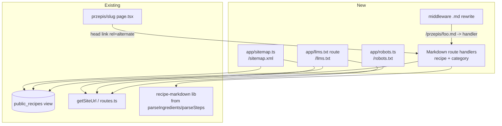

# Sitemap + Markdown Alternates for AI Citability

## 📝 TLDR
`zapiszprzepis.pl` ships **no sitemap and no robots.txt** today, and every page exists only as
rendered HTML — so search crawlers discover recipes only by following links, and an LLM that fetches a
recipe page gets the content buried in galleries, action bars and rails. This spec adds, as two
independently shippable phases: (1) a generated `sitemap.xml` + `robots.txt` covering every public
page, and (2) a **Markdown alternate** of each recipe and category page at a `.md` suffix URL, plus a
root `llms.txt` index — so an AI agent can fetch `…/przepis/{slug}.md` and get the recipe as clean,
quotable Markdown with a stable, citable URL. *(Future behavior — none of this exists yet.)*

## 📝 Problem Statement
- **No discoverability surface.** `find src -iname "*sitemap*" -o -iname "*robots*"` returns nothing;
  there is no `app/sitemap.ts` / `app/robots.ts`. Crawlers must walk links, with no freshness or
  canonical-URL signal. The project's own platform research
  (`context/foundation/infrastructure.md`) scores platforms on `llms.txt` and per-page `.md`
  availability as an agent-friendliness signal the site does not yet emit itself.
- **HTML is a poor citation source.** `src/app/przepis/[slug]/page.tsx` wraps the content in
  `RecipeGallery`, `RecipeActions`, `DishVersionsBar`, breadcrumbs, `LockedGallery` CTAs and
  `SimilarRecipes`. An LLM must strip all of it, and there is no "just the recipe as text" URL to cite.
- **The data is already clean, public and parsed.** Recipes expose title, `ingredients`/`steps` (Json),
  times, servings, tags, `source_url`/`source_author` and `youtube_id` through the guest-safe
  `public_recipes` view, with `parseIngredients` (`src/lib/ingredients.ts`), `parseSteps`
  (`src/lib/steps.ts`) and `buildFallbackMetaDescription` (`src/lib/recipe-tags.ts`) already in place.
  Only the delivery surface is missing.

## 📝 Proposed Solution
Two phases sharing one set of helpers (`getSiteUrl`, `public_recipes`, `src/lib/routes.ts`, and a new
`src/lib/public-recipe.ts` that owns the oldest-wins slug resolution — see Data Model):

**Phase 1 — Discoverability.** `app/sitemap.ts` lists all public URLs read from the DB + the static
set; `app/robots.ts` allows public routes, disallows authenticated/action/api paths, and points at the
sitemap. Both are standard Next App Router metadata routes (`/sitemap.xml`, `/robots.txt`).

**Phase 2 — AI citability.** A Markdown rendering of each recipe and category listing, served at the
canonical path + `.md` suffix (`/przepis/{slug}.md`, `/przepisy/{kategoria}.md`), advertised from the
HTML page head and an HTTP `Link` header, and indexed in a root `llms.txt`. The Markdown is assembled
from the same `public_recipes` read the HTML page uses, so it shows exactly what a guest/crawler sees.

Alternatives considered:
- **Content negotiation on the canonical URL** (switch on `Accept`/user-agent) — rejected: not directly
  citable, needs `Vary: Accept` and fights Cloudflare edge caching.
- **`/md/…` path prefix** — rejected: a second URL shape divorced from the canonical path; `.md` suffix
  keeps the Marksown URL one `.md` away from the page a human is already looking at.
- **`llms-full.txt`** (whole catalog concatenated) — deferred: it duplicates the per-page `.md` files
  and grows unbounded; the `.md` files + `llms.txt` index already give agents everything.

## 📝 Architecture

Takeaway: every new surface reads the **same guest-safe `public_recipes` view** and the **same route
helpers** the HTML pages use — no parallel data path, no new auth surface. The only genuinely new
mechanism is the `.md`-suffix routing, because Next's dynamic segments don't natively carry a file
extension.

**`.md` routing mechanism.** The existing `src/middleware.ts` rewrites a request whose path ends in
`.md` under a public content prefix to a Route Handler, stripping the suffix:
`/przepis/{slug}.md` → handler `app/przepis/[slug]/md/route.ts`;
`/przepisy/{kategoria}.md` → handler `app/przepisy/[kategoria]/md/route.ts`.
The rewrite is a cheap regex added to middleware (worker-size sensitive — see Risks); the handlers
return `text/markdown; charset=utf-8`. Keeping handlers colocated with their page keeps the data read
and the slug/category validation in one place and unit-testable.

**Markdown assembly** lives in a new pure helper (`src/lib/recipe-markdown.ts`, `category-markdown.ts`)
that takes a `public_recipes` row (or category + rows) and returns a Markdown string, so it is tested
without HTTP. It reuses `parseIngredients`, `groupBySection`, `parseSteps`, `recipePath`,
`originalLinkLabel` and `buildFallbackMetaDescription`.

## 📝 Data Model
No new tables or relations. One **change to the existing `public_recipes` view**: expose a
`last_modified` timestamp (map to `recipes.updated_at`, falling back to `created_at`) so the sitemap can
emit an accurate `<lastmod>`. The view currently `Omit`s `updated_at` (see the `PublicRecipe` type in
`src/app/przepis/[slug]/load-recipe.ts`). Applied as an idempotent migration through the Supabase
Management API per the project's migration convention; registered in `schema_migrations`.

Dedup — **a single shared owner, used by both phases.** `public_recipes` may still hold two rows
sharing a slug until the global-unique-slug migration lands. Every surface here MUST resolve a slug to
the same row — the oldest (`created_at`, then `id`), mirroring `loadRecipe`'s deterministic winner —
or a crawler could reach the `.md` of the *losing* duplicate while the sitemap lists the *winning* one.
To stop that logic being written twice and drifting, a new `src/lib/public-recipe.ts` owns it:
`listCanonicalRecipes()` (distinct-by-slug, oldest-wins, for the sitemap + `llms.txt`) and
`canonicalRecipeBySlug(slug)` (the `.md` handler). Both phases import it; neither reimplements dedup.
*(No new entities/relations → data-model graph intentionally omitted.)*

## 📝 API Contracts
New GET surfaces (all anonymous, all cacheable at the edge):

| URL | Produces | Body | Headers |
|---|---|---|---|
| `/sitemap.xml` | `application/xml` | `<urlset>` of all public URLs with `lastmod`, `changefreq`, `priority` | `Cache-Control: public, s-maxage=3600, stale-while-revalidate` |
| `/robots.txt` | `text/plain` | allow public, disallow `/api/`, `/ulubione`, `/powiadomienia`, `/settings`, `/recipes`, `/dodaj`, `/witaj`, `/login`, `/signup`, `/forgot-password`, `/reset-password`, `/auth/`, `/share`, `*?*` search params; `Sitemap:` line | static-ish |
| `/przepis/{slug}.md` | `text/markdown; charset=utf-8` | recipe as Markdown (see below); 404 → `text/plain` "not found" | `X-Robots-Tag: noindex, follow`; `Link: <canonical>; rel="canonical"`; `Cache-Control: public, s-maxage=3600, stale-while-revalidate` |
| `/przepisy/{kategoria}.md` | `text/markdown; charset=utf-8` | category: H1 + intro + bullet list of recipe titles each linking its `.md` | same as recipe `.md` |
| `/llms.txt` | `text/markdown; charset=utf-8` | H1 + summary blockquote + `## Przepisy` / `## Kategorie` link sections | `Cache-Control: public, s-maxage=3600, stale-while-revalidate` |

**Recipe Markdown shape** (stable contract; order fixed so citations are reproducible):
`# {title}` → one-line source/author/time meta → optional description → `## Składniki` (grouped by
section, `-` bullets) → `## Przygotowanie` (numbered steps) → footer line: canonical HTML URL +
`Źródło:` original `source_url`/YouTube. No owner-only data, no gallery (text only, so nothing locked
leaks). An invalid/unknown slug or category returns 404, not a partial document.

**HTML head advertisement** (added to recipe + category `generateMetadata`):
`alternates.types['text/markdown'] = '{canonical}.md'` → Next renders
`<link rel="alternate" type="text/markdown" href="…">`.

The sitemap deliberately does **not** encode `.md` files via `<xhtml:link rel="alternate">` — that
element is for language alternates (hreflang), not media types; misusing it confuses crawlers. Markdown
discovery is via the head link, the `Link` header, and `llms.txt` only.

## 📝 UI/UX
No visible UI. The only user-perceivable change is an extra `<link rel="alternate">` in `<head>` and the
three new text endpoints. Accessibility/contrast rules (the E01 design laws) do not apply to
machine-readable text endpoints. Single locale (pl) → no hreflang.

## 📝 Edge Cases & Failure Scenarios
- **DB read fails during `/sitemap.xml`** → return the static public URLs (home, 12 categories, legal)
  with a 200, rather than a 500 that would make Google drop the whole sitemap. Log the partial.
- **Large catalog** → a single sitemap holds 50k URLs. Below that, one file. Design leaves a
  `generateSitemaps` shard + sitemap-index seam (noted in the plan) to switch on when recipe count
  approaches ~10–20k; not built now (MVP volume is small).
- **Duplicate slug in `public_recipes`** → dedup to the oldest row (above); never emit two URLs for one
  slug.
- **Recipe deleted/merged** → `.md` 404s; `merged-recipe-redirect` already 301s merged recipes, and the
  middleware rewrite runs after that redirect, so a merged slug's `.md` follows the same 301.
- **Search results page** → `/szukaj` bare landing is listed low-priority; parametrized
  `/szukaj?q=…` is `Disallow`ed (thin/duplicate results), matched by the `*?*` rule.
- **Worker CPU (10 ms free tier)** → DB I/O does not count; Markdown/XML string building for MVP volume
  is well under budget. Edge caching (`s-maxage`) means crawlers mostly hit cache, not the Worker.
- **`.md` of a locked/full-access recipe** → the Markdown is the same guest-safe text the recipe page
  shows a guest; galleries are image-only and excluded, so there is nothing gated to leak.

## 📝 Risks & Impact Review
- **Worker 3 MiB script limit (hard).** The middleware comment in `src/middleware.ts` documents that
  crossing it already broke production once (#119). The `.md` rewrite adds a few lines of regex to
  middleware and small route handlers + two pure Markdown helpers — all tiny — but the plan's final
  step MUST confirm the deployed bundle still uploads. Reversible: the whole feature is additive and can
  be reverted without touching existing routes.
- **`public_recipes` view change** is a public-contract change to a view other code reads. Additive
  (one new column); existing `select('*')` consumers keep working. Applied idempotently; rollback = drop
  the column.
- **Deploy reality:** Workers Builds deploys only from `master` (no PR preview builds). These endpoints
  can only be verified on production after merge, or via `pnpm exec opennextjs-cloudflare preview`
  locally — not from a dev server alone.
- **`noindex` on `.md`** is deliberate: it prevents Google treating the Markdown as duplicate content
  while still letting LLM fetchers read it. If a future goal is to *rank* the `.md`, that decision
  reverses this header.

## 📋 Phasing
**Phase 1 ships first.** The two phases are each independently *valuable* and could in principle ship in
either order, but Phase 1 introduces the shared substrate Phase 2 reuses — the `public_recipes`
`last_modified` column, the `PublicRecipe` type widening, and `src/lib/public-recipe.ts` (the oldest-wins
selector). Shipping Phase 2 first would mean hoisting those pieces out of Phase 1; shipping Phase 1 first
(the natural order) avoids all cross-phase coordination.
- **Phase 1 — Sitemap + robots** (shippable on its own): `src/lib/public-recipe.ts`, `app/sitemap.ts`,
  `app/robots.ts`, the `last_modified` view column, tests. Ships discoverability with zero Markdown work.
- **Phase 2 — Markdown alternates + llms.txt** (shippable once Phase 1's shared pieces are in): Markdown
  helpers, route handlers, middleware `.md` rewrite, head advertisement, `llms.txt`, tests. Imports
  `public-recipe.ts` for dedup rather than reimplementing it.

## 📋 Implementation Plan

### Phase 1 — Sitemap + robots
1. **`last_modified` on `public_recipes`.** Write an idempotent migration exposing
   `coalesce(updated_at, created_at) as last_modified`; apply via Management API; register in
   `schema_migrations`; add `last_modified` to the `PublicRecipe` type. *App still builds and runs.*
2. **`src/lib/public-recipe.ts` (shared, used by both phases).** `listCanonicalRecipes()` (distinct-by-
   slug, oldest-wins) and `canonicalRecipeBySlug(slug)`, reading the `public_recipes` view. Unit test the
   dedup winner against rows sharing a slug. *Pure data module; nothing consumes it yet.*
3. **`app/robots.ts`.** Return allow/disallow rules + `sitemap: {site}/sitemap.xml`, host from
   `getSiteUrl()`. Unit test the rule set (public allowed, authenticated/api/search-params disallowed).
   *`/robots.txt` serves.*
4. **`app/sitemap.ts`.** Use `listCanonicalRecipes()` + distinct author profiles from `public_recipes`,
   add the static set (home, 12 categories via `RECIPE_CATEGORIES`/`categoryPath`, 3 legal paths, bare
   `/szukaj`), emit `loc`/`lastmod`/`changefreq`/`priority`. DB-failure fallback to static set. Unit
   test URL set + fallback. *`/sitemap.xml` serves and validates.*
5. **Cache headers + verify.** Set `s-maxage` revalidation; `pnpm typecheck && pnpm lint && pnpm test`;
   confirm XML validates. *Phase 1 shippable.*

### Phase 2 — Markdown alternates + llms.txt
6. **`src/lib/recipe-markdown.ts`.** Pure `recipeToMarkdown(row)` reusing the existing parse helpers;
   fixed section order per the contract. Unit test against fixture rows (grouped ingredients, numbered
   steps, missing description, YouTube source). *Pure module, app unaffected.*
7. **`src/lib/category-markdown.ts`.** Pure `categoryToMarkdown(category, rows)` → H1 + recipe list
   linking each recipe `.md`. Unit test. *Pure module.*
8. **Recipe `.md` route handler** `app/przepis/[slug]/md/route.ts`: resolve the slug via
   `canonicalRecipeBySlug` (step 2 — same oldest-wins row the sitemap lists), 404 on miss, return
   `text/markdown` with `noindex`/canonical `Link`/cache headers. Unit/integration test. *New endpoint
   reachable at its rewrite target.*
9. **Category `.md` route handler** `app/przepisy/[kategoria]/md/route.ts`: validate category, read its
   recipes, return Markdown. Test. *Endpoint reachable.*
10. **Middleware `.md` rewrite.** Add a regex in `src/middleware.ts` rewriting `/przepis/{slug}.md` and
    `/przepisy/{kategoria}.md` to their handlers, placed after the existing merged-recipe redirect and
    before auth gating; add the two `.md` shapes to `isPublicRoute`. Extend `src/middleware.test.ts`.
    *`.md` URLs resolve end to end.*
11. **Head advertisement.** Add `alternates.types['text/markdown']` to the recipe and category
    `generateMetadata`. Test that the `<link rel="alternate">` renders with the right href. *HTML now
    points to its Markdown.*
12. **`app/llms.txt` route** (`app/llms.txt/route.ts`): H1 "Zapisz Przepis", summary blockquote,
    `## Kategorie` (12 category `.md` links) and `## Przepisy` (recipe `.md` links via
    `listCanonicalRecipes()`, newest first, capped with a note if large). Cache headers. Test the
    structure. *`/llms.txt` serves.*
13. **Full gate + bundle check.** `pnpm typecheck && pnpm lint && pnpm test`; `opennextjs-cloudflare
    preview` locally to confirm the Worker bundle still uploads under 3 MiB and the `.md`/sitemap/robots
    endpoints respond. *Phase 2 shippable.*
