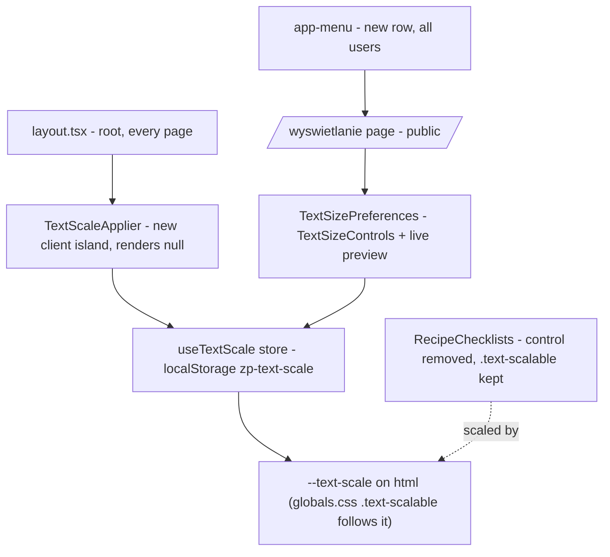

# Text size — move „Wielkość tekstu" into a guest-reachable display-preferences page

> Issue: #485 · Backlog: `.ai/specs/backlog-przebudowa.md` (E01-S01 visual foundation — the A/A+/A++ scale; E01-S07 recipe page, where the control lives today) · Depends on: nothing new (reuses the shipped `useTextScale` / `TextSizeControls` / `--text-scale` mechanism).

## 📝 TLDR

Today the „Wielkość tekstu" (A / A+ / A++) control sits inline at the top of every recipe's ingredients/steps area, and the scale is only *applied* while that recipe component is mounted. **Proposed:** give the control one home — a new **guest-reachable** page at `/wyswietlanie` (H1 „Wielkość tekstu"), reachable from the MENU drawer by everyone, signed in or not — and **remove the inline control from the recipe page**. To keep recipe text scaling after the inline control is gone, the "read the saved level and set `--text-scale` on `<html>`" job moves into a tiny always-mounted client island in the root layout (like `PWARegister`). Persistence stays exactly as it is: per-device `localStorage` key `zp-text-scale`, no account sync, no schema, no migration. Client-only except for one `isPublicRoute` entry so middleware lets guests reach the page.

Owner-confirmed decisions (answering the issue's four Open Questions, interactive 2026-10-23): (1) the control must stay reachable **without login**; (2) it lives on a **new display-preferences page separate from „Mój profil"**; (3) persistence stays **per-device**; (4) the recipe-page control is **removed** — „na stronie przepisu ustawienia nie są potrzebne".

## 📝 Problem Statement

„Wielkość tekstu" is an accessibility affordance for a target audience that explicitly includes older users (`CLAUDE.md`, E01 rules). Three things are wrong with its current home:

1. **It clutters the recipe view.** The control is a permanent panel above „Składniki" on every recipe, even though most readers set their size once and never touch it again.
2. **It has no stable home.** There is nowhere to go to change text size *except* opening a recipe — unintuitive for a global, set-once preference.
3. **The naive "move it to Settings" would break it.** `/settings` („Mój profil") lives in the `(authenticated)` route group behind `requireUser()`. Putting an accessibility control there would lock it away from signed-out guests — the exact people (first-time older visitors) who most need larger text, and who may not be able to get through the sign-in screen itself. A display preference must not require login to reach.

## 📝 Proposed Solution

**One home, reachable by everyone.** A new public page `/wyswietlanie` with H1 „Wielkość tekstu", the A/A+/A++ control, a short help line, and a **live preview** sample (a mock ingredient row + a line of step text using `.text-scalable`) so the reader sees the effect as they tap — important for the older audience. The page is a server component rendering the shared header (AppShell) and one client island; it needs no server data.

**Reached from the MENU drawer**, as a row shown in **every** access state (guest and signed-in) — not folded into the signed-in-only „Ustawienia | Wyloguj" footer, and not into „Mój profil" (per-account profile data; mixing a per-device display preference there is a category mismatch). Because the control no longer sits on the recipe page, this MENU row is the single discoverable entry point, so it is placed prominently.

**The recipe page loses the control** but keeps scaling. Today `RecipeChecklists` mounts `useTextScale()`, whose effect sets `--text-scale` on `<html>`; remove that and recipe text would freeze at scale 1. So the *applying* of the saved level moves to an always-mounted global island (below), and `RecipeChecklists` simply drops the control — its `.text-scalable` content keeps following `--text-scale` as before.

Alternatives considered:
- *Put it on `/settings` („Mój profil").* Lost: login-gated, so guests lose the feature — an accessibility regression (Open Question 1).
- *Account-synced preference.* Lost (Open Question 3): per-device matches how display preferences normally behave (they follow the browser), and it adds a Supabase migration + regenerated types + a second review (`risk-high`, `BACKWARD_COMPATIBILITY.md` §5) for little gain at this stage. A cheap follow-up if users ask to sync across devices.
- *Keep a control on the recipe too.* Lost per the owner's correction — with a global set-once preference the recipe view does not need its own copy.
- *A quick A/A+/A++ toggle directly in MENU instead of a page.* Not chosen as the primary home, but the page can grow other display preferences later under the generic `/wyswietlanie` URL; the MENU row links to the page rather than toggling inline.

## 📝 Architecture

- **New:** `src/app/wyswietlanie/page.tsx` — public server page (`metadata.title = 'Wielkość tekstu · Zapisz Przepis'`), renders the shared header via AppShell + `PageContainer` + the client island. No `requireUser`, no DB read.
- **New:** `src/app/wyswietlanie/text-size-preferences.tsx` (`'use client'`) — `useTextScale()` wired to `TextSizeControls`, plus the help line and the live-preview sample.
- **New:** `src/app/components/text-scale-applier.tsx` (`'use client'`, renders `null`) — the always-mounted island that reads the saved level and sets `--text-scale` on `<html>` app-wide. Mounted once in `src/app/layout.tsx`'s `<body>`, beside `PWARegister`.
- **Refactor:** `src/app/components/ui/use-text-scale.ts` — **move the `useEffect` that writes `--text-scale` out of the hook and into `TextScaleApplier`**, so the DOM write has a single always-mounted owner. The hook keeps returning `{ level, scale, setLevel }` over the same module-level store (localStorage + listeners `Set` + the `storage` event), so a change made on `/wyswietlanie` notifies the applier (same tab) and other tabs (storage event) and updates `--text-scale` live. This fixes today's limitation where the scale is applied only while the recipe component is mounted.
- **Edited (minimal):** `src/app/przepis/[slug]/_components/recipe-checklists.tsx` — remove the `TextSizeControls` import/usage and the `useTextScale()` call; keep the „Wyczyść zaznaczenia" button (adjust the row that currently holds both). The `.text-scalable` classes on ingredients and steps are untouched.
- **Edited:** `src/lib/routes.ts` — add `DISPLAY_PREFS_PATH = '/wyswietlanie'` and include it in `isPublicRoute()` so `src/middleware.ts` does not bounce guests to `/login`.
- **Edited:** `src/app/components/app-menu-model.ts` + `src/app/components/app-menu.tsx` — add a „Wielkość tekstu" entry (href `DISPLAY_PREFS_PATH`) shown to everyone, guest and signed-in.
- **Reused unchanged:** `TextSizeControls` (its a11y — `aria-pressed`, per-button `aria-label`, ≥ 48 px targets — is already shipped, handoff C3), the `TEXT_SCALE_VALUES` levels, `.text-scalable` / `.text-scalable-body` / `--text-scale` in `globals.css`, AppShell, PageContainer.

Takeaway: the apply-the-scale job becomes app-wide and always-on; the *control* gets one public home; the recipe page only loses a panel. No server logic beyond one public-route entry.

## 📝 Data Model

None. No schema, migration, query or write. The level stays in `localStorage` under `zp-text-scale` (preserved, not renamed — renaming would silently reset everyone's saved size). The SSR snapshot stays `'A'` (scale 1), so server and first client render still match.

## 📝 UI/UX

**Design authority:** the control itself is already shipped and designed (handoff C3, `text-size-controls.tsx`); this spec composes it onto a new page and into the MENU, so no new control visuals are introduced. Mockups were **not** rendered (text-only spec): the new page reuses shipped primitives (`TextSizeControls`, `PageContainer`, AppShell header), and the MENU row follows the existing row pattern.

**`/wyswietlanie` page** (public; no horizontal scroll at 320 px; WCAG 2.2 AA per `CLAUDE.md`), top to bottom:
1. Shared AppShell header with the single back link (the „← Wróć" convention).
2. H1 „Wielkość tekstu" (30 px bold, like „Mój profil").
3. Help line (≥ 16 px, `#374151`): e.g. „Ustaw, jak duży ma być tekst przepisów. Zmiana zapisuje się na tym urządzeniu." (per-device is stated honestly).
4. `TextSizeControls` (A / A+ / A++), unchanged.
5. **Live preview**: a small panel showing a sample ingredient line and a line of step text, both `.text-scalable`, so tapping a level visibly resizes them in place.

**MENU drawer** (`app-menu.tsx`): a „Wielkość tekstu" row linking to `/wyswietlanie`, shown in every access state. It is the sole entry point now, so it is placed prominently (recommended: near the top of the drawer, above the category list / account footer), with a text label (icons always carry a label here).

Accessibility: targets ≥ 48 px, visible 3 px focus (global rule), underlined links, the control keeps its labelled `aria-pressed` state. Reflow: `pnpm test:reflow` must stay green at A++ on the new page and on the recipe page after the control is removed.

## 📝 Edge Cases & Failure Scenarios

- **Guest on a recipe** → `TextScaleApplier` (mounted in the root layout) reads `localStorage` and sets `--text-scale`, so recipe content scales even though the recipe page has no control. This is the main behavior the removal depends on and is verified in Phase 2.
- **`localStorage` blocked / private window** → reads default to `'A'`, `setLevel` cannot persist; the control still works for the session (current behavior preserved).
- **Change on `/wyswietlanie` with a recipe open in another tab** → the `storage` event updates `--text-scale` in the other tab live (existing subscription).
- **First paint before hydration** → a brief flash at scale 1 before `TextScaleApplier`'s effect runs, identical to today's recipe-page behavior; now app-wide. An optional pre-hydration inline script could remove it (A5) but is out of scope to keep parity.
- **Deep link to `/wyswietlanie` as a guest** → must load, not redirect to `/login`; guaranteed by the `isPublicRoute` entry (regression-tested).
- **Recipe with the „Wyczyść zaznaczenia" button** → that button stays; only the text-size control leaves its shared row.

## 📝 Risks & Impact Review

- **Blast radius:** one new public page, one always-mounted client island, a one-line `isPublicRoute` addition, a MENU row, and the removal of a panel from the recipe page. No RLS, no schema, no URL contract broken. Adding `/wyswietlanie` is additive and safe per `BACKWARD_COMPATIBILITY.md` §1.
- **The one subtle move** is relocating the `--text-scale` write from the recipe component to the global applier (the `useTextScale` refactor). If it regressed, recipe text would stop scaling; Phase 2 verifies a guest recipe at A++ before and after the control removal.
- **Middleware:** forgetting the `isPublicRoute` entry would bounce guests to `/login` — covered by a routes unit test asserting `isPublicRoute('/wyswietlanie')`.
- **Rollback:** delete the page, the applier and the MENU row, restore the control in `RecipeChecklists`, revert the hook refactor. No data to migrate back.

## 📋 Phasing

Phase 1 — **add the home, keep the recipe control** (nothing removed yet, so it is shippable on its own): the `useTextScale` refactor, `TextScaleApplier` in the layout, `/wyswietlanie` page + `DISPLAY_PREFS_PATH` + `isPublicRoute` entry, the MENU row, and tests. At the end the control works from both the recipe page and the new page.

Phase 2 — **remove the inline recipe control**: drop it from `RecipeChecklists`, adjust the „Wyczyść zaznaczenia" row, and verify a guest recipe still scales at A++ via the global applier.

## 📋 Implementation Plan

### Phase 1 — the home
1. `use-text-scale.ts`: move the `--text-scale` writing `useEffect` out of the hook; the hook returns `{ level, scale, setLevel }` only. Update/extend `use-text-scale` unit coverage.
2. `src/app/components/text-scale-applier.tsx` (`'use client'`, returns `null`): calls `useTextScale()` and owns the `--text-scale` write; mount it in `layout.tsx` beside `PWARegister`. Test: applier sets `--text-scale` from the stored level and updates on change.
3. `src/lib/routes.ts`: `DISPLAY_PREFS_PATH = '/wyswietlanie'` + add to `isPublicRoute()`; unit-assert the public-route membership.
4. `src/app/wyswietlanie/page.tsx` + `text-size-preferences.tsx`: the public page, control, help line, live preview.
5. `app-menu-model.ts` + `app-menu.tsx`: the „Wielkość tekstu" row for all users; extend `app-menu-model.test.ts` for both guest and signed-in.
6. Verify on the dev server: a **guest** opens MENU → „Wielkość tekstu" → `/wyswietlanie`, changes the level, sees the preview resize, and the recipe page reflects it; 320 px width; `pnpm typecheck`, `pnpm lint`, `pnpm test`, `pnpm test:reflow`.

### Phase 2 — remove the recipe control
7. `recipe-checklists.tsx`: remove `TextSizeControls` + `useTextScale`; keep „Wyczyść zaznaczenia"; tidy the row.
8. Verify: a guest recipe at A++ still scales (global applier), the „Wyczyść zaznaczenia" row looks right, no sideways scroll; full gate again.

## Resolved decisions (owner-confirmed) & autonomous assumptions

| # | Question | Decision | Source |
|---|----------|----------|--------|
| D1 | Reachable without login? | **Yes — guest-reachable.** | Owner, 2026-10-23 (Open Question 1) |
| D2 | Where does it live? | **New page `/wyswietlanie`, separate from „Mój profil".** | Owner, 2026-10-23 (Open Question 2) |
| D3 | Persistence? | **Per-device `localStorage` (no sync, no schema).** | Owner, 2026-10-23 (Open Question 3) |
| D4 | Keep the recipe-page control? | **No — removed.** | Owner, 2026-10-23 („na stronie przepisu ustawienia nie są potrzebne") |
| A1 | Page URL and name | Route `/wyswietlanie` (generic, survives a later rename); H1 + MENU label „Wielkość tekstu" (concrete for older users). Broaden to „Wyświetlanie" if more display prefs are added. | Autonomous default — override on the PR |
| A2 | MENU placement | A row shown to **everyone**, placed prominently near the top of the drawer (it is now the only entry point). | Autonomous default |
| A3 | Live preview on the page | Included (a sample ingredient + step line that scale), so the effect is visible on the settings page itself. | Autonomous default |
| A4 | Who owns the `--text-scale` write | A single always-mounted `TextScaleApplier` in the root layout, not the per-page control. | Autonomous default (correctness) |
| A5 | Pre-hydration anti-FOUC script | **Not** added — keep parity with today's behavior; revisit if the flash is objectionable app-wide. | Autonomous default |
| A6 | Page indexability | Left indexable (low-stakes utility page); add `noindex` later if unwanted in search. | Autonomous default |
