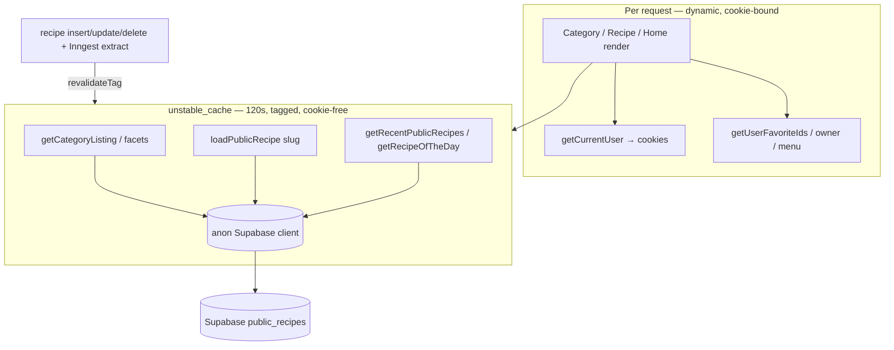

# Cache user-independent guest reads (category, recipe, home) with a short TTL

## 📝 TLDR

Guests and crawlers are the hottest traffic on the public pages, yet every render
re-queries Supabase for data that is identical for all of them — the category
listing + facet counts, the recipe page content, and the home "Ostatnio dodane"
feed + "Przepis dnia". **Proposed (future behavior):** extract those
user-independent reads into standalone functions wrapped in `unstable_cache`
(`revalidate: 120 s`, owner-confirmed) with cache tags, backed by a cookie-free
anon Supabase client, invalidated on recipe writes. Per-user state (favorite
hearts, owner buttons, gallery, menu counts) stays dynamic and read per request.
The code lands first and is a safe no-op under OpenNext's default caches; the
Cloudflare cache infrastructure that produces real hits is a separate,
owner-gated step.

> **Status (2026-10-27).** Phase 1 shipped in #532; the Inngest invalidation it
> missed (Q4) is #551. Phase 2 is owner-approved as **R2 + D1 only** — no queue,
> the D1 tag cache wrapped in a soft-tag filter, the D1 table created by hand.
> Analysis, local verification and rollout: `2026-10-26-cache-guest-reads-phase2-plan.md`;
> operator steps: `2026-10-25-cache-guest-reads-phase2-runbook.md`.

## 📝 Problem Statement

`src/app` has no `revalidate` / `'use cache'` anywhere — the only `next/cache`
use is `revalidatePath` in write actions. Three public surfaces re-read Supabase
on every request, including repeat guest views and crawler hits:

- **Category listing** — `src/app/przepisy/[kategoria]/page.tsx`: the
  `public_recipes` card query (per `category`/`tag`/`strona`), the
  `category_tag_facets` RPC, and the filtered head count.
- **Recipe page** — `src/app/przepis/[slug]/load-recipe.ts`: the `public_recipes`
  read for the slug (shared by layout, `generateMetadata`, and the page via
  React `cache()` — but only within a single render).
- **Home** — `src/app/page.tsx`: `getRecentPublicRecipes` (the guest feed) and
  `getRecipeOfTheDay` (a bounded pool, keyed by the day).

The reads do not depend on the viewer, so repeat traffic needlessly loads
Supabase and inflates TTFB — felt most by the target audience (older users on
slower connections). Epic #225 listed this caching as an explicit non-goal at the
time; #445 is the deferred follow-up.

## 📝 Proposed Solution

For each surface, split the **user-independent** read out of the request-scoped
render into a standalone async function keyed by its inputs and wrapped in
`unstable_cache` with `revalidate: 120` and a cache tag. The cached function must
not touch cookies/headers (that is what makes it cacheable), so it uses a new
**cookie-free anon Supabase client** rather than `createSupabaseServerClient()`
(which binds to `cookies()`). `public_recipes` is already anon-readable (E01-S02
public RLS), so a plain anon client returns the same rows.

Writes invalidate by tag (`revalidateTag`) so a new/edited/deleted recipe never
shows stale beyond the TTL. Per-user reads (`getUserFavoriteIds`, owner check,
menu summary, gallery, member rows) are left exactly where they are — outside the
cache, read per request through the cookie-bound client.

**Mechanism — `unstable_cache`, not `'use cache'`:** Next 16's `'use cache'`
requires enabling `cacheComponents`, which changes default rendering/caching
semantics app-wide (large blast radius, still stabilizing). `unstable_cache`
targets exactly these reads, needs no global flag, and is supported by the
OpenNext Cloudflare data cache. (See Resolved assumptions.)

**Alternatives considered:**
- *`'use cache'` + `cacheComponents`* — rejected for the app-wide blast radius above.
- *Cloudflare Cache API by URL (`withRegionalCache` of full responses)* — rejected:
  the pages are legitimately dynamic (cookies), so a whole-response cache would
  either leak per-user state or force the pages static. We cache the data, not the page.
- *React `cache()` only* — already in use; it dedupes within one render, not across requests.

## 📝 Architecture

- **New:** `src/lib/supabase/anon.ts` — a cookie-free anon client (module-level
  singleton via `@supabase/supabase-js` `createClient`); `src/lib/recipe-cache.ts`
  — the cached read functions + the tag constants and a `revalidateRecipeCaches()`
  helper.
- **Changed:** the three route files call the cached helpers for the
  user-independent part; the write paths call `revalidateRecipeCaches()`.
- **Planned/owner-gated:** `open-next.config.ts` + `wrangler` bindings to give
  OpenNext a real incremental cache (R2) + tag cache (D1, soft `_N_T_` tags
  filtered out). No queue: `unstable_cache` revalidates stale entries in the
  background through Next itself (`pendingRevalidates` + `waitUntil`); OpenNext's
  queue only serves ISR pages, which this app has none of. Until then the
  helpers run against OpenNext's default *dummy* caches and simply always
  miss — behavior identical to today, which is why the code is safe to ship first.
- **Consumers unaffected:** `/ulubione`, `/recipes`, `/dodaj`, notifications —
  they read per-user data and keep their current cookie-bound path.

**Takeaway:** the only user-independent reads move behind a tagged 120 s data
cache on a cookie-free client; everything per-user is untouched. The cache's
*effect* is gated on Cloudflare infrastructure; its *correctness* is not.

## 📝 Data Model

No schema change. Reads continue through the existing `public_recipes` view and
the `category_tag_facets` RPC. No new columns, tables, or migrations.

## 📝 API Contracts

No public HTTP/RPC contract changes. Internal module surface added:

- `createSupabaseAnonClient()` → a cookie-free `SupabaseClient` (anon key).
- `getCategoryListing({ category, tags, page })`, `getCategoryFacets({ category, selected })`,
  `getCategoryTotal({ category })`, `loadPublicRecipe(slug)`,
  `getRecentPublicRecipes()`, `getRecipeOfTheDay(dateKey)` — each `unstable_cache`-wrapped.
- Tags: `RECIPES_LIST_TAG = 'recipes:list'`, `recipeTag(slug) = ` `recipe:${slug}`.
- `revalidateRecipeCaches(slug?)` — `revalidateTag(RECIPES_LIST_TAG)` and,
  when a slug is known, `revalidateTag(recipeTag(slug))`.

Keys (second arg of `unstable_cache`): listing `[category, tags.sort().join(','), page]`;
facets `[category, selected.sort().join(',')]`; recipe `[slug]`; recent feed `[]`;
recipe-of-the-day `[dateKey]` (`YYYY-MM-DD`, so it rolls over daily on its own).

## 📝 UI/UX

No visual change. The only observable effect is faster TTFB on repeat public
views once the Cloudflare cache infra (Phase 2) is live, and that a guest may see
a just-added/edited/deleted recipe reflected up to the TTL late on surfaces that
are not synchronously invalidated (owner accepted ≤120 s). No prototype — not a
UI feature.

## 📝 Edge Cases & Failure Scenarios

- **Cookie read inside a cached fn** — forbidden by `unstable_cache` and would
  reintroduce per-user coupling. The anon client takes no cookies; a test asserts
  the cached helpers never import `cookies`/`createSupabaseServerClient`.
- **Cross-user leakage** — the cache holds only `public_recipes` columns (no
  `user_id`, favorites, or owner flags). Hearts/owner buttons/menu are computed
  per request outside the cache. A test signs in as two users and asserts the
  cached list is identical while the hearts differ.
- **Recipes appear via Inngest, not the add action** — `addRecipeFromUrl` and
  `refreshRecipe` only queue a `recipe/extract` job; the row is inserted later by
  the worker. So the add action cannot be the only invalidation point: the worker
  that writes the recipe calls `revalidateRecipeCaches(slug)` on completion; until
  then the ≤120 s TTL bounds staleness (owner-accepted).
- **Delete** — `src/app/api/recipes/delete/route.ts` currently does not
  revalidate; it will call `revalidateRecipeCaches(slug)` after a successful
  delete so the list/recipe drop within the request, not after the TTL.
- **Dummy cache (no infra yet)** — every call misses and re-reads Supabase:
  correct, just un-accelerated. `revalidateTag` is a no-op against the dummy tag
  cache — harmless.
- **Supabase error inside a cached read** — a `revalidate` window must not pin a
  failed/empty result. Cached helpers return data only on success and throw on
  error (as the pages do today) so a failure is not cached; the route error
  boundary still renders.
- **`?strona=` / tag permutations** — each distinct key is a distinct entry;
  `MAX_PAGE` already bounds pages and `parseTagParam` bounds tags, so key
  cardinality is bounded.

## 📝 Risks & Impact Review

- **Stale public data** — bounded by the 120 s TTL (owner-confirmed) and cut
  further by synchronous `revalidateTag` on delete and on worker completion.
  Reversible: lower the TTL or revert the wrap.
- **Cross-user state leakage** — the real hazard; gated by the data-model split
  and the two-user test above. This is *not* auth/money/data-scoping logic — the
  per-user reads and RLS are unchanged — which is why the change is `risk-medium`,
  not high.
- **OpenNext cache infra (Phase 2)** — provisioning an R2 bucket, a D1 tag-cache
  DB, and `wrangler` bindings is a hard-to-reverse infrastructure
  commitment on the owner's Cloudflare account, which the automation cannot reach
  (deploy is Workers-Builds-only; see `CLAUDE.md` + project memory). Owner bears
  it; owner-confirmed 2026-10-27 (Q3). Rollback: remove the bindings / revert
  `open-next.config.ts`; the code falls back to the dummy cache (today's behavior).
- **No GitHub-Actions assumption** — the change reaches production only via a
  Workers Builds build of `master`; `pnpm smoke:prod` after deploy per project rule.

## 📋 Phasing

- **Phase 1 — Code (ships now, safe no-op under default caches).** Cookie-free
  anon client; extract + wrap the user-independent reads in `unstable_cache`
  (120 s, tagged); add `revalidateRecipeCaches()` at the write/worker points;
  tests for stable-within-TTL, re-read after invalidation, and no cross-user
  leakage. Independently shippable: with OpenNext's dummy cache it behaves exactly
  like today.
- **Phase 2 — Cloudflare cache infrastructure (owner-run, confirmed
  2026-10-27).** Provision R2 + D1 and create the D1 `revalidations` table by
  hand, add `wrangler` bindings, enable `withRegionalCache(r2IncrementalCache)` +
  `withFilter(d1NextTagCache, softTagFilter)` in `open-next.config.ts`, deploy via
  Workers Builds, then run `pnpm smoke:prod`, verify invalidation and post
  before/after TTFB (same method as epic #225). Steps: the Phase 2 runbook.

## 📋 Implementation Plan

### Phase 1 — Code

1. **Cookie-free anon client** — add `src/lib/supabase/anon.ts`:
   `createSupabaseAnonClient()` returning a module-singleton `createClient` with
   `SUPABASE_URL` + `SUPABASE_ANON_KEY`, no cookies, no session persistence
   (`auth: { persistSession: false }`). Unit test: it reads `public_recipes` and
   carries no cookie dependency. *App still works (new unused module).*
2. **Cache module** — add `src/lib/recipe-cache.ts`: the tag constants,
   `revalidateRecipeCaches(slug?)`, and the `unstable_cache`-wrapped read
   functions listed in API Contracts, each using the anon client and keyed as
   specified, `{ revalidate: 120, tags: [...] }`. Unit tests: stable result within
   the TTL (mocked `unstable_cache`/clock), fresh read after `revalidateTag`.
   *App still works (module not yet wired in).*
3. **Recipe page** — in `load-recipe.ts`, read the `public_recipes` row via
   `loadPublicRecipe(slug)` (cached, anon) and keep the owner check + `user` on
   the cookie-bound client; `loadRecipe` composes the two so its return shape is
   unchanged. Test: owner flag still correct per user; public row identical across
   users. *App works.*
4. **Category page** — move the cards query, `category_tag_facets`, and the
   filtered head count into `getCategoryListing`/`getCategoryFacets`/`getCategoryTotal`;
   keep `getCurrentUser` + `getUserFavoriteIds` per request. Test: hearts differ
   per user, list identical. *App works.*
5. **Home** — move `getRecentPublicRecipes` and `getRecipeOfTheDay` into the cache
   module (recipe-of-the-day keyed by `YYYY-MM-DD`); the member/favorite/menu
   reads stay per request. Test: guest feed cached; member rows uncached. *App works.*
6. **Invalidate on writes** — call `revalidateRecipeCaches(slug)` in the delete
   route after a successful delete, in the Inngest extraction-completion step
   where the recipe row is written, and keep/align the existing `revalidatePath`
   calls. Test: delete/add path triggers the tag invalidation (mocked
   `revalidateTag`). *App works.*
7. **Validation gate** — `pnpm typecheck`, `pnpm lint`, `pnpm test`,
   `pnpm test:reflow` green.

### Phase 2 — Cloudflare cache infrastructure (owner-gated)

8. Provision the R2 bucket (with a lifecycle rule) + the D1 database, and create
   the D1 `revalidations` table by hand (owner, `wrangler`); add the bindings to
   `wrangler.jsonc`.
9. Enable `withRegionalCache(r2IncrementalCache)` + `withFilter(d1NextTagCache,
   softTagFilter)` in `open-next.config.ts`; confirm `pnpm preview` locally.
10. Deploy `master` via Workers Builds; run `pnpm smoke:prod`; verify a refresh
    invalidates; post before/after TTFB on #445 (method from epic #225).

Exact commands, verification and rollback: `2026-10-25-cache-guest-reads-phase2-runbook.md`.

## 📝 Resolved assumptions (autonomous defaults)

| # | Question | Resolution | Rationale | Confirmation |
|---|----------|------------|-----------|--------------|
| Q1 | Freshness budget / TTL for public lists & recipes? | **`revalidate: 120 s`** | **Owner-confirmed** on the issue before this spec (resolves the blocking open question). | resolved |
| Q2 | `'use cache'`/`cacheComponents` vs `unstable_cache` on OpenNext Cloudflare? | **`unstable_cache`** | Targeted, no app-wide flag, OpenNext-supported; `cacheComponents` is experimental with app-wide blast radius. Reversible. | default (reversible) |
| Q3 | How does the cache actually persist + honor tags on Cloudflare Workers? | Wire OpenNext **R2 incremental cache (regional cache in front) + D1 tag cache wrapped in `withFilter(softTagFilter)`**, no queue; until provisioned the code runs on the default dummy caches (no-op, = today). | OpenNext's default caches are no-ops; real hits need owner-provisioned Cloudflare resources + bindings the automation cannot create, and a Workers Builds deploy. The queue only serves ISR; without the soft-tag filter every `revalidatePath('/', 'layout')` would purge the whole data cache (verified locally, phase-2 plan §2.3). | ✅ owner-confirmed 2026-10-27 |
| Q4 | Where to invalidate, given recipes are inserted by the async Inngest worker (not the add action)? | `revalidateTag` at synchronous points (delete route) **and** in the worker: a step after the extraction and one after the photos are archived. #532 shipped only the delete route; the worker steps are #551. | Smallest reliable surface that avoids stale-beyond-TTL; owner accepted ≤120 s. | default (reversible) |
| Q5 | One spec, or split the three surfaces? | **One spec** — one capability, one mechanism (cookie-free client + tag scheme) shared across surfaces. | Surfaces are not independently deployable capabilities; splitting would duplicate the shared design. | default |

> Scope-cohesion check: a single independently-deployable capability (cache
> user-independent guest reads) delivered across three call sites that share one
> mechanism — not a bundle. Phase 2's infra is the same capability's deployment
> enabler, not a second feature.
