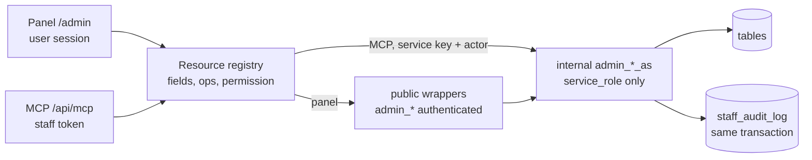

# Admin panel: roles, users, recipe moderation, MCP

> Brief: `.ai/specs/briefs/2026-10-28-admin-panel.md`. Risk: **high** (new roles, account deletion, edits to public recipes, RLS and schema changes; touches auth, data scoping and shared contracts). Read against `origin/master` at `3b3b5c6` (the main checkout is a stale detached HEAD). Spec only: no code changes in this document's PR.

## 📝 TLDR
Today nobody can manage content or accounts from the app. Every correction is a one-off script under `scripts/` (`apply:recipe-fixes`, `collapse:*`, `rewrite:recipe-steps`) run with the service-role key from the owner's machine, or hand-written SQL in Supabase Studio. *Proposed (future behavior):*
- Staff accounts with **roles** (`admin`, `moderator`; more later without a schema change) get an **`/admin` panel**: users (list, search, block, delete), the import queue (failed shares with the reason and a retry), access codes, and recipe moderation (list and search including hidden, source preview, hide, delete, merge duplicates, fix category and tags, edit title, SEO description, content and cover framing).
- The same operations are exposed as an **MCP server**, so staff manage data from Claude Code instead of Supabase Studio, each under their own account and role.
- Both run on **one resource registry** inside this repo. A resource declares its fields, operations and required permission once; the panel pages, the MCP tools, the permission check and the audit log all derive from it. It is not extracted into a package and not shared with other services.

## ✅ Decisions (Open Questions gate, 2026-10-28)
All twelve recommendations accepted.
- **Q1:** one spec, four phases, each independently shippable.
- **Q2:** `admin` = everything, including roles, account deletion, access codes and user e-mails; `moderator` = recipes and the import queue, read-only on users (no block, no delete, no e-mail).
- **Q3:** the web panel writes through `SECURITY DEFINER` functions that check the caller's permission in SQL. No service-role key in the panel's request path.
- **Q4:** the MCP endpoint is a route in the same Worker (`/api/mcp`, plain `fetch` JSON-RPC, no SDK), with per-account tokens stored hashed. It resolves token → account → permission and calls internal functions with the service key and the actor id, which the function re-checks. Falls back to a second Worker only if the Phase 1 bundle measurement says the first does not fit.
- **Q5:** a registry of hand-written resource definitions; panel pages and MCP tools are generated from it. No schema-introspection CRUD.
- **Q6:** a hidden recipe is gone for guests; only staff see it. Its owner and the people who favorited it see an "unavailable" row.
- **Q7:** staff delete is a hard delete with a copy to an archive table, restorable by an admin; an optional redirect target gives a 301, otherwise the URL answers 404 or 410 (see Risks).
- **Q8:** account deletion keeps the existing hand-over to the oldest favoriter; personal data is removed.
- **Q9:** a recipe edited by staff is locked against automatic overwrites until staff unlock it.
- **Q10:** cover framing is a focal point stored on the recipe; the file in R2 is untouched.
- **Q11:** access-code and entitlement management is part of Phase 1, admin-only.
- **Q12:** the PRD and roadmap are amended in the Phase 1 PR: staff roles exist; only staff edit content; end users still enter no data.

## 📝 Problem Statement
Staff work is invisible and unsafe. Each fix is a script plus the service-role key on one laptop; nothing records who changed what; a second moderator cannot be added without sharing that key; failed imports are visible only in logs and in the bell of the user who shared the link. The public catalog (824 sitemap URLs) grows with no way to take a bad recipe away from guests short of deleting it, and a deletion is blocked outright when others favorited it.

## 📝 Proposed Solution
One permission model in the database, one resource registry in the app, two thin front ends (panel, MCP).

Alternatives considered:
- **Keep Supabase Studio and scripts.** Rejected: no roles, no audit, the key stays on one machine, and the owner asked for per-account access.
- **A column on `profiles`.** Rejected: see Constraints. A private table follows `user_full_access`.
- **Service-role server actions with an app-level check.** Rejected: widens the service key into every request path (`CODE_REVIEW.md` allows it only in Inngest, cron and storage), and a bug in one check becomes full write access. SQL-level checks fail closed.
- **Schema-introspection admin** (Directus style). Rejected: every column becomes reachable by default, and tags, covers and merges need hand-written parts anyway.
- **MCP as a local stdio script.** Rejected: no per-account identity, the key sits on each laptop.
- **Build nothing / Studio only** lost because role separation and an audit trail are the point.

Research notes (what established admin systems get right and what to skip): Django admin and Filament register a resource once and derive list, edit and permissions from it, which is the registry here. Directus and Payload keep permissions as data and write an activity log with the actor, which is the `staff_role_permissions` and `staff_audit_log` split here. Skipped on purpose: a role-builder UI, field-level permissions, approval workflows, bulk import/export, and a plugin system. Eight resources do not need them.

## 📝 Architecture

Takeaway: the permission check and the audit write live in the `_as` functions, so both front ends get them whether or not the app code remembers.

- **Primary module:** new `src/lib/staff/` (permissions, registry, audit helpers) and `src/app/admin/` (layout and pages). The MCP route is `src/app/api/mcp/route.ts`.
- **Reused:** `collapse_recipe_group` / `restore_recipe_merge` for merges, `recipes_block_shared_delete` with its transaction-local opt-out for deletes, `transfer_recipes_on_account_delete` for account deletion, `recipe_shares` and the `recipe/extract` event for retries, `recipe-cache.ts` (`revalidateRecipeCaches`, `recipeTag`) for cache invalidation, `redeem_access_code` / `create_access_code` for codes.
- **Cross-system effects:** hiding changes what `public_recipes`, `search_recipes`, the category facets, `sitemap.ts`, `llms.txt`, the `.md` mirrors and the service worker's public cache return (Phase 2).
- **Existing precedent for the service key in a request path:** `findMergedRecipeSlug` reads a service-only table with it. The MCP endpoint becomes one more allowed use, restricted to the `_as` functions; `CODE_REVIEW.md` is amended in Phase 4.

## 📝 Data Model
All new tables have RLS on and no grants to `anon` or `authenticated` except where stated. One migration per phase, forward-only, with a `Down` comment block like the existing ones. Every migration is `risk-high`; local dev points at production, so none is applied without the owner's explicit go.

**Phase 1**
- `staff_roles(name text primary key, description text)`; seeded `admin`, `moderator`. A new role is an insert, not a migration.
- `staff_role_permissions(role text → staff_roles, permission text, primary key (role, permission))`. Permissions are dotted strings: `users.read`, `users.read_email`, `users.block`, `users.delete`, `imports.read`, `imports.retry`, `access.manage`, `roles.manage`, `audit.read`, `recipes.read`, `recipes.hide`, `recipes.delete`, `recipes.merge`, `recipes.taxonomy`, `recipes.edit`, `tokens.own`. Seeds follow Q2.
- `user_roles(user_id uuid → auth.users on delete cascade, role text → staff_roles, granted_by uuid, granted_at timestamptz, primary key (user_id, role))`. Owner may `select` their own rows; nobody writes through the API.
- `staff_audit_log(id bigint identity, actor_id uuid (no FK), via text check in ('panel','mcp'), token_id bigint null, resource text, operation text, target_id text, before jsonb, after jsonb, created_at timestamptz default now())`. No foreign key on `actor_id` or `target_id`, so deleting an account never deletes its history. For user operations `before`/`after` hold ids and flags only, never e-mail or names. Read through a function guarded by `audit.read`.
- Functions: `staff_can(p_actor uuid, p_permission text) → boolean` (internal, `service_role` only), `has_permission(p_permission text)` (wrapper over `auth.uid()`, granted to `authenticated`, used by the app to pick what to render), `staff_audit(...)` helper. All `SECURITY DEFINER` with `set search_path = ''`, grants revoked from `public`, following `20261017140000_full_access_gate`.
- Bootstrap: the first admin is inserted by the owner with SQL, documented in the migration header. There is no UI path to self-grant.
- Invariants in the role-change function: the last `admin` cannot be removed; a staff member cannot change their own role.
- Staff read policy `recipe_shares_staff_select` for `authenticated` using `has_permission('imports.read')`, needed by the import queue. Writes stay service-only.

**Phase 2**
- `recipes`: `hidden_at timestamptz null`, `hidden_by uuid null`, `hidden_reason text null`.
- `recipes_deleted_by_staff` (archive, service-only): `row_data jsonb`, `deleted_by`, `deleted_at`, `redirect_to_slug text null`, same shape idea as `recipes_merged_duplicates`.
- `public_recipes` and `recipe_gallery_images` gain `where hidden_at is null`. `search_recipes`, the facet functions and the category-context function read `public_recipes`, so they follow without a change of their own. Consequence, accepted: the "mine" and "favorites" search scopes omit hidden recipes too, while the lists "Moje przepisy" and "Ulubione" read the tables directly and show the "unavailable" row; `assert_public_view_boundary()` is extended to fail if `hidden_at` ever appears in the output columns or the filter is dropped.
- Staff read policy `recipes_staff_select` for `authenticated` using `has_permission('recipes.read')`. Writes stay service-only.

**Phase 3**
- `recipes`: `staff_edited_at timestamptz null`, `staff_edited_by uuid null`, `cover_focus_x smallint null`, `cover_focus_y smallint null` (percent 0–100, null = centered).

**Phase 4**
- `staff_tokens(id bigint identity, user_id uuid → auth.users on delete cascade, token_hash text unique, prefix text, label text, expires_at timestamptz, last_used_at timestamptz, revoked_at timestamptz, created_at timestamptz)`. The raw token is shown once; only its SHA-256 is stored (the `access_codes` pattern). A token carries no role of its own: the role is read at call time, so removing the role or blocking the account disables every token at once.

Sensitive data: e-mail is visible only with `users.read_email`; tokens are hashed; no secret or token is ever written to logs or the audit log.

## 📝 API Contracts
**Registry** (`src/lib/staff/registry.ts`): a resource is `{ name, label (Polish), fields, operations }`; an operation is `{ name, permission, destructive, input validator, rpc, audit label }`. Validators are plain functions (no new dependency) and reject unknown keys. `destructive` operations need `confirm: "<operation>"` on the MCP and a confirmation step in the panel.

**Functions (SQL)**, each as `admin_<op>_as(p_actor uuid, …)` (service-role only; checks `staff_can`, performs the change, writes the audit row in one transaction) plus a thin `admin_<op>(…)` wrapper for `authenticated` that passes `auth.uid()`:
- Users: `admin_list_users(p_query, p_limit, p_after)`, `admin_block_user` / `admin_unblock_user` (sets `auth.users.banned_until`, deletes the user's rows in `auth.sessions`), `admin_delete_user` (deletes the `auth.users` row; the existing trigger hands over shared recipes).
- Imports: `admin_list_imports(p_status, …)`; retry sends `recipe/extract` from the app layer after the function validates and audits.
- Access: `admin_create_access_code(note, max_uses, expires_at)` generates a random code in the function, passes it to the existing `create_access_code(code, max_uses, expires_at, note)` and returns the code once; `admin_list_access_codes`, `admin_set_full_access(user, on/off)`.
- Roles: `admin_set_role(user, role, on/off)`.
- Recipes: `admin_list_recipes(p_query, p_filter, …)`, `admin_hide_recipe` / `admin_unhide_recipe`, `admin_delete_recipe(id, redirect_to_slug)` / `admin_restore_recipe(id)`, `admin_merge_recipes(canonical, losers)` / `admin_unmerge(merge_id)`, `admin_set_taxonomy(id, category, tags)`, `admin_update_recipe(id, fields, expected_updated_at)`, `admin_unlock_recipe(id)`.
- Every update takes `expected_updated_at` and fails on a mismatch, a stricter relative of the per-field `where` guard in `scripts/apply-recipe-fixes.ts`, so a long-running Claude session cannot overwrite a newer edit.

**MCP** (`POST /api/mcp`, Streamable HTTP JSON-RPC subset: `initialize`, `tools/list`, `tools/call`): `Authorization: Bearer <token>`. Tools are `<resource>_list`, `<resource>_get` and one per operation (`recipes_hide`, `users_block`, …), derived from the registry, filtered to the caller's permissions in `tools/list`. Errors are ordinary tool results with `isError`, in English for the model; the panel shows Polish. Tool names and argument names become a protected contract (clients are configured against them).

**Cache:** every recipe mutation calls `revalidateRecipeCaches()` and `revalidateTag(recipeTag(slug))` after commit.

## 📝 UI/UX
Only what is unique; lists are standard tables on the existing tokens.
- `/admin` is a separate layout, `noindex`, out of the sitemap, not cached by the service worker (a test keeps it out of `isPublicRoute`). A signed-in non-staff visitor gets a plain 404 so the panel's existence is not confirmed.
- Navigation shows only the resources the caller has `*.read` for. Buttons for operations the caller lacks are absent, not disabled.
- WCAG 2.2 AA and the 48 px targets from `CLAUDE.md` apply: staff may be older.
- Destructive screens (delete account, delete recipe, remove role) name the target in plain words and need a typed or explicit confirmation; blocking and hiding are one click with an undo link.
- The cover editor shows the 4:3 hero crop live over the image and drags a focal point; saved as two percentages.
- A recipe locked by an earlier edit shows "Edytowany ręcznie, odświeżanie wyłączone" with an unlock button.
- A hidden recipe shows to staff with a visible "Ukryty" banner; to its owner and favoriters it is a row "Przepis jest niedostępny" in "Moje przepisy" / "Ulubione".

## 📝 Edge Cases & Failure Scenarios
- **Non-staff calls an RPC directly** (hand-crafted PostgREST): the wrapper's `staff_can` fails closed; internal `_as` functions are not granted to `authenticated` at all.
- **Moderator calls a user operation** over MCP: absent from `tools/list`; a forced call returns the permission error and is audited as denied.
- **Last admin** tries to demote themselves or another last admin: refused with a clear message.
- **Token for a blocked or de-roled account:** the lookup joins `auth.users.banned_until` and `user_roles`; no row → 401/403, not a stale cached allow.
- **Blocking:** `banned_until` stops sign-in and refresh; an already-issued access token works until it expires (default one hour), so block also deletes the user's sessions. Verified in Phase 1 against the actual GoTrue behavior before the step is marked done.
- **Deleting an account whose recipes were handed over:** the heir's recipes still point at images under the deleted user's storage folder, so account deletion never deletes storage objects; `sweep:orphaned-images` cleans real orphans.
- **Deleting a recipe others favorited:** the function sets `zapiszprzepis.allow_shared_recipe_delete` for its transaction, removes the favorites with it, archives the row first. With `redirect_to_slug` the old slug resolves through the same lookup as merged duplicates (301).
- **Hide a recipe that is a merge target or has a redirect pointing at it:** the redirect lookup must not resolve to a hidden recipe; it returns 404 instead.
- **Retry an import whose source sharer has no full access:** allowed for staff; the event carries the original `userId` and URL; the audit row names the staff actor.
- **Inngest unreachable on retry:** the function already audited the intent, so the app records the failure on the share (`error_message`, Polish) and the panel offers retry again; nothing is duplicated because `extract-recipe` is idempotent.
- **Staff edit during an automatic refresh:** `expected_updated_at` mismatch → the edit is refused and the panel reloads the row; an in-flight refresh that lands after an edit is discarded because the recipe now has `staff_edited_at`.
- **Concurrent hide and unhide:** last writer wins; both are audited.
- **Audit write fails:** the whole operation rolls back (same transaction). No unaudited change.
- **Next.js cannot answer 410 from a page.** Deleted slugs return 404 with `noindex` unless Phase 2 finds a supported way (route handler or middleware without a database call); recorded as a decision then.

## 📝 Risks & Impact Review
- **Roles in `profiles` would be a privilege escalation** (public table, owner-updatable). Avoided by design; a test asserts `user_roles` has no API write grant.
- **Service key in the MCP route.** One more request-path use. Mitigations: only `_as` functions, actor re-checked in SQL, per-token rate limit (a Workers `ratelimits` binding like `EXA_SEARCH_LIMIT`), tokens hashed and revocable, audit with `via='mcp'`. Residual risk: a leaked service key already bypasses everything today; this adds no new key.
- **Worker bundle (3 MiB free-tier limit).** Panel pages, registry and MCP route add code. Phase 1 step 0 records the baseline, each phase re-measures, and a regression past the budget blocks the PR. No MCP SDK, no new UI library.
- **Hiding is cross-cutting:** a missed reader leaks a hidden recipe. The boundary assertion plus one test per reader (list in Phase 2 step 2) is the guard.
- **Hard-to-reverse:** account deletion (partly: profile and favorites are gone), the archive makes recipe deletion reversible, hiding is reversible. Daily R2 backup (`worker-cron.ts`) is the last resort; the backup does not cover `auth.users`.
- **Contracts added to `BACKWARD_COMPATIBILITY.md`:** `/admin/*` paths, `/api/mcp` and the tool and argument names, the `admin_*` function names and tables. Existing contracts touched: §5 (schema, views, RLS), §6 (middleware allow-list for `/api/mcp`, possible new `ratelimits` binding), §4 (the `recipe/extract` payload is reused unchanged).
- **Product direction calls (owner's, not defects):** staff may edit recipe content, which departs from `prd.md` ("no roles") and the `roadmap.md` non-goal "manual editing after extraction". Resolved by Q12.
- **Testing limit:** local development points at the production database, so no staff test account or role may be created there for automated e2e. Permission logic is covered by Vitest against mocked clients plus SQL assertion functions run in the migration; end-to-end verification is manual by the owner with their own admin account.

## 📋 Phasing
1. **Foundation, users, imports, access codes, PRD amendment.** Ships a working `/admin` for admins and moderators with no recipe changes.
2. **Recipe moderation.** Hide, delete with archive, merge, taxonomy. Needs 1.
3. **Content, SEO and cover editing** with the edit lock. Needs 2.
4. **MCP.** Tokens, endpoint, tools from the registry. Needs 1; reads can ship before 2 and 3 land.

## 📋 Implementation Plan
Each step leaves the app working and is verified by `pnpm typecheck`, `pnpm lint`, `pnpm test` unless noted. Commit messages in English.

### Phase 1 — Foundation, users, imports, access codes
1. **Measure the Worker bundle.** Record the baseline and set the budget in the PR; add a script or documented command. No behavior change.
2. **Migration: roles and permissions.** `staff_roles`, `staff_role_permissions`, `user_roles`, `staff_can`, `has_permission`, seeds, grants, bootstrap note, `Down`. Test: SQL assertion that `anon` and `authenticated` have no write grant on the three tables and cannot execute `staff_can`.
3. **Migration: audit log.** `staff_audit_log`, `staff_audit()` helper, read function guarded by `audit.read`. Test: assertion on grants; unit test of the audit payload builder (no e-mail field can be passed).
4. **App: staff context and the `/admin` shell.** `src/lib/staff/` (`getStaff`, `requirePermission`), registry types, `src/app/admin/layout.tsx` returning 404 for non-staff, noindex, service-worker exclusion test. Middleware needs no change (session-gated by default); a test pins that. Update `src/lib/supabase.types.ts`.
5. **Users resource.** Migration with the `_as` functions and wrappers: `admin_list_users`, block / unblock (sets `banned_until`, deletes sessions), delete; panel list with search and paging, detail with actions, confirmations. Tests: permission matrix per role, block-then-sign-in behavior note verified manually, delete uses the existing hand-over trigger.
6. **Import queue.** Migration with `recipe_shares_staff_select` and `admin_list_imports`; retry through the existing event. Tests: only `failed` and stuck `pending` are retryable; payload unchanged.
7. **Access codes and entitlements.** Migration with `admin_create_access_code`, `admin_list_access_codes` and `admin_set_full_access`; create (code shown once), list (hash never shown), toggle `user_full_access`. Tests: code length rule reuses `create_access_code`; moderator denied.
8. **Roles screen.** Migration with `admin_set_role` and the last-admin and self-change guards. Tests for both guards.
9. **Audit screen.** Read-only list of `staff_audit_log` for `audit.read` (admin only), filtered by actor, resource and date. Test: a moderator is denied.
10. **PRD and docs.** Amend `prd.md` and `roadmap.md` per Q12, add the new contracts to `BACKWARD_COMPATIBILITY.md`, add `/admin` notes to `docs/`. Docs-only; `skip-qa` for this step's commit but the phase PR carries `needs-qa` (risk-high).

### Phase 2 — Recipe moderation
1. **Migration: hiding.** Columns, the `where hidden_at is null` filter on the two views, extended boundary assertion. Test: the assertion fails if the filter is dropped.
2. **Readers.** One test per reader (all reach the filtered views): `public_recipes`, `recipe_gallery_images`, `search_recipes`, category facets, category context, `listCanonicalRecipes` (sitemap), `llms.txt`, the `.md` route, the home feed and recipe of the day, similar recipes, `/u/{username}`, the redirect lookup. The "mine" and "favorites" search scopes omit hidden recipes (accepted).
3. **Unavailable rows and staff view.** "Moje przepisy" and "Ulubione" read the tables directly and select `hidden_at`, rendering the "Przepis jest niedostępny" row. `/przepis/{slug}` loads a hidden recipe for staff through the staff read path with the "Ukryty" banner, while guests get the 404 and owners and favoriters get the unavailable state. A test per viewer.
4. **Recipes resource: list and read.** Staff select policy, `admin_list_recipes` (query, hidden filter, author, source), detail with source preview.
5. **Hide / unhide** with cache invalidation and audit.
6. **Delete / restore** with the archive table, favorites handling, optional redirect and 404 handling for deleted slugs. The redirect lookup (`findMergedRecipeSlug` / `mergedRecipeSlug`) is extended to read `recipes_deleted_by_staff` and never resolves to a hidden recipe.
7. **Merge / unmerge** wrapping `collapse_recipe_group` and `restore_recipe_merge`.
8. **Category and tags** with validation against `recipe-categories.ts` and `recipe-tags.ts` before the call.

### Phase 3 — Content, SEO, cover
1. **Migration: edit lock and cover focus.** Columns; update `public_recipes` columns for `cover_focus_*` (boundary assertion allows them).
2. **Honor the lock.** `extract-recipe` refresh path, `queueRecipeRefresh`, the owner's "Odśwież" action and the `scripts/` that overwrite recipes skip a locked recipe and say why. Tests for each entry point.
3. **Edit title, `meta_description` and content fields.** Slug does not change on a title edit (URLs are a contract). Validators reuse the ingredient and step shapes in `src/lib/ingredients.ts` and `steps.ts`.
4. **Cover focus.** Editor plus `object-position` wherever the cover renders (recipe header, cards, OG image path stays centered). Tests for the style helper.
5. **Unlock.**

### Phase 4 — MCP
1. **Migration and screen: tokens.** `staff_tokens`, a "Moje tokeny" page (create shows once, revoke, expiry default 90 days).
2. **Endpoint.** `/api/mcp` with bearer auth, constant-work hash lookup, rate limit binding (created in Cloudflare before merge), middleware allow-list entry, size check against the budget.
3. **Tools from the registry.** `tools/list` filtered by permission; destructive tools need `confirm`; `dry_run` on updates returns the diff without writing; every call audited with `via='mcp'`.
4. **Docs and contract.** Add the tool contract to `BACKWARD_COMPATIBILITY.md`, edit the service-role rule in `CODE_REVIEW.md` to allow the MCP route's calls to the `_as` functions (the actor id replaces the `user_id` scoping) and to list `findMergedRecipeSlug` as the existing exception, document `claude mcp add --transport http …` in `docs/`.

## Review
Reviewed against the `om-spec-writing` checklist. An independent scope-cohesion read (fresh context, spec path only) found the four phases independently shippable and the codebase claims correct, and raised ten findings (two of them confirmations that needed no change, the other eight applied):
- Phase 1 steps 5–8 now each carry their migration; `recipe_shares_staff_select` moved into Phase 1.
- A read-only audit screen was added to Phase 1.
- Phase 2 filters only the two views; the search-scope consequence is stated, and the hiding step was split into migration, readers and unavailable-row UI plus the staff view.
- The deleted-slug redirect lookup and the hidden-target guard are explicit steps.
- The optimistic-guard precedent is reworded; the access-code function signature and the `CODE_REVIEW.md` wording are corrected.
