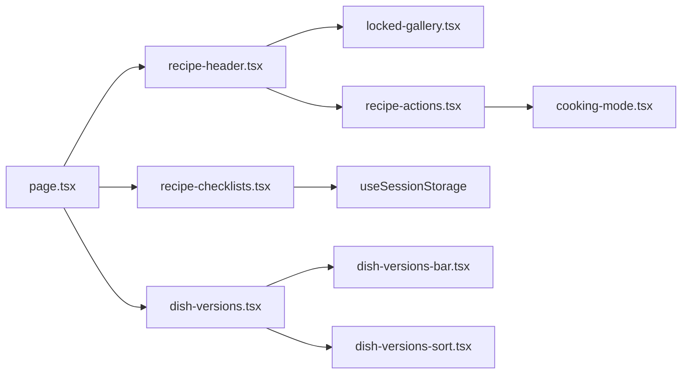

# Recipe page per the 2026-10-28 design handoff (#590)

## 📝 TLDR

Guests and signed-in users read a recipe on `/przepis/[slug]` today, but the page has four parts that the handoff replaces: the hero (a separate photo gallery block and a source line), the steps (plain text, nothing to tick), the "Mamy jeszcze N…" bar that opens the other versions, and the layout of the actions. The proposed behaviour is the handoff's layout: one main action ("Zacznij gotować") and the key facts above the fold, ingredients beside the steps, steps that can be ticked off and remembered per tab, and other versions shown as a short, scannable comparison. This is future behaviour; the page's data, routes and server actions do not change.

## 📝 Problem Statement

- Readers on a phone (the target group includes older people) have to scroll past a separate gallery section to reach the steps, and the steps cannot be marked as done. Only ingredients can.
- The other versions of a dish are behind a yellow bar that does not say what the versions differ in.
- The current design does not match the 2026-10-28 owner handoff, which is the design authority for this change (`ZASADY_PROJEKTU.md` and the README are embedded in issue #590 and copied to `.ai/specs/assets/recipe-page-handoff/`).

Evidence: `src/app/przepis/[slug]/_components/recipe-checklists.tsx` (the step list has no state; only ingredients use `useSessionStorage`), `dish-versions-bar.tsx` (the "Mamy jeszcze N…" text), `locked-gallery.tsx` (the separate "Zdjęcia" block).

## 📝 Proposed Solution

Restyle and restructure the existing page components. Keep everything that is logic:

- Hero: two columns from 440 px (one column below). Photo 4:3 with no radius, source badge bottom-left, thumbnails for the gallery under the photo (see A1), title, subtitle, author line, description, a time strip, the actions and a link to the other versions.
- Ingredients beside the steps (sticky only from 960 px). The "Przygotowanie" heading shows "N z M kroków zrobione" and a progress bar.
- Each step is a numbered button (48 px) that toggles done, plus the text. The state is kept per tab in sessionStorage, the same way ingredients are (`checklistStorageKey`, `toggleChecked`).
- "Dalej" section for the next recipe in the category, when the list context exists (unchanged behaviour).
- Other versions: section `#wersje` with the handoff's comparison rows, sorting kept as it is.

Alternatives considered: a new route for the cooking screen (rejected: the existing cooking mode in `cooking-mode.tsx` already covers that and its logic stays unchanged); a new design system component set (rejected: the handoff asks for the existing components and tokens).

## 📝 Architecture

Takeaway: the change stays inside the components of `src/app/przepis/[slug]/_components/`. `page.tsx` only passes existing props. Existing modules (`cooking-mode.tsx`, `dish-versions-sort.tsx`, `use-session-storage.ts`, `text-size-controls.tsx`) keep their logic.

## 📝 Data Model

None. No schema change, no migration, no new query, no server action. Step ticks use sessionStorage with a key per recipe, the same pattern as ingredient ticks, so they survive a page reload in the same tab and are not stored on the server.

## 📝 UI/UX

Design reference: `.ai/specs/assets/recipe-page-handoff/Strona przepisu - nowy design.dc.html` (with `support.js`), and the README in the same folder. Where the design and `ZASADY_PROJEKTU.md` disagree, the rules win; the disagreements are listed in the handoff and resolved in the table below.

Key behaviours:

- Source is a badge on the photo. Links open in a new tab with an accessible name.
- Steps: a 48 px button with `aria-pressed`, label "Krok N — oznacz jako zrobiony" / "Krok N — zrobiony, cofnij". Done steps are struck through as well as greyed.
- The page has no portion calculator, no timers, no temperature labels (the handoff removes them).
- Contrast and focus follow the project rules: text ≥ 4.5:1, secondary text `#374151`, focus `outline: 3px solid #1d4ed8`, touch targets ≥ 48 px, body text 19 px on mobile.

## 📝 Edge Cases & Failure Scenarios

- **No steps** → the steps area is hidden; the "Gotowe" message is not shown.
- **One step** → the "Teraz" label goes on step 1; the progress bar is full when it is ticked.
- **Ticks in another tab** → sessionStorage is per tab, so ticks do not carry over. This matches ingredients today.
- **Storage blocked** (private mode) → the page renders with no saved state (the `useSessionStorage` hook already never throws).
- **No time-waiting data** → the "Doliczyć ok. 30 min" note is not shown; it is never inferred from the step text.
- **Recipe with no source (book, person)** → the badge has no link and no external icon.
- **Guest views the gallery** → the lock stays on (A1), including on the thumbnails.
- **Long recipe name or source** → the badge text truncates on one line with an ellipsis.
- **Other versions: none** → the link is not rendered.
- **Owner actions (refresh, delete)** → stay at the bottom of the page, as today.

## 📝 Risks & Impact Review

- **Blast radius:** one route, its `_components`, and the tests next to them. Shared components used elsewhere (`RecipeCard`, `card-carousel.tsx`) are not changed by this spec; the "Podobne" and "Inne wersje" cards keep their current structure.
- **Recent changes on the same files:** #210 and #404 shipped earlier versions of this page; this spec changes the same files again. Merge conflicts are expected in `recipe-header.tsx` and `dish-versions.tsx` if other work lands first.
- **Accessibility regressions:** the handoff's colours and sizes are checked against the WCAG rules in `ZASADY_PROJEKTU.md`, not taken as given. The step buttons are the main new interactive element and get keyboard and screen-reader tests.
- **Rollback:** revert the PR; no data changes.

## 📋 Phasing

Phase 1 — the static layout: hero, source badge, time strip, the ingredient and step columns, other-versions section and wording (no new behaviour; existing tests updated).
Phase 2 — step ticks with progress, sessionStorage persistence, and the accessibility pass.

## 📋 Implementation Plan

### Phase 1 — layout and wording

1. `src/app/przepis/[slug]/_components/recipe-header.tsx`: hero in two columns, source badge on the photo (remove the "Źródło:" line), subtitle, author line, time strip with icons, the "Zacznij gotować" / "Zapisz" row, print and share as quiet text buttons, and the link to other versions. Tests in `recipe-header.test.ts`.
2. `src/app/przepis/[slug]/_components/recipe-actions.tsx`: remove the "Oryginał" button and rename "Tryb gotowania" to "Zacznij gotować" (label only; `cooking-mode.tsx` logic unchanged). Update `recipe-actions.test.ts`.
3. `src/app/przepis/[slug]/_components/locked-gallery.tsx`: remove the separate "Zdjęcia" section; render the thumbnails under the main photo. The guest lock stays (A1). Tests in `locked-gallery.test.ts`.
4. `src/app/przepis/[slug]/_components/dish-versions-bar.tsx` and `dish-versions.tsx`: replace the yellow "Mamy jeszcze N…" bar with the link "Inne przepisy na … (N) ↓"; section layout per the handoff; "Ma dodatkowo:" / "Nie ma:" labels in the DOM. Update `dish-versions.test.ts`.
5. `src/app/przepis/[slug]/_components/recipe-checklists.tsx`: ingredient layout per the handoff (sticky from 960 px only); steps rendered with the new numbered layout (no state yet). Update `recipe-checklists.test.ts`, which asserts that the text-size control is not on the page (A2).
6. Verify: `pnpm typecheck`, `pnpm lint`, `pnpm test`; manual check at 390 px and 1280 px.

### Phase 2 — step ticks and accessibility

7. `recipe-checklists.tsx`: step state via `useSessionStorage` keyed like ingredients (`checklistStorageKey`), toggled with `toggleChecked`. Progress text "N z M kroków zrobione", the progress bar, the "Teraz" marker on the first open step, and the "Gotowe! Smacznego." status when all are ticked.
8. Tests: a tick survives remount (storage mocked), a blocked-storage render has no state, one-step and no-step recipes, `aria-pressed` toggles.
9. Accessibility pass: focus outline, touch sizes, contrast of every new colour (`#374151`, `#9a3412`, `#c2410c` as a fill only), reduced-motion for the progress bar.
10. Verify at 320 px, 390 px and 1280 px; screenshots on the PR.

## Resolved assumptions (autonomous defaults)

| # | Question | Default applied | Why |
|---|----------|-----------------|-----|
| A1 | Blocking on #590: the handoff removes the separate "Zdjęcia" section, but #210 requires the gallery to stay locked for guests. Does the lock also cover the thumbnails? | **Yes.** The lock covers the main photo gallery and its thumbnails for guests; the signed-in user sees all. | Keeps the rule from #210 and the access model in `ZASADY_PROJEKTU.md` (the gallery is for signed-in users). The handoff's thumbnail row is kept for signed-in users. Confirmed by the issue's stated default. |
| A2 | Blocking on #590: the handoff keeps "Wielkość tekstu" on the recipe page, but FR #485 moved it to `/wyswietlanie` and a test enforces that. Which one wins? | **FR #485 wins.** The control stays on `/wyswietlanie` and is not added to the recipe page. | An earlier decision the owner already made; the test is the guard for it. Confirmed by the issue's stated default. |
| A3 | Non-blocking: text colour `#374151`, underlined links, "Ma dodatkowo / Nie ma" with words not colour alone. | Project rules apply. | `ZASADY_PROJEKTU.md` is authoritative over the mock. |
| A4 | Non-blocking: the "Inne wersje" list vs the shared card. | Keep the shared card's structure; the comparison line is added inside the existing component. | Handoff item 4 is marked for owner decision; this is the reversible option. |
| A5 | Non-blocking: the button label "Zacznij gotować" instead of "Tryb gotowania". | Label changes; behaviour does not. | Handoff item 7. |
| A6 | Ingredient grouping bug ("Ciasto", dried yeast as a separate row). | Out of scope. Reported in the PR; data is not edited by hand. | Parser or data issue, not layout. |
| A7 | Portion calculator, timers, temperature labels on the page. | Not shown. The current code has no portion calculator on this page; timers and temperature labels are not rendered in the step text. | Handoff removes them; nothing to delete if they are absent. |
| A8 | Where the handoff's HTML lives. | A copy under `.ai/specs/assets/recipe-page-handoff/` in this PR, and the same files under `.ai/design/` on PR #592. | The spec is self-contained; the duplicate is removed when #592 lands. |
