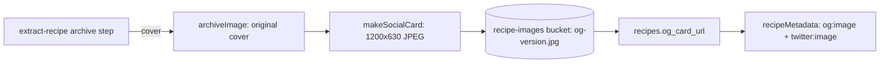

# Generated 1200×630 social card for recipe links

## 📝 TLDR

Recipe links preview the archived cover exactly as uploaded, so portrait photos produce a tall, awkwardly cropped card. The home and category pages already use fixed 1200×630 cards. Proposed: every `/przepis/[slug]` link gets a generated 1200×630 `og:image` and `twitter:image`, cut from the cover around the centre. The card is generated when a recipe is archived, and existing recipes are backfilled once. Admin control over the crop is a separate spec that depends on this one.

## 📝 Problem Statement

- `recipeMetadata` (`src/app/przepis/[slug]/recipe-metadata.ts`) passes the raw cover from `coverImageSrc` as `og:image`, with no width, height, or crop. The source comment states "covers keep whatever size the source had". A portrait photo becomes a tall preview in a 1.91:1 slot.
- The home card (`src/lib/home-meta.ts`) and the category cards (`src/lib/category-og.ts`, committed files under `public/og/categories/`) already declare 1200×630. Recipe links are the only shares without a fixed format.

## 📝 Proposed Solution

For every archived recipe cover, produce one social card:

- **Format:** 1200×630 JPEG, cover-fit (scale to fill, then crop) around the centre.
- **Storage:** a new object `<user_id>/<recipe_id>/og-<version>.jpg` in the existing `recipe-images` bucket, next to the original cover. `<version>` is a timestamp, so scrapers and CDN caches fetch a new URL when the card changes.
- **Metadata:** `recipeMetadata` uses the card when `og_card_url` is set, with `width: 1200` and `height: 630`. When it is `NULL`, today's behaviour stays, so nothing regresses before the backfill.
- **Original cover:** unchanged. On-page photos are a non-goal.

### Alternatives considered

- **Crop at request time (Next `opengraph-image` route with `ImageResponse`).** Rejected: it fetches the source on every scraper hit and leaves no stored artifact to review.
- **CDN image transform on the Storage URL.** Simplest if the account has it. Availability is unconfirmed, so it is the fallback in Phase 0.
- **Committed static files, one per recipe** (the category precedent). Rejected: recipes are created at runtime, so committed files do not scale.
- **Third-party proxy (wsrv.nl).** Rejected: every cover URL would go to a third party, which the privacy policy does not currently disclose for this purpose.

## 📝 Architecture

Takeaway: the card is produced in the same archive pipeline as the cover, and the page only reads a stored URL. Reused: `archiveImage` and its SSRF-safe fetch (`src/lib/recipe-image-archive.ts`), the Inngest archive step, the `recipe-images` bucket and its owner policies. New: `makeSocialCard`, the `og_card_url` column, and the backfill function.

## 📝 Data Model

Additive only (`BACKWARD_COMPATIBILITY.md`, schema surface):

- `public.recipes.og_card_url text null`: the Storage URL of the current card.
- New objects only in `recipe-images`. No existing column, policy, or object is dropped, renamed, or moved.
- Sensitive data: none. The card is derived from an already public photo.

## 📝 API Contracts

- No public API change. `/przepis/[slug]` keeps its URL. Only the `og:image` value and its `width`/`height` change.
- Internal: an Inngest function `recipe/og-card-backfill` with `{ batchSize }`. Out of band: run once after deploy.

## 📝 Edge Cases & Failure Scenarios

- **Cover missing or not archived:** no card is generated. `og_card_url` stays `NULL`, and metadata falls back to today's behaviour.
- **Cover smaller than 1200×630:** the card scales up and looks soft. Accepted for now; reported by the backfill if it is common.
- **Generation fails:** the archive step keeps the cover and records no card. Its test verifies the archive step still resolves.
- **Scrapers caching the old card:** the new version name means new fetches get the new image. Platforms that cached the old card keep it until their own cache expires.

## 📝 Risks & Impact Review

- **Runtime (main risk):** `sharp` does not run on Cloudflare Workers. It is not verified whether the Inngest path runs on Node or in the Worker. Phase 0 settles this before any code depends on it.
- **New dependency:** one image library if Phase 0 picks `sharp`. Removing the function reverts to today's behaviour.
- **Storage:** roughly 100–200 KB per recipe.
- **Production write:** the backfill writes to every recipe's `og_card_url`. It must be run in batches with a dry-run count first.
- **Rollback:** dropping the metadata change restores today's preview. The column and objects can stay, since they are unused.

## 📝 Decisions in play

No `product-brief.md` exists for this area, so no Non-goal, Business rule, or Decision id applies.

## Resolved assumptions (autonomous defaults)

| # | Question | Chosen answer | Rationale | Status |
|---|---|---|---|---|
| Q1 | Where is the card generated? | Phase 0 spike decides: `sharp` in the deployed Inngest runtime, else a Cloudflare image transform if the account has one, else stop and ask. | The runtime is unverified, so the choice cannot be made without the spike. | Procedure confirmed by owner; runtime answer comes from the Phase 0 spike |
| Q2 | Backfill for existing recipes? | One-off batch Inngest function after Phase 1. No lazy generation on request. | A batch is reviewable and reversible. Lazy generation would move cost onto the public page. | Default, not blocking |
| Q4 | Crop default | Centre (50/50) | Most predictable, and matches the category cards. | Confirmed by owner |
| Q5 | Original cover format | Unchanged | Scope: on-page photos are a non-goal. | Default |

The admin focal point question (previously Q3) moved to its own spec: `2026-10-29-og-social-card-admin-focal-point.md`.

## 📋 Phasing

- **Phase 0 — Spike and decision (gate, not product code):** confirm the generation runtime and whether the account has an image transform, and check the `recipe-images` insert and update policies for owners. Requires production and Cloudflare access. Output: a recorded Q1 decision.
- **Phase 1 — Generated card for new and existing recipes:** shippable on its own, because metadata falls back when `og_card_url` is `NULL`.

## 📋 Implementation Plan

### Phase 0 — Spike and decision

1. Deploy a throwaway Inngest function that resizes one stored cover to 1200×630 with `sharp`, and confirm it runs in the deployed runtime. Record the result. *Needs a production deploy; cannot be verified before merge.*
2. If step 1 fails, check the account for a Cloudflare image transform and test `fit=cover` on a Storage URL. Record the result. *Needs Cloudflare account access.*
3. Check the `recipe-images` insert and update policies. Confirm an authenticated owner can write `og-<version>.jpg` under their own path. Record the result. *Verifiable by reading the migrations plus one test upload.*
4. If neither option works, stop and report to the human.

### Phase 1 — Generated card

5. Add migration: `recipes.og_card_url text null` (additive). Test: migration applies to a copy of the schema.
6. Add `makeSocialCard({ sourceUrl })` in `src/lib/recipe-social-card.ts`, returning a 1200×630 JPEG buffer with a centred crop. Unit tests: portrait, landscape, smaller-than-target input.
7. Call `makeSocialCard` from the archive step in `src/inngest/run-extract-recipe.ts` after the cover is archived. Store `<user_id>/<recipe_id>/og-<version>.jpg` and set `og_card_url`. Test: a failure logs, keeps the cover, and the archive step still resolves. The test uses a fake storage client, so it runs without the database or real Storage.
8. Extend `recipeMetadata` (`src/app/przepis/[slug]/recipe-metadata.ts`): when `og_card_url` is set, use it with `width: 1200` and `height: 630`; keep the `summary` fallback. Update `recipe-metadata.test.ts`.
9. Add `og_card_url` to `RecipeForJsonLd` and the recipe query. Test: the field reaches `recipeMetadata`.
10. Add the backfill Inngest function `recipe/og-card-backfill`. It processes recipes with a null `og_card_url` in batches and records failures. Before running, it reports a dry-run count. *Production write; run manually after review, not in tests.*
11. Verify on production: share one portrait and one landscape recipe, and check `og:image` in the page source. Run `pnpm smoke:prod` after the deploy. *Production only.*
