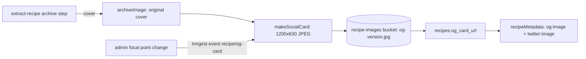

# Fixed 1200×630 social card for recipe links, with admin focal point

## 📝 TLDR

Visitors who receive a recipe link see its preview built from the archived cover exactly as uploaded. Portrait photos produce a tall, awkwardly cropped card, while the home and category pages already use fixed 1200×630 cards. Proposed: every `/przepis/[slug]` link gets a generated 1200×630 `og:image` and `twitter:image` cut from the cover around a stored focal point. The card is generated when a recipe is archived, and an admin can change the focal point later, which regenerates the card.

## 📝 Problem Statement

- `recipeMetadata` (`src/app/przepis/[slug]/recipe-metadata.ts`) passes the raw cover from `coverImageSrc` as `og:image`, with no width, height, or crop. The source comment states "covers keep whatever size the source had". A portrait photo therefore becomes a tall preview in a 1.91:1 slot, and the platform crops it unpredictably.
- The home card (`src/lib/home-meta.ts`) and the category cards (`src/lib/category-og.ts`, committed files under `public/og/categories/`) already declare 1200×630. Recipe links are the only shares without a fixed format.
- Evidence: the issue body for #626 describes the current behaviour; the code path above is verified.

## 📝 Proposed Solution

For every archived recipe cover, produce one social card:

- **Format:** 1200×630 JPEG, cover-fit (scale to fill, then crop) around the focal point.
- **Focal point:** `og_focus_x` and `og_focus_y`, percentages 0–100, nullable. `NULL` means 50/50 (centred).
- **Storage:** a new object `<user_id>/<recipe_id>/og-<version>.jpg` in the existing `recipe-images` bucket, next to the original cover. `<version>` changes on every regeneration, so social scrapers and CDN caches fetch the new image instead of a stale one.
- **Metadata:** `recipeMetadata` uses the card when `og_card_url` exists and sets `width: 1200`, `height: 630`. When it does not exist, it keeps today's behaviour, so nothing regresses before the backfill.
- **Original cover:** untouched. On-page photos are not changed.

### Alternatives considered

- **Crop at request time (Next `opengraph-image` route with `ImageResponse`).** Rejected: it fetches the source on every scraper hit, needs an edge-compatible image path, and gives no stored artifact to version or review.
- **CDN image transform on the Storage URL** (`fit=cover` with `gravity`). Cheapest to build if the account has it, but I could not confirm availability for this account, and it would still need a stored focal point. Kept as the fallback in Q1.
- **Committed static files, one per recipe** (the category precedent). Rejected: recipes are created by users at runtime, so committing files does not scale.
- **Third-party proxy (wsrv.nl).** Rejected: it would send every cover URL to a third party for each card. The privacy policy names wsrv.nl only as a download fallback, so this would change what it covers.

## 📝 Architecture

Takeaway: the card is produced in the same archive pipeline as the cover, and the page only reads a stored URL. Existing parts are the archive step and `recipeMetadata`. New parts are `makeSocialCard`, the card URL column, and the admin event.

Reused components: `archiveImage` and its SSRF-safe fetch (`src/lib/recipe-image-archive.ts`), the Inngest archive step, the `recipe-images` bucket, and the owner-scoped storage policies.

## 📝 Data Model

Additive only (`BACKWARD_COMPATIBILITY.md`, schema surface):

- `public.recipes.og_focus_x numeric(5,2) null` and `og_focus_y numeric(5,2) null`, with a check of `0 <= x <= 100`. `NULL` = centred.
- `public.recipes.og_card_url text null`, the Storage URL of the current card.
- No existing column, policy, or object is dropped, renamed, or moved.
- Storage: new objects only. Regeneration writes a new `og-<version>.jpg` and then updates `og_card_url`. The previous object is deleted after the update succeeds (owner delete policy `recipe_images_owner_delete` already exists).
- Sensitive data: none. The card is derived from an already public photo.

## 📝 API Contracts

- No public API changes. `/przepis/[slug]` keeps its URL and metadata shape; only the `og:image` value and the `width`/`height` keys change.
- Internal event `recipe/og-card` with `{ recipeId, userId, reason: 'archive' | 'focus-change' | 'backfill' }`, consumed by the same function that creates the card.
- Admin server action `setRecipeOgFocus(recipeId, x, y)` (Phase 2). It checks the staff permission the admin panel already uses for recipe edits and writes an audit row through the existing `staff_audit` function.

## 📝 UI/UX

- Phase 2 only: an admin panel control on the recipe edit screen. It shows the cover inside a 1.91:1 frame, with the card area outlined and a draggable focal point. Saving sends the new point and shows "Card updates in a few seconds" while regeneration runs.
- No change to on-page UI for visitors.
- Accessibility: the focal point can also be set with two number inputs (0–100) for keyboard users. The frame has a text label.

## 📝 Edge Cases & Failure Scenarios

- **Cover missing or not archived:** no card is generated. `og_card_url` stays `NULL`, and metadata falls back to today's behaviour (`summary` card when there is no image).
- **Cover smaller than 1200×630:** the card scales up, which looks soft. Accepted for Phase 1; logged as a follow-up if it shows up in the backfill report.
- **Generation fails:** the archive step keeps the cover and records no card. A failed focal-point regeneration keeps the previous card, so the public link never breaks.
- **Focal point changed while a card is being generated:** the newer event wins because the version is written last and the old object is removed only after a successful update.
- **Scrapers caching the old card:** the new version name means new fetches get the new image. Platforms that already cached the old card keep it until their own cache expires; that is outside our control.

## 📝 Risks & Impact Review

- **Runtime (the main risk):** `sharp` does not run on Cloudflare Workers. The extract and archive functions run through Inngest, and it is not verified whether that path runs on Node or inside the Worker. Phase 0 settles this before any code depends on it.
- **New dependency:** Phase 1 adds one image library, if Phase 0 chooses `sharp`. This is reversible: removing the function reverts to today's behaviour.
- **Storage growth:** one extra JPEG per recipe, about 100–200 KB. Previous versions are deleted.
- **Rollback:** dropping the metadata change restores today's preview. Columns and objects can stay; they are additive and unused.

## 📝 Decisions in play

No `product-brief.md` exists for this area, so no Non-goal, Business rule, or Decision id applies.

## Resolved assumptions (autonomous defaults)

| # | Question | Chosen answer | Rationale | Status |
|---|---|---|---|---|
| Q1 | Where is the card generated? | Phase 0 spike: if `sharp` runs in the deployed Inngest runtime, generate inside the archive function. If not, use a Cloudflare image transform, only if the account has it. Otherwise stop and ask. | Least new surface first. The runtime is unverified, so the choice cannot be made without the spike. | ⚠ NEEDS HUMAN CONFIRMATION (runtime and account capability) |
| Q2 | Backfill for existing recipes? | One-off batch Inngest function, run after Phase 1 ships. New recipes are covered at archive time. No lazy generation on request. | A batch is reviewable and reversible. Lazy generation on request would move cost to the public page. | Default, not blocking |
| Q3 | Is the admin control in this issue? | No. Phase 2, after Phase 1 works. | Keeps Phase 1 shippable on its own and limits the blast radius of the admin change. | Default |
| Q4 | Focal point default | 50/50 (`NULL`) | Centred crop is the most predictable default and matches the category cards. | ⚠ NEEDS HUMAN CONFIRMATION (a centred crop may cut off dish details on tall photos) |
| Q5 | Keep the original cover format? | Yes, unchanged | Scope rule: on-page photos are a non-goal. | Default |

## 📋 Phasing

- **Phase 0 — Spike and decision:** confirm the generation runtime and whether the account has an image transform. Output: a written choice for Q1. No product code.
- **Phase 1 — Generated card for new and existing recipes:** card generation at archive time, metadata wiring, and a backfill function. Shippable on its own: links use the card when present and fall back otherwise.
- **Phase 2 — Admin focal point:** columns used by the admin control, the regeneration event, and the audit row. Depends on Phase 1.

## 📋 Implementation Plan

### Phase 0 — Spike and decision

1. Deploy a throwaway Inngest function that resizes one stored cover to 1200×630 with `sharp`. Confirm it runs in the deployed Worker/Inngest runtime. Record the result in the spec.
2. If step 1 fails, check the account for a Cloudflare image transform and test `fit=cover` with `gravity` on a Storage URL. Record the result.
3. Check the `recipe-images` insert and update policies. Confirm an authenticated owner can write `og-<version>.jpg` under their own path. Record the result.
4. Update Q1 with the decision. If neither option works, stop and report to the human.

### Phase 1 — Generated card

5. Add migration: `recipes.og_card_url text null` (additive).
6. Add `makeSocialCard({ sourceUrl, focusX, focusY })` in `src/lib/recipe-social-card.ts`. Output: 1200×630 JPEG buffer. Unit test: portrait, landscape, and smaller-than-target inputs, plus the centred default.
7. Call `makeSocialCard` from the archive step in `src/inngest/run-extract-recipe.ts` after the cover is archived. Store the object as `<user_id>/<recipe_id>/og-<version>.jpg` and set `og_card_url`. A failure logs and keeps the cover (test: the archive step still resolves).
8. Extend `recipeMetadata` in `src/app/przepis/[slug]/recipe-metadata.ts`: when `og_card_url` is set, use it with `width: 1200`, `height: 630`. Keep the existing `summary` fallback. Update `recipe-metadata.test.ts`.
9. Add `og_card_url` to `RecipeForJsonLd` and the recipe query so the field reaches `recipeMetadata`.
10. Add the batch backfill Inngest function `recipe/og-card-backfill`. It processes recipes with a null `og_card_url` in chunks and records failures. Run it once against production after review.
11. Verify on production: share one portrait recipe and one landscape recipe, and check `og:image` in the page source. Run `pnpm smoke:prod` after deploy.

### Phase 2 — Admin focal point

12. Add `og_focus_x` and `og_focus_y numeric(5,2) null` with range checks (additive migration).
13. Add the `recipe/og-card` event with `reason: 'focus-change'`. The function regenerates the card and deletes the previous object after the update succeeds.
14. Add `setRecipeOgFocus` (server action) with the staff permission check and a `staff_audit` row. Test: a user without permission is refused, and the audit row is written.
15. Add the focal-point control in the admin recipe editor: 1.91:1 frame, draggable point, number inputs, and a status line while regeneration runs. Test: the inputs clamp to 0–100.
16. Verify in the admin panel with the QA account (`/api/dev/login?as=full`). Do not add recipes as the QA account. Verify the public card after the change.

## ⚠️ Open decisions for the human

- Q1: confirm the generation runtime after the Phase 0 spike, and whether a Cloudflare image transform is available.
- Q4: confirm that a centred 50/50 default is acceptable for portrait photos.
