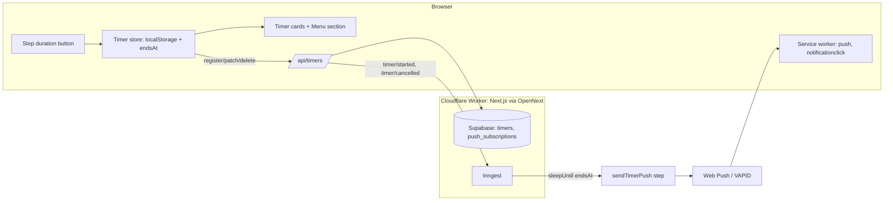

# Recipe step timers and Android push notifications

## 📝 TLDR
Readers cooking from a recipe page must currently track step durations by hand. Today the step text is plain text and the site has no timers and no Web Push. The proposal: a duration in a step ("na **30 minut**") becomes a button that starts a timer; timers survive reloads; when a timer ends the reader gets a Web Push notification on Android, including with the screen locked and the tab closed. Future behaviour, not yet implemented. Issue: #611. Visual source: the handoff bundle `design_handoff_minutniki_powiadomienia.zip`.

## 📝 Problem Statement
- Recipe steps frequently name a duration ("12–15 minut", "30 minut"). The reader has to switch to a clock app and remember which step they started.
- Verified in this checkout: `public/sw.js` has `activate` and `fetch` listeners only. There is no `push` or `notificationclick` handler. No Web Push code, VAPID configuration or push-subscription table exists in `src/` or `supabase/`.
- Recipe step text is stored and rendered as text. The checklist state (`src/lib/recipe-checklist.ts`) indexes steps by position and does not parse durations. Duration parsing does not exist yet.
- Evidence the feature matters: it is the reason the design handoff exists; the owner requested it.

## 📝 Proposed Solution

Three parts, each independently testable:

1. **Client timers (no server).** Parse durations from step text into `{ min, name, hint?, next?, addMin }` (rules in *Duration parsing* below). Timers are stored in `localStorage` and run from `endsAt` timestamps. A timer component mounted in the root layout keeps the state alive across navigation inside the site.
2. **Server-scheduled push.** Each started timer is registered on the server. An Inngest function sleeps until `endsAt` (`step.sleepUntil`), then sends a Web Push to the timer's subscription if the timer is still active. Pause, end and "+N min" cancel or reschedule the pending run.
3. **Service worker push handling.** `push` shows the notification; `notificationclick` handles the `+N min` action (PATCH to the server) and the open-at-step URL.

### Alternatives considered
- **Cloudflare Durable Object alarms** (second-precision, runs inside the existing Worker). Rejected for this iteration: it adds a new binding, a Durable Object class and a second state store next to Supabase, for a scheduling need Inngest already covers. Revisit if Inngest cost or latency becomes a problem.
- **Supabase `pg_cron`** (minimum one-minute resolution). Rejected: the handoff requires delivery within seconds of `endsAt`, and cron cannot schedule per-row second-level sends.
- **Client-only notifications via the Notification API while the page is open.** Rejected as the sole mechanism: the handoff requires delivery with the tab closed and the screen locked. Kept as the in-page fallback when the page is open (the card itself shows the end state).

### Duration parsing
- Patterns, case-insensitive, Polish: `N minut(y)|min`, `N–M minut`, `N godz.|godzin(y)`. Number words are skipped (no timer).
- Ranges start at the lower bound; `addMin` is the difference to the upper bound, rounded to 1, 3 or 5.
- The parser runs on the stored step text at render time as a pure function, so no migration is needed. The unit test covers the handoff examples (`krok 3 → 30 min`, `krok 9 → 12–15 min`).
- A step without a duration gets no timer. Timer names come from a short label when available, otherwise "Krok N".

## 📝 Architecture



- Existing: Next.js on OpenNext (`custom-worker.ts`, `wrangler.jsonc`), Supabase, Inngest (`src/inngest/`, already runs `extractRecipe`), `public/sw.js`, `src/app/components/pwa-register.tsx`.
- New: timer store and UI, `/api/timers` routes, `push_subscriptions` and `timers` tables, `src/inngest/` timer functions, service worker push handlers, `web-push` dependency, VAPID env variables.
- Coupling: the timer functions are called only from the API routes via Inngest events. Nothing else in the app depends on them.

## 📝 Data Model

```sql
create table push_subscriptions (
  id uuid primary key default gen_random_uuid(),
  endpoint text not null unique,
  p256dh text not null,
  auth text not null,
  user_id uuid not null references auth.users(id) on delete cascade,  -- push is for signed-in users only
  created_at timestamptz not null default now(),
  last_seen_at timestamptz not null default now()
);

create table timers (
  id uuid primary key,                       -- generated client-side, stable across retries
  subscription_id uuid not null references push_subscriptions(id) on delete cascade,
  ends_at timestamptz not null,
  name text not null,
  recipe_slug text,
  recipe_title text,
  step int,
  next text,
  add_min int not null check (add_min in (1, 3, 5)),
  status text not null check (status in ('running', 'cancelled', 'sent')),
  created_at timestamptz not null default now()
);
create index timers_subscription_status_idx on timers (subscription_id, status);
```

- Sensitive data: `endpoint`, `p256dh` and `auth` are per-device push credentials. They are readable only by the server (service role); RLS denies anon and authenticated clients. Only signed-in users get a subscription; guests never register one.
- Timer rows hold only the recipe title and slug (public data). No free text from the user.
- Retention: `timers` rows with status `sent` or `cancelled` older than 7 days are deleted by a daily cron (added to the existing `triggers.crons` list in `wrangler.jsonc`).
- Migration: one new migration file under `supabase/migrations/`. Applied through the Management API per project memory (`apply-prod-migrations-via-management-api`); the migration is idempotent.

## 📝 API Contracts

All routes live under `src/app/api/timers/`. Responses are JSON. Validation with the project's existing schema helper; unknown fields refused.

- `POST /api/timers` — requires a signed-in session; a guest gets `401` and the timer stays in the browser only. Body `{ id, subscription: { endpoint, p256dh, auth }, endsAt, name, recipeSlug, recipeTitle, step, next, addMin }` → `201 { id, endsAt }`. Upserts the subscription by `endpoint` and `user_id`, inserts the timer, sends Inngest event `timer/started` with `{ timerId }`. `endsAt` must be in the future and at most 24 h ahead; otherwise `422`.
- `PATCH /api/timers/:id` — body `{ action: 'pause' | 'resume' | 'extend', endsAt?, remainingMs?, addMin? }`:
  - `pause` → status stays `running`, the server cancels via Inngest event `timer/cancelled`; the client keeps `remaining`.
  - `resume` / `extend` → new `endsAt`; the server emits `timer/rescheduled` so the old sleep is cancelled and a new one starts.
  - Returns `200 { id, endsAt, status }`. Unknown or foreign id → `404`.
- `DELETE /api/timers/:id` — end or dismiss; sets status `cancelled`, emits `timer/cancelled`. Idempotent.
- `POST /api/push/subscribe` — optional separate route for re-subscribing when the browser rotates the subscription; the same upsert logic as `POST /api/timers`.

Authorization: every route requires the signed-in session. Timers are addressed by an unguessable UUID and must also belong to the caller's `subscription_id`; a foreign id returns `404`.

## 📝 UI/UX

Source of truth for visuals is the handoff README and `ZASADY_PROJEKTU.md`. Summary:

- **Step trigger.** The duration in the step text is a button styled as a link: Lucide `Timer` 18 px, 800 weight, `#9a3412`, 2 px underline with 4 px offset, 10 px vertical padding with −10 px margin. `aria-label` "Włącz minutnik: {name}, {min} min".
- **Running state.** Green text `#15803d` and a badge (`#dcfce7` / `#14532d`, 15 px, `tabular-nums`) with the remaining time. A second click does nothing.
- **Timer cards.** Fixed bottom-right, 340 px wide, `max-width: calc(100% - 32px)` on phones, stacked with 8 px gap, `role="region"` "Minutniki". Ended state uses `#c2410c` with `role="status"` "Czas minął: {name}".
- **Menu.** A "Minutniki" section at the top of the panel, a count badge on the Menu button, a custom timer (1–180 min), and a notification status line (on / off / not asked yet).
- **Keep screen on.** `role="switch"`, Screen Wake Lock API, re-acquired on `visibilitychange`; hidden when the API is unavailable.
- **Consent.** Shown only to signed-in users, asked once, at the first timer start, and only when `PushManager` exists and `Notification.permission === 'default'`. Guests see the in-page timer and a status line saying notifications are for signed-in users. The "Tak" button calls `Notification.requestPermission()` before any other `await` in the click handler. Esc or "Nie" records the refusal in `localStorage`; the timer still starts.
- **Accessibility.** WCAG 2.2 AA per `ZASADY_PROJEKTU.md`: targets ≥ 48 px where the handoff says so (44 px minimum for inline controls, as in the handoff), focus `3px solid #1d4ed8`, announced end of timer, reduced-motion respected.

## 📝 Edge Cases & Failure Scenarios
- **Device clock skew.** `endsAt` is computed on the client from `Date.now()`. The server schedules from that absolute time. Skew of a few seconds is accepted; the card shows the server-independent countdown.
- **Push rejected or subscription gone (`404/410`).** The subscription row is deleted; the timer shows "Czas minął" in the page only. The user sees the status line in the menu change to "wyłączone".
- **Inngest unavailable when `POST` is made.** The timer is stored locally and in the database; the route returns `202` and the client retries the registration once a minute until it succeeds. Delivery may be late by that retry interval; the card still ends on the page.
- **Pause or end races the send.** The sleeping function re-reads the row after waking up and sends only if `status = 'running'` and `ends_at` equals the scheduled value. Duplicate Inngest deliveries are safe because of this check.
- **Notification fired while the page is visible.** The service worker still shows the notification (the handoff's rule), without vibration, so the reader does not miss it.
- **Non-Android or iOS Safari.** No push; the timer runs in the open page only. Documented in the UI status line. Out of scope to add the "Add to Home Screen" instruction.
- **Storage cleared mid-timer.** Timers disappear from the menu; the scheduled push still arrives and opens the recipe at the step. Acceptable; documented.

## 📝 Risks & Impact Review
- **Hard to reverse.** The `push_subscriptions` and `timers` tables and the public `/api/timers` routes become a contract once users have subscriptions. Keep the routes additive; no existing route changes.
- **Third-party processing.** Inngest receives timer ids and `endsAt` (no subscription keys in event payloads; the function loads them from Supabase by id). Inngest payload retention follows its own policy; this must be stated in the privacy notice. Owner agreed to Inngest as the delayed sender, tentatively; re-confirm before launch.
- **Guest subscriptions.** Excluded by owner decision: push is for signed-in users only, so no per-device endpoint is stored for guests.
- **Cost.** One sleeping Inngest run per active timer. At expected usage this is small; the owner should confirm against the Inngest plan before launch.
- **Rollback.** Disable by removing the `POST` call from the client (timers then run in-page only). Tables can be left in place; the cron removes old rows.
- **Who bears impact.** Readers on Android. Other readers see no change.

## 📝 Decisions in play
- No `product-brief.md` exists in `.ai/specs/`; no brief-level decisions apply.
- No `BACKWARD_COMPATIBILITY.md` protected surface is touched; new routes and tables are additive.

## 📋 Phasing
- **Phase 1 — In-page timers (no push, no server).** Duration parsing, step trigger, timer store, cards and menu section, wake lock switch. Shippable alone; the reader gets timers on the page.
- **Phase 2 — Server registration and delayed push.** Tables, migration, `/api/timers`, Inngest functions, service worker push and click handlers, consent dialog, VAPID configuration. Depends on Phase 1 store.
- **Phase 3 — Hardening.** Retention cron, subscription rotation route, Android end-to-end test procedure in the PR description, reduced-motion pass.

## 📋 Implementation Plan

### Phase 1 — In-page timers
1. Add `src/lib/step-duration.ts`: pure parser returning `{ min, addMin } | null` for a step text; unit tests for the handoff examples, ranges, number words (no match), and `godz.`.
2. Add `src/lib/timer-store.ts`: `localStorage` read/write with try/catch, `endsAt`-based remaining time, pause/resume/extend; unit tests with fake timers, including a reload simulation.
3. Add `src/app/components/timer-provider.tsx` mounted in the root layout: context with `start`, `pause`, `resume`, `extend`, `end`; ticks once per second only while a timer runs.
4. Change the recipe step renderer (`src/app/przepis/[slug]/` step list) to render the duration button when `step-duration` returns a value; keep the existing step text unchanged otherwise. Test: button present, `aria-label` correct, running state after click.
5. Add timer cards (`role="region"`) and the Menu section in `app-menu.tsx`; badge on the menu button via `app-header.tsx`. Test: badge count equals running timers.
6. Add the Keep-screen-on switch in the recipe page header area; hidden without the Wake Lock API. Test: switch role and state.

### Phase 2 — Server registration and delayed push
7. Add migration `supabase/migrations/<timestamp>_push_timers.sql` with both tables, RLS enabled, no anon/authenticated policies. Apply via the Management API; record in `schema_migrations`.
8. Add `src/lib/push/` with the `web-push` sender and VAPID env parsing (`VAPID_PUBLIC_KEY`, `VAPID_PRIVATE_KEY`, `VAPID_SUBJECT`); unit test with a mocked sender, including `404/410` deletion.
9. Add routes `src/app/api/timers/route.ts` and `src/app/api/timers/[id]/route.ts` with validation; integration tests for create, pause/resume/extend, delete, foreign id (`404`), past `endsAt` (`422`).
10. Add Inngest functions in `src/inngest/timers.ts`: `timer/started` → `step.sleepUntil(endsAt)` → re-read row → send if `running` and `ends_at` unchanged → mark `sent`; cancellation and reschedule events cancel the sleeping run. Register in the existing Inngest serve route. Tests: sent, cancelled before end, rescheduled, duplicate delivery.
11. Update `public/sw.js`: `push` handler (`waitUntil(showNotification)`, suppression rules per the handoff), `notificationclick` handler (`add` → PATCH `extend`; `open` → focus or `openWindow` on `/przepis/{slug}#krok-{n}`). Test: `src/lib/sw.test.ts` extended.
12. Add the consent dialog (`role="dialog"`, Esc = no, once only, signed-in users only) and the subscription call (`pushManager.subscribe` in the same click handler). Test: dialog appears once; refusal persisted; guests never see it.

### Phase 3 — Hardening
13. Add the daily retention cron to `wrangler.jsonc` `triggers.crons` and a handler that deletes old `timers` rows. Test: the handler's query selects only rows older than 7 days with terminal status.
14. Add `POST /api/push/subscribe` for subscription rotation; test the upsert by endpoint.
15. Run the gate (`pnpm typecheck`, `pnpm lint`, `pnpm test`, `pnpm test:reflow`) and an Android test procedure in the PR body: lock the screen, start a 1-minute timer, confirm delivery within seconds, tap `+3 min`, tap the body, confirm the step anchor.

## Resolved assumptions (autonomous defaults)

| # | Question | Chosen default | Rationale | Status |
|---|----------|----------------|-----------|--------|
| 1 | Delayed-delivery mechanism at second precision | Inngest `step.sleepUntil` | Already in the stack (`src/inngest/`); DO alarms would add a second state store | Reversible |
| 2 | Should guests receive push? | No, signed-in users only (owner decision) | Avoids storing per-device endpoints for guests | Owner decided |
| 3 | Route Inngest payloads contain subscription keys? | No, ids only | Limits what a third party holds | Reversible |
| 4 | Is a server-side scheduler acceptable at all? | Yes, Inngest as processor (owner, tentatively) | The handoff explicitly asks for second-level delivery | Re-confirm before launch |
| 5 | iOS support | Out of scope | Handoff non-goal | Reversible |
| 6 | Timer retention | 7 days, then deleted | Minimal stored history | Reversible |
