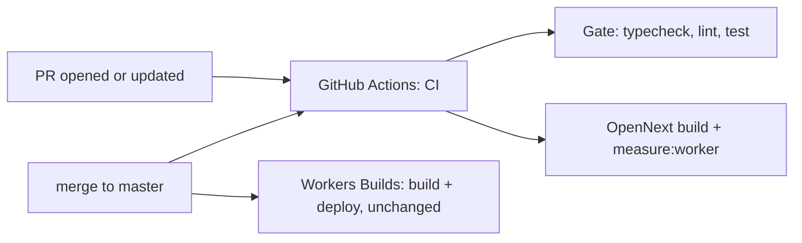

# CI check on every pull request (E02-S07)

Issue: #375 (epic #368). Design authority: `context/foundation/code-audit-2026-10-20.md` §3a A1, A8. Status: spec and implementation ship together on one PR (see "Resolved assumptions").

## 📝 TLDR
The owner merges PRs "on green tests", but nothing runs those tests except an agent or a person who remembers to. The Worker build and its 3 MiB size limit are checked only by Workers Builds on `master`, after the merge. **Proposed (future behavior):** a GitHub Actions workflow named `CI` runs on every PR and on `master`. It runs the validation gate (`pnpm typecheck`, `pnpm lint`, `pnpm test`), then the OpenNext Worker build and the existing Worker size check, with no production secrets. The one e2e test that adds a recipe stops writing to the production database.

## 📝 Problem Statement
- Audit A1 (high): no `.github/`, no hosted check. A PR can merge with a red gate if nobody ran it, and a Worker over the free-plan limit is found only when the `master` deploy fails (it leaves the previous version live, so a follow-up PR is needed).
- Audit A8 (low): `e2e/add-recipe.spec.ts` "accepts valid URL" submits `https://example.com/przepis-testowy`. Local dev uses the production Supabase project, so every run writes a real `recipe_shares` row and starts a real Inngest job.
- `SDLC.md` says Actions minutes are exhausted. The repository is now public, and GitHub-hosted runners are free for public repositories, so this is checked on the PR itself (see "Edge cases").

## 📝 Proposed Solution
1. `.github/workflows/ci.yml`, triggers `pull_request`, `push` to `master`, `workflow_dispatch`. Two parallel jobs on `ubuntu-latest`:
   - **Gate:** checkout → pnpm from `packageManager` → Node from `.nvmrc` (pnpm store cached) → `pnpm install --frozen-lockfile` → `pnpm typecheck` → `pnpm lint` → `pnpm test`.
   - **Worker build and size:** same setup → `pnpm exec opennextjs-cloudflare build` → `pnpm measure:worker`. The size check is the existing `scripts/measure-worker-bundle.mjs`: `wrangler deploy --dry-run` reports the gzipped upload size, and the script fails above its 2900 KiB budget, which is about 5 % under the 3072 KiB hard limit. CI reuses that budget so the PR check and the admin-panel phases use the same number.
2. **No production secrets:** the build needs `NEXT_PUBLIC_SUPABASE_URL` and `NEXT_PUBLIC_SUPABASE_ANON_KEY` (`src/lib/env.ts` throws when they are missing). CI sets them to a placeholder (`http://127.0.0.1:54321`, nothing listening), so the build never reaches the production database. The sitemap already falls back to static entries when the database is unreachable. `wrangler deploy --dry-run` bundles without a Cloudflare login. The workflow has `permissions: contents: read` and uses no `secrets.*`.
3. **e2e guard:** a helper `e2e/db-writes.ts` exports `dbWritesAllowed(env)`. It is true only when `E2E_DB_WRITES=1` is set and the Supabase URL is set and is not the production project. "accepts valid URL" calls `test.skip(!dbWritesAllowed(process.env), …)`. The two validation tests (empty field, malformed URL) still run because the server action rejects them before anything is written.
4. **Docs:** `CLAUDE.md` ("One account") and `SDLC.md` (validation gate, operational notes) name the `CI` check as part of the merge gate, `.ai/agentic.config.json` gets a non-zero `ci.maxWaitMinutes`, and the repo-local `om-approve-merge-pr` / `om-auto-fix-issue` extensions require the check to be green.

Alternatives that lost:
- *Run the full e2e/reflow suite in CI:* needs a non-production database (E03), out of scope.
- *Deploy from CI:* Workers Builds keeps deploying `master`, out of scope.
- *Mock the server action in Playwright:* the write happens on the server. Intercepting the RSC action response is fragile, and the test would no longer exercise the real path.
- *Real Supabase values in CI:* they are public (publishable key), but the build would then read the production database. The placeholder keeps CI fully isolated.

## 📝 Architecture

CI is a new pre-merge check that runs next to the existing deploy path and does not replace it. Workers Builds stays the only deployer.

## 📝 Edge Cases & Failure Scenarios
- **Actions cannot run on the account** (billing lock): the run shows "not started" instead of red/green. The PR body reports what the first run actually did. If Actions cannot run, the docs keep the local gate as the merge evidence and the owner decides whether to keep the workflow.
- **Renovate PRs** (pnpm 12, TypeScript 7, …) now get a real check. A red check on a dependency PR means the bump breaks the gate, which is the point.
- **Size budget crossed by a dependency bump:** the PR goes red with "over budget by N KiB". Raising `--budget-kib` (max 3072) is an explicit, reviewable change.
- **A new e2e test that fills the add-recipe URL field** without the guard: a vitest test scans `e2e/*.spec.ts` and fails, so the regression shows up in CI instead of in the production database.

## 📝 Risks & Impact Review
- No app or runtime change. Rollback = delete the workflow file. `master` has no branch protection, so the check informs the merge but cannot block it on GitHub. The merge skills and `CLAUDE.md` make it a gate by rule.
- Action versions are pinned by major tag. Renovate (`renovate.json`) keeps them current.

## 📋 Implementation Plan
**Phase 1 — CI workflow**
1. Add `.github/workflows/ci.yml` with the two jobs above, `concurrency` cancel-in-progress per ref, and job timeouts. Check: YAML parses, and the commands match the local run (`pnpm typecheck && pnpm lint && pnpm test`, then build + `pnpm measure:worker` with placeholder env).

**Phase 2 — e2e production-write guard**
2. Add `e2e/db-writes.ts` (`dbWritesAllowed`, production host constant) and guard "accepts valid URL" with it.
3. Add `src/lib/e2e-db-writes.test.ts`: truth table for `dbWritesAllowed`, the production-host constant matches `wrangler.jsonc`, and every `e2e/*.spec.ts` that fills `URL przepisu` calls the guard.

**Phase 3 — process docs**
4. Update `CLAUDE.md`, `SDLC.md`, `.ai/agentic.config.json` (`ci.maxWaitMinutes`) and the repo-local merge extensions so the green `CI` check is part of the merge gate.

**Phase 4 — verify on the PR**
5. Push and confirm both jobs run green. Then push one deliberately failing commit to show the check goes red, revert it, and record both run links in the PR body.

## Resolved assumptions (autonomous defaults)
| # | Question | Default | Why |
|---|---|---|---|
| Q1 | Separate spec PR and implementation PR? | One PR carrying both | The session may push to one branch only. The spec is short and the change is CI-only. |
| Q2 | Size threshold: 3072 KiB hard limit or the 2900 KiB project budget? | 2900 KiB budget (existing script default) | Same number the admin phases already gate on; it still fails above 3 MiB. |
| Q3 | Add `knip` as a non-blocking report? | No, deferred | Optional in the issue. It adds a dependency and report noise with no gate value yet. |
| Q4 | How to keep the add test off production? | Opt-in env flag plus a production-host refusal | Smallest change that keeps the test runnable once E03 provides a test project. |
