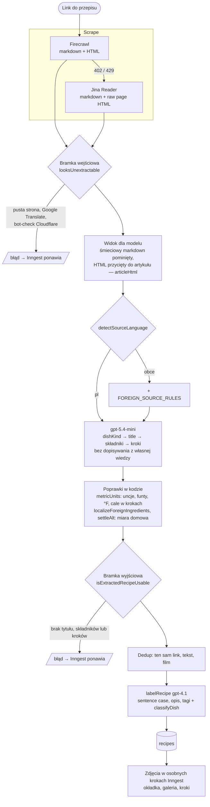

# Recipe extraction pipeline

How a shared link becomes a saved recipe, as of 2026-10-28 (after #557 and
#565). Code: `src/inngest/run-extract-recipe.ts`; the pieces named below live
in `src/lib/`. Edit in place when a stage changes.

## Stages

| Stage | What it does | Where |
|---|---|---|
| Scrape | Firecrawl with `onlyMainContent`, retried with the full page when the main content is under 200 chars. Out of credits (402) or rate-limited (429) → Jina Reader, which returns the rendered markdown and fetches the raw page HTML itself (`readableHtml` strips scripts, styles, SVG). Blogger posts come from the Blogger feed, Facebook posts from the embed plugin, YouTube from the description and captions. | `firecrawl.ts`, `jina-reader.ts`, `blogger-feed.ts`, `facebook.ts`, `youtube.ts` |
| Input gate | `looksUnextractable` on the markdown and on the HTML. Both junk → the run throws and Inngest retries; the share stores the reason. Junk means under 150 readable chars, a Google Translate or "skip to main content" stub, or (since #557) a bot-check page such as Cloudflare's "Performing security verification". | `content-quality.ts` |
| Model view | What the LLM reads is not the raw scrape (#557): junk markdown beside a real page is left out, and the HTML goes through `articleHtml` — `<head>` cut to its title and JSON-LD, site menu/footer/sidebar/forms dropped, attributes thinned to `src`/`alt`/`href` — so the article fits the prompt's 20,000-character cap. Photo scans still read the full HTML. | `article-html.ts` |
| Language | `detectSourceLanguage` counts Polish diacritics and short words; a foreign source gets `FOREIGN_SOURCE_RULES` appended (translate everything, Polish shop names, no calqued titles). | `source-language.ts` |
| Model | One `gpt-5.4-mini` call for every source (#531 Polish, #565 foreign), reasoning effort `none`, JSON mode. The answer starts with `dishKind` so the model settles what the dish is before naming it. It must not complete a partial recipe from its own knowledge (#557). | `run-extract-recipe.ts` |
| Fixes in code | Rules the prompt could not enforce: `metricUnits` rewrites US units left in any step; `localizeForeignIngredients` drops made-up cup measures and lean grades; `settleAlt` keeps only a Polish household measure in `alt`. | `us-units.ts`, `source-language.ts`, `extracted-recipe.ts` |
| Output gate | `isExtractedRecipeUsable`: a title, at least one ingredient, at least one real step (steps optional for a post whose method is on video). Fails the run otherwise. | `content-quality.ts` |
| Dedup | The same source URL, the same author text (fingerprint) or the same YouTube video links the share to the saved recipe instead of saving a copy. | `recipe-dedup.ts` |
| Labelling | `gpt-4.1` (`LABEL_MODEL`, kept distinct from the extraction model) writes the sentence-case title, the short note that tells same-titled recipes apart, and the tags; `classifyDish` groups it with its dish. | `recipe-labeling.ts`, `recipe-dish.ts` |
| Images | Archived into Storage in separate Inngest steps after the row exists: cover, gallery, per-step photos. | `recipe-image-archive.ts` |

## Known limits

- Firecrawl credits: the plan has 1,000 a month and ran out on 2026-10-21. On the Jina path a site behind a bot check (howsweeteats.com) now fails cleanly instead of producing an invented recipe, but it still fails. Top up or wait for the period to reset.
- The input gate recognises the bot-check phrases seen so far; a new wording passes until it is added to `BOT_CHECK_SIGNATURES`.
- Titles from English sources are judged right about four times in five (eval in `extraction-model-eval-2026-10.md`); the rest are calques or an English word left in.
